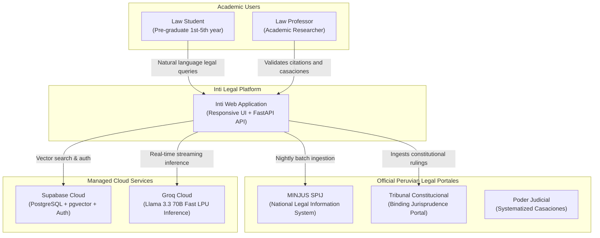
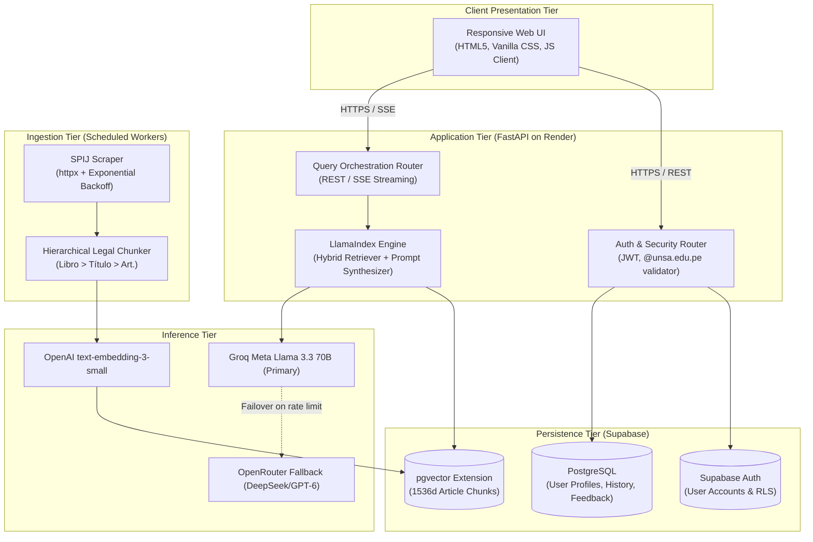

# Software Architecture Diagrams

This guide explains how to document system architecture, component layers, and cloud infrastructure using GitHub-compatible Mermaid syntax.

## Why Not Native C4 Directives?

GitHub Markdown does not bundle the `C4Context` or `C4Container` plugins. Attempting to use them produces broken code blocks. Instead, we use `flowchart TD` or `flowchart LR` with structured `subgraph` enclosures to achieve identical architectural clarity with 100% native GitHub compatibility.

## Architectural Levels

### Level 1: System Context Diagram

Visualizes the software system in its environment, including human users, external legal data sources, and cloud platforms.

### Level 2: Container / Layered Architecture Diagram

Decomposes the system into high-level deployment containers and architectural layers.

