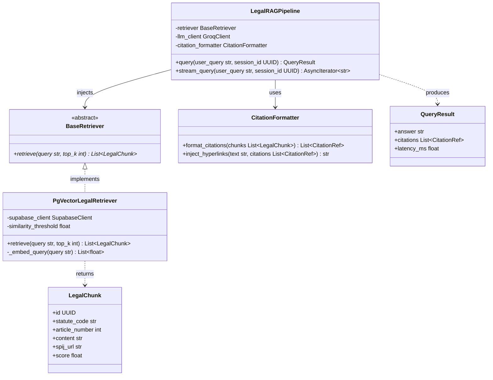

# Class Diagrams

Class diagrams illustrate object-oriented structure, class hierarchies, interfaces, and contracts within software modules. In Mermaid, declare class diagrams using `classDiagram`.

## Relationship Notation

| Syntax | Relationship Type | Meaning |
|---|---|---|
| `<|--` | Inheritance | Subclass extends Superclass |
| `<|..` | Realization | Class implements Interface |
| `*--` | Composition | Part cannot exist without Whole (strong ownership) |
| `o--` | Aggregation | Part can exist independently of Whole |
| `-->` | Directed Association | Class A holds reference to Class B |
| `..>` | Dependency | Class A uses Class B as parameter or return type |

---

## Example: Inti RAG Architecture & Retriever Contract

Documents the Python class hierarchy, abstract interfaces, and service contracts in the Inti backend pipeline.

---

## Best Practices for Class Diagrams

1. **Member Modifiers**:
   - `+` Public
   - `-` Private
   - `#` Protected
2. **Generics**:
   - Use tildes for type arguments in Mermaid: `List~LegalChunk~` instead of angle brackets (`List<LegalChunk>`), which cause parsing errors in GitHub Markdown.
3. **Contracts**:
   - Mark abstract classes or interfaces with `<<abstract>>` or `<<interface>>`.
4. **Scope Control**:
   - Limit class diagrams to related packages or layers. Do not model the entire application in a single diagram.
