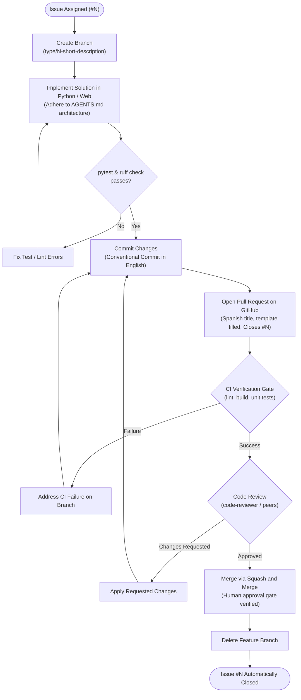
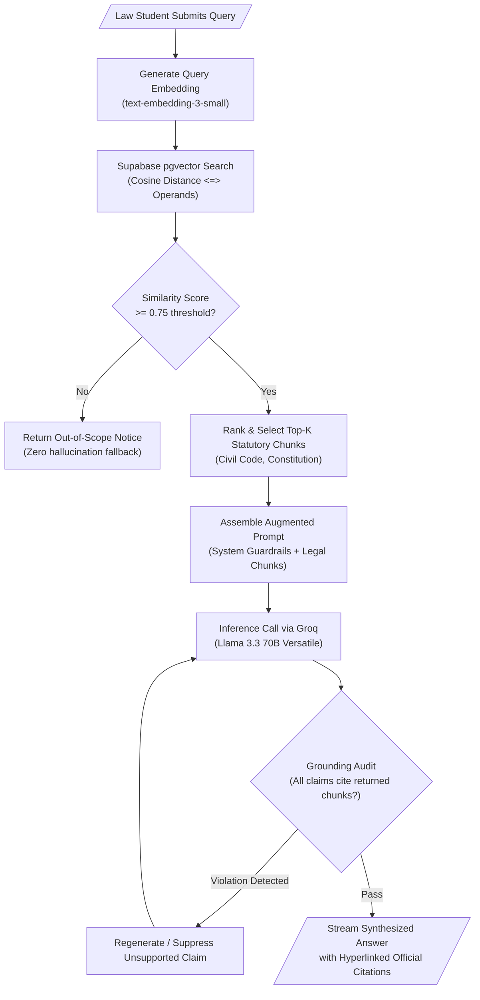

# Flowcharts

Flowcharts model algorithms, business logic branching, asynchronous state progression, and development workflows. In Mermaid, declare flowcharts using `flowchart TD` (top-to-bottom) or `flowchart LR` (left-to-right).

## Core Node Shapes

| Syntax | Shape | Usage in Diagrams |
|---|---|---|
| `id["Square Box"]` | Rectangle | Generic process, action, or state |
| `id(["Rounded Box"])` | Stadium | Start, end, or entry points |
| `id[/"Input or Output"/]` | Parallelogram | User input or external output data |
| `id(("Connector"))` | Circle | Phase markers or join points |
| `id{"Decision"}` | Diamond | Conditional checks and branching gates |
| `id[("Database")]` | Cylinder | Database or vector store |

---

## Example 1: Git Team Development Workflow

Documents the mandatory lifecycle from GitHub Issue assignment to main branch merge for the Inti RAG project.

---

## Example 2: Legal RAG Query & Grounding Pipeline

Illustrates how Inti processes natural language questions against Peruvian statutes and ensures zero hallucinations.

---

## Best Practices for Flowcharts

1. **Orientation**: Default to `flowchart TD` for top-to-bottom step processes. Use `flowchart LR` only when modeling data streaming pipelines or wide progression timelines.
2. **Quoting**: Enclose node text containing parenthesis, slashes, or special characters in double quotes: `Node["Text (with details)"]`.
3. **Escapes**: Use `\n` to introduce line breaks in dense text nodes to prevent horizontal stretching.
4. **Clean Technical Content**: Never insert decorative emojis or pictorial characters in nodes or connector labels.
