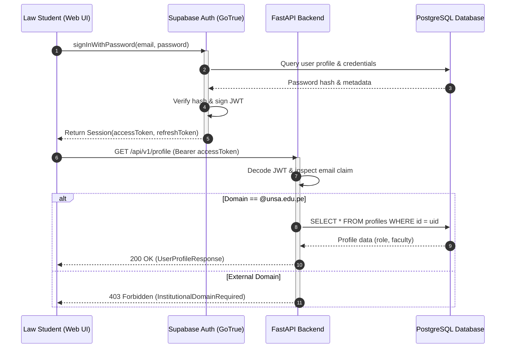
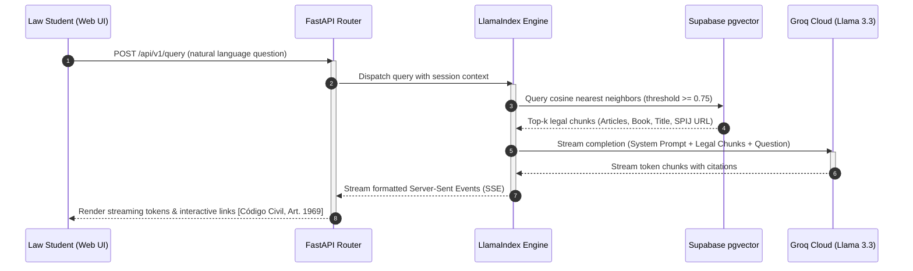
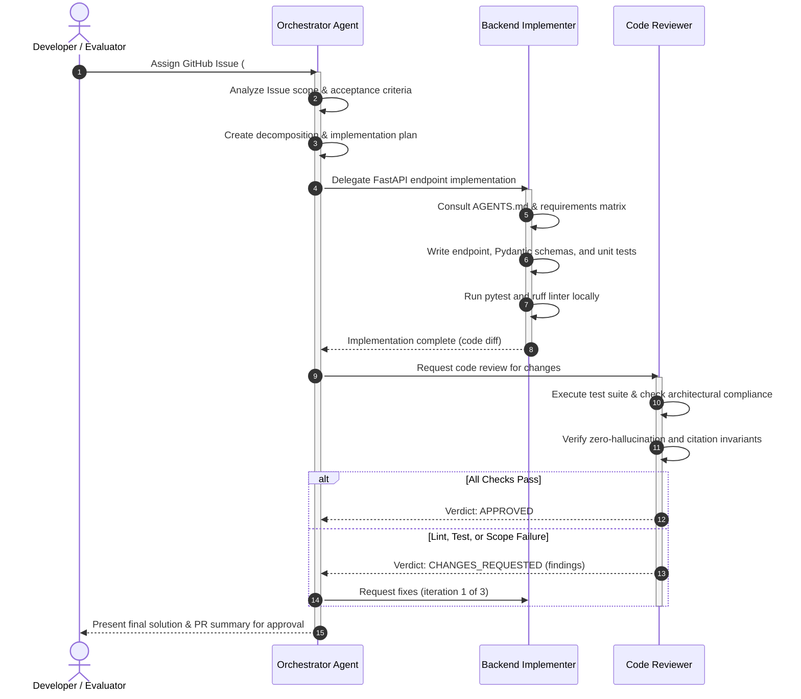

# Sequence Diagrams

Sequence diagrams illustrate interactions and message exchanges between participants over time. They are ideal for documenting API authentication lifecycles, streaming retrieval pipelines, and multi-agent coordination flows.

## Core Syntax Rules for GitHub

1. Use `autonumber` at the top of the diagram to make steps easy to reference in text discussions and PR reviews.
2. Define all participants explicitly with `participant ID as Label` at the beginning of the block to control column order.
3. Use solid arrows with filled heads `->>` for synchronous calls and open dashed arrows `-->>` for return messages.
4. Use `alt / else / end` blocks for branching logic (e.g. success vs error scenarios).
5. Never use reserved syntax words (`loop`, `alt`, `opt`, `end`, `par`) as participant identifiers.
6. Do not include semicolons `;` in message labels.

---

## Example 1: Law Student Authentication & UNSA Verification

Documents how the Web UI signs in via Supabase Auth and enforces the `@unsa.edu.pe` institutional domain filter.

---

## Example 2: Streaming Legal RAG Query Flow

Shows how natural language queries stream back synthesized statutory answers with bracketed official citations.

---

## Example 3: Antigravity Multi-Agent Orchestration Flow

Illustrates how the project's AI subagents collaborate from requirement parsing to verified implementation.

---

## Best Practices for Sequence Diagrams

- **Focus**: Keep sequence diagrams strictly to one interaction flow or scenario. Do not combine disparate use cases into one diagram.
- **Activations**: Use `activate` and `deactivate` to explicitly show processing lifespans.
- **Notes**: Add explanatory context when necessary using `Note over Participant: Explanation`.
- **Clean Naming**: Ensure participant labels reflect accurate system roles (`FastAPI Backend`, `Supabase pgvector`, `Orchestrator Agent`).
