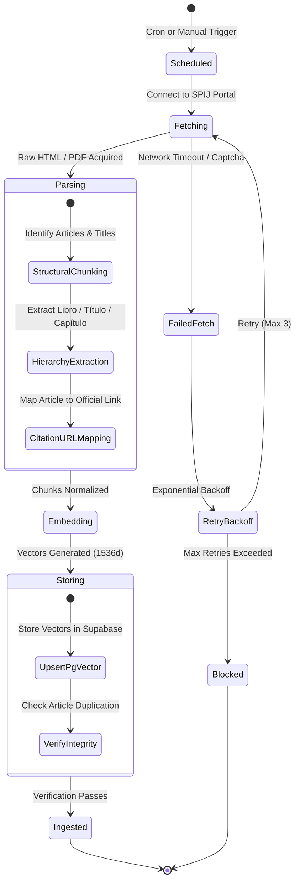
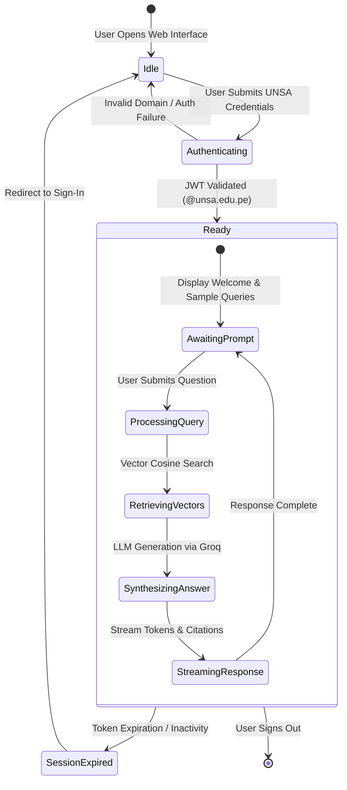

# State Diagrams

State diagrams model the lifecycle, status transitions, and finite state machines (FSM) of domain entities and user sessions. Always declare state diagrams using `stateDiagram-v2` for modern, clean visual rendering on GitHub.

## Core Syntax

- `[*] --> StateA`: Initial transition.
- `StateA --> StateB : Event / Condition`: Transition with triggering event.
- `StateB --> [*]`: Terminal transition.
- `state "Descriptive Label" as StateAlias`: Custom state descriptions.
- `<<choice>>`: Branching condition pseudostate.
- `note right of StateA`: Contextual explanations.

---

## Example 1: Statutory Ingestion Pipeline Lifecycle

Documents the progression of an official Peruvian legal document (SPIJ) from raw fetch to embedded vector persistence.

---

## Example 2: Legal Query Session State Machine

Models the interactive lifecycle of a user query in the Inti RAG web assistant.

---

## Best Practices for State Diagrams

1. **GitHub Rendering**: Always use `stateDiagram-v2` instead of legacy `stateDiagram`.
2. **Substates**: Use composite states (`state EnclosingState { ... }`) to group related processing stages without cluttering the main flow.
3. **Choice Pseudostates**: Use `<<choice>>` nodes for clear decision branching.
4. **Clean Technical Content**: Avoid non-semantic emoji glyphs in state names.
