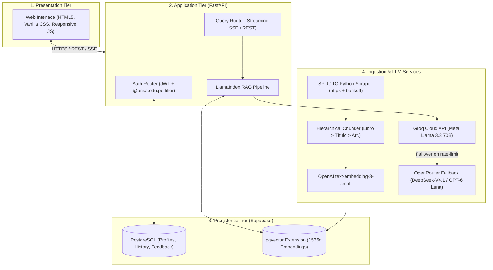

# AGENTS.md — Master Operational Guidelines for Application Development

> **Project:** Inti - Asistente Jurídico Inteligente (RAG)  
> **Repository:** `jorghee/inti-rag` (Software Project Management — UNSA 2026-B)  
> **Audience:** All AI Agents and Engineers contributing code, architecture, or documentation

---

## 1. Product Context & Objectives

* **What is Inti?**  
  **Inti** is an intelligent legal assistant powered by a **Retrieval-Augmented Generation (RAG)** architecture. It is specifically designed for undergraduate law students (1st to 5th year) and academic faculty at Universidad Nacional de San Agustín (UNSA).
* **Core Problem Solved (AS-IS vs. TO-BE):**  
  - *AS-IS (Current Pain):* Manual search across dispersed government portals (SPIJ, Tribunal Constitucional, Poder Judicial) takes **30 to 90 minutes** per complex legal query. Generalist LLMs (e.g. ChatGPT) suffer a **40–50% hallucination rate** when citing Peruvian articles and casaciones. Commercial tools (Justina) are cost-prohibitive for undergraduate students.
  - *TO-BE (Inti Target):* Reduces query time to **1 to 3 minutes** ($\sim 95\%$ reduction), delivers **$< 5\%$ hallucination rate**, and guarantees 100% verifiable citations linking directly to official Peruvian legal repositories.
* **Core Functional Scope (MVP — 39 Story Points):**  
  The Minimum Viable Product comprises strictly the 5 **Must Have** User Stories:
  1. [`HU-05`](https://github.com/jorghee/inti-rag/issues/5) — Institutional registration and JWT authentication restricted to `@unsa.edu.pe`.
  2. [`HU-03`](https://github.com/jorghee/inti-rag/issues/3) — Automated ingestion and hierarchical chunking of the Peruvian Civil Code from SPIJ.
  3. [`HU-01`](https://github.com/jorghee/inti-rag/issues/1) — Natural language semantic legal search and synthesized answers.
  4. [`HU-02`](https://github.com/jorghee/inti-rag/issues/2) — Traceable legal citations with clickable hyperlinks to official SPIJ/TC URLs.
  5. [`HU-08`](https://github.com/jorghee/inti-rag/issues/8) — Mobile-responsive web user interface accessible from phone and desktop browsers.

---

## 2. Invariable Global Rules & Boundaries

Every AI agent working on this codebase must strictly enforce the following invariants:

1. **Zero Hallucination & Mandatory Citations:**  
   Every legal assertion generated or displayed by the system must be grounded in indexed source chunks. Output citations must follow the interactive hyperlink format: `[Código Civil, Art. 1969](https://spij.minjus.gob.pe/...)`. If a queried topic is not present in the indexed corpus, the system must explicitly decline to answer rather than speculating.
2. **Clean Technical Content (Anti-Ornamentation):**  
   All artifacts (code, comments, documentation, commit messages, PRs, issues) must maintain strictly functional formatting:
   - Prohibit decorative Unicode emojis (e.g., checkmarks, warning icons, rocket ships, celebratory glyphs) in all text bodies, diagram labels, issue titles, and commit messages.
   - Standard GitHub Flavored Markdown alerts (`> [!NOTE]`, `> [!WARNING]`, `> [!IMPORTANT]`) and task list brackets (`- [ ]`, `- [x]`) are structural syntax and are fully permitted.
   - Prohibit decorative separators (`*~*~*`, divider lines) and repeated punctuation (`!!!`, `???`).
   - Limit list nesting to a maximum of 2 levels; use structured headings (`###`) or Markdown tables for deeper hierarchies.
3. **Linguistic Conventions:**  
   - **Code, Architecture & Git:** English ASCII only for variable names, functions, classes, docstrings, filenames, branch names, and Conventional Commit messages (`feat:`, `fix:`, `docs:`).
   - **User Documentation & Issues:** Spanish adhering strictly to standard grammar and orthography: mandatory acute accents on vowels (á, é, í, ó, ú, Á, É, Í, Ó, Ú), the letter ñ (ñ, Ñ), the diaeresis (ü, Ü), and opening punctuation marks (¿, ¡). Diacritics are structural and phonological, not decorative.
4. **Explicit Scope Exclusions (Won't Have — Issue #13):**  
   Agents must never implement, plan, or propose:
   - *Native Mobile Apps (Android/iOS):* Satisfied 100% via mobile-responsive web UI ([`ADR-005`](docs/architecture/decisions.md#adr-005-mobile-responsive-web-application-over-native-mobile-implementations)).
   - *Automated Scraping of CEJ (Poder Judicial):* Prohibited by anti-bot Captchas and mandatory national ID (DNI) validation ([`ADR-006`](docs/architecture/decisions.md#adr-006-rejection-of-automated-cej-scraping-and-pre-2004-ocr-for-the-mvp)).
   - *Pre-2004 OCR of Judicial Rulings:* Excluded due to scanned image degradation and GPU budget limits ([`ADR-006`](docs/architecture/decisions.md#adr-006-rejection-of-automated-cej-scraping-and-pre-2004-ocr-for-the-mvp)).

---

## 3. System Architecture & Components

The application follows a decoupled 4-tier architecture:



* **Persistence:** Supabase (PostgreSQL with `pgvector`). Unified database for relational entities and vector search ([`ADR-001`](docs/architecture/decisions.md#adr-001-unified-relational-and-vector-storage-with-supabase-postgresql--pgvector)).
* **Chunking Pipeline:** Domain-aware structural parser maintaining atomic articles and metadata ([`ADR-002`](docs/architecture/decisions.md#adr-002-hierarchical-chunking-pipeline-for-peruvian-codified-norms)).
* **Inference Tier:** Primary low-latency generation via Groq API (Llama 3.3) at zero runtime cost; automatic failover to OpenRouter contingency model supported by reserve budget ([`ADR-003`](docs/architecture/decisions.md#adr-003-multi-tiered-llm-inference-engine-groq-llama-33-with-openrouter-contingency)).
* **Authentication:** Supabase Auth + FastAPI validation ensuring accounts use `@unsa.edu.pe` ([`ADR-004`](docs/architecture/decisions.md#adr-004-unsa-institutional-email-validation-strategy-unsaedupe)).

---

## 4. Project Layout & Organization

```text
inti-rag/
├── AGENTS.md                                  # This file: Primary developer & agent entry point
├── README.md                                  # Public project landing page and Scrum roadmap
├── docs/                                      # Application Technical Documentation
│   ├── README.md                              # Technical documentation index & map
│   ├── architecture/                          # System architecture, decisions & data model
│   │   ├── overview.md                        # 4-tier decoupled architecture, data flow & integration
│   │   ├── decisions.md                       # Architecture Decision Records (ADR-001..006)
│   │   └── data-model.md                      # PostgreSQL + pgvector schema, ERD & RLS policies
│   ├── modules/                               # Subsystem technical designs
│   │   ├── authentication.md                  # Institutional auth (@unsa.edu.pe) & JWT security
│   │   ├── legal-ingestion.md                 # SPIJ scraper & hierarchical chunking pipeline
│   │   ├── rag-pipeline.md                    # LlamaIndex RAG, pgvector retrieval & Groq LLM
│   │   ├── citations.md                       # Verifiable hyperlinked citations & grounding engine
│   │   └── web-interface.md                   # Responsive web UI & SSE real-time streaming
│   └── setup/                                 # Environment setup & operation
│       ├── installation.md                    # Prerequisites, local run & test execution
│       └── configuration.md                   # Environment variables (.env) & API credentials
├── .agents/                                   # Specialized Agent Skills & Plans
│   └── skills/
│       ├── clean-technical-content/           # Rules for anti-ornamentation and Spanish orthography
│       ├── mermaid-diagrams/                  # Technical diagramming in GitHub-native Mermaid
│       ├── github-issues/                     # Managing GitHub issues, labels, and backlogs via CLI
│       └── issue-lifecycle/                   # Workflow for resolving issues, branching, and PRs
├── backend/                                   # FastAPI API application source (Sprint 1+)
├── ingestion/                                 # SPIJ/TC scrapers and chunking parsers (Sprint 1+)
└── tests/                                     # Automated test suites (Pytest)
```

---

## 5. Reference Documentation Router

Do not duplicate deep specifications in memory. Agents must inspect the following technical documentation in `docs/` depending on their implementation objective:

| If your implementation task involves... | Consult this document: | Key information provided: |
| :--- | :--- | :--- |
| System architecture, layers, or data flow | [`docs/architecture/overview.md`](docs/architecture/overview.md) | 4-tier decoupled architecture, component integration, and sequence diagrams. |
| Reviewing architectural decisions & invariants | [`docs/architecture/decisions.md`](docs/architecture/decisions.md) | Formal ADRs (ADR-001 through ADR-006: pgvector, chunking, Groq, exclusions). |
| Database schemas, tables, indexes, or vectors | [`docs/architecture/data-model.md`](docs/architecture/data-model.md) | PostgreSQL + pgvector DDL, ERD, HNSW cosine index, and RLS policies. |
| Implementing auth or institutional validation | [`docs/modules/authentication.md`](docs/modules/authentication.md) | Supabase GoTrue, `@unsa.edu.pe` email constraint, JWT FastAPI dependency. |
| Implementing SPIJ scraping or chunking | [`docs/modules/legal-ingestion.md`](docs/modules/legal-ingestion.md) | SPIJ scraper, backoff exponential algorithm, and hierarchical chunk parser. |
| Implementing vector search or RAG pipeline | [`docs/modules/rag-pipeline.md`](docs/modules/rag-pipeline.md) | LlamaIndex pipeline, cosine similarity threshold $\ge 0.75$, and Groq inference. |
| Formatting citations or grounding validation | [`docs/modules/citations.md`](docs/modules/citations.md) | Hyperlinked citation syntax, citation persistence, and anti-hallucination rules. |
| Developing or modifying the web interface | [`docs/modules/web-interface.md`](docs/modules/web-interface.md) | Mobile-first responsive layout, SSE streaming reader, and citation popovers. |
| Setting up local development or running tests | [`docs/setup/installation.md`](docs/setup/installation.md) | Python 3.11+ setup, virtualenv, dependencies, and `pytest` execution. |
| Configuring environment variables or keys | [`docs/setup/configuration.md`](docs/setup/configuration.md) | Complete `.env` parameters, Supabase keys, Groq API, and CORS origins. |

> **Note on Issue & Task Tracking:** Project requirements, User Stories, and sprint tasks are managed directly via GitHub Issues (`gh issue list`, `gh issue view <id>`), milestones, and pull requests as guided by `.agents/skills/github-issues/` and `.agents/skills/issue-lifecycle/`.

---

## 6. Application Development Workflow

When implementing code, features, or architectural adjustments:

```text
┌────────────────────────────────────────────────────────────────────────┐
│ STEP 1: CONTEXT & REQUIREMENT ANALYSIS                                 │
│ - Identify the target User Story (HU-XX) or Technical Task (TASK-XX.Y).│
│ - Read acceptance criteria in target GitHub issue (gh issue view).     │
│ - Verify relevant ADRs in docs/architecture/decisions.md.              │
└───────────────────────────────────┬────────────────────────────────────┘
                                    │
┌───────────────────────────────────▼────────────────────────────────────┐
│ STEP 2: ISOLATED IMPLEMENTATION                                        │
│ - Create branch: `feat/<id>-<desc>` or `fix/<id>-<desc>`.              │
│ - Write clean, typed, modular code adhering to clean-technical-content.│
│ - Keep programmatic identifiers and docstrings in English ASCII.       │
└───────────────────────────────────┬────────────────────────────────────┘
                                    │
┌───────────────────────────────────▼────────────────────────────────────┐
│ STEP 3: AUTOMATED TESTING & VERIFICATION                               │
│ - Run automated unit tests (`pytest`). Ensure >= 80% coverage on logic.│
│ - Format code and run linters with zero warnings.                      │
│ - Validate against Given-When-Then acceptance criteria.                │
└───────────────────────────────────┬────────────────────────────────────┘
                                    │
┌───────────────────────────────────▼────────────────────────────────────┐
│ STEP 4: DEFINITION OF DONE & HANDOFF                                   │
│ - Verify all checklist items of Definition of Done (DoD).              │
│ - Open Pull Request referencing `Closes #<id>` with zero emojis.       │
│ - Document completed criteria and test results in PR description.      │
└────────────────────────────────────────────────────────────────────────┘
```

---

## 7. Document Authority Hierarchy & Anti-Drift Governance

When reconciling conflicting statements across the repository:

$$\text{Level 1: Live Git Code on main} > \text{Level 2: GitHub Issues/Board} > \text{Level 3: Lab 04} > \text{Level 4: Lab 03} > \text{Level 5: Lab 02} > \text{Level 6: Lab 01}$$

* **Rule of Grounded Reality:** Uncommitted claims in academic deliverables do not override physical repository state. If code is missing on `main`, the task is open.
* **Scope Protection Invariant:** Agents are strictly forbidden from altering Story Point estimates, MoSCoW priorities, or architectural boundaries without explicit directive from the Product Owner or user.
* **Discrepancy Logging:** If a new contradiction is discovered, document it in a GitHub issue or pull request review comment for maintainer clarification; do not silently overwrite documents to force artificial consistency.
