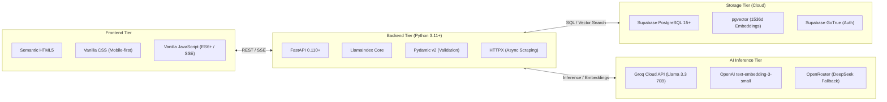

# Application Technical Documentation: Inti

> **System:** Inti - Legal AI Assistant (RAG)  
> **Repository:** `jorghee/inti-rag`  
> **Audience:** Software developers, system architects, and DevOps / maintenance engineers

---

## 1. Documentation Purpose

This directory (`docs/`) contains **exclusively the technical documentation covering the architecture, design, implementation, and configuration** of the **Inti** application.

---

## 2. Documentation Map

The documentation is organized into three specialized technical areas:

```text
docs/
├── README.md                                  # This file: Technical documentation index & roadmap
├── architecture/                              # Global architecture and system design decisions
│   ├── overview.md                            # 4-tier decoupled architecture, interaction & data flow
│   ├── decisions.md                           # Architecture Decision Records (ADR-001 through ADR-006)
│   └── data-model.md                          # Relational & vector schema (PostgreSQL + pgvector)
├── modules/                                   # Detailed subsystem technical specifications
│   ├── authentication.md                      # Institutional auth (@unsa.edu.pe) & JWT security
│   ├── legal-ingestion.md                     # SPIJ scraper & hierarchical chunking pipeline
│   ├── rag-pipeline.md                        # RAG engine, pgvector semantic search & LLM inference
│   ├── citations.md                           # Verifiable citations engine & grounding validation
│   └── web-interface.md                       # Responsive web UI & real-time SSE streaming
└── setup/                                     # Setup, deployment, and operational procedures
    ├── installation.md                        # Prerequisites, local environment & automated testing
    └── configuration.md                       # Environment variables (.env) & API credentials
```

---

## 3. Summary of Modules and Documents

| Component / Topic | File | Primary Responsibility |
| :--- | :--- | :--- |
| **System Architecture** | [`architecture/overview.md`](architecture/overview.md) | 4-tier decoupled architecture (Presentation, FastAPI API, Supabase, and LLM Services). |
| **Architecture Decisions** | [`architecture/decisions.md`](architecture/decisions.md) | Michael Nygard ADRs: unified pgvector storage, Llama 3.3 model, and explicit scope boundaries. |
| **Data Model** | [`architecture/data-model.md`](architecture/data-model.md) | Relational tables (`profiles`, `query_sessions`, `query_logs`), vectors (`legal_chunks`), and RLS policies. |
| **Authentication Module** | [`modules/authentication.md`](modules/authentication.md) | Institutional email restriction (`@unsa.edu.pe`), JWT token management, and FastAPI security dependencies. |
| **Legal Ingestion Module** | [`modules/legal-ingestion.md`](modules/legal-ingestion.md) | SPIJ Civil Code extraction, hierarchical chunk parser (Book > Title > Article), and 1536d embeddings. |
| **RAG Pipeline Module** | [`modules/rag-pipeline.md`](modules/rag-pipeline.md) | Cosine similarity threshold ($\ge 0.75$), LlamaIndex orchestration, and Groq inference engine. |
| **Citations & Grounding** | [`modules/citations.md`](modules/citations.md) | Interactive official citation syntax, semantic grounding verification, and $< 5\%$ hallucination rate. |
| **Responsive Web Interface** | [`modules/web-interface.md`](modules/web-interface.md) | Lightweight web client (HTML5 / Vanilla CSS / JS) with real-time SSE streaming and mobile support. |
| **Installation Guide** | [`setup/installation.md`](setup/installation.md) | Environment prerequisites (Python 3.11+), virtual environment setup, and `pytest` execution. |
| **Environment Configuration** | [`setup/configuration.md`](setup/configuration.md) | Required and optional environment variables, API credentials (Supabase, Groq, OpenRouter). |

---

## 4. Application Technology Stack


