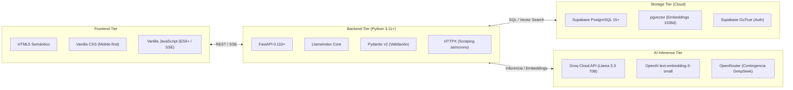

# Documentación Técnica de la Aplicación: Inti

> **Sistema:** Inti - Asistente Jurídico Inteligente (RAG)  
> **Repositorio:** `jorghee/inti-rag`  
> **Audiencia:** Desarrolladores de software, arquitectos de sistemas e ingenieros de mantenimiento

---

## 1. Propósito de la Documentación

Este directorio (`docs/`) contiene **exclusivamente la documentación técnica general sobre la arquitectura, diseño, implementación y configuración** de la aplicación **Inti**.

---

## 2. Mapa Temático de la Documentación

La documentación se organiza en tres áreas temáticas especializadas:

```text
docs/
├── README.md                                  # Este archivo: Índice general de documentación técnica
├── architecture/                              # Arquitectura global y decisiones de diseño
│   ├── overview.md                            # Arquitectura en 4 capas, interacción y flujo de datos
│   ├── decisions.md                           # Registros de decisiones de arquitectura (ADR-001 a ADR-006)
│   └── data-model.md                          # Esquema de datos relacional y vectorial (PostgreSQL + pgvector)
├── modules/                                   # Diseño técnico detallado por subsistema funcional
│   ├── authentication.md                      # Autenticación institucional (@unsa.edu.pe) y JWT
│   ├── legal-ingestion.md                     # Pipeline de ingesta, normalización y chunking jerárquico SPIJ
│   ├── rag-pipeline.md                        # Motor RAG, búsqueda semántica pgvector e inferencia LLM
│   ├── citations.md                           # Generación de citas verificables y control de alucinaciones
│   └── web-interface.md                       # Interfaz de usuario web responsiva y streaming SSE
└── setup/                                     # Puesta en marcha, despliegue y mantenimiento
    ├── installation.md                        # Prerrequisitos, instalación y ejecución local
    └── configuration.md                       # Parámetros de entorno (.env) y configuración de servicios
```

---

## 3. Resumen de Módulos y Documentos

| Componente / Tema | Archivo | Responsabilidad Principal |
| :--- | :--- | :--- |
| **Arquitectura del Sistema** | [`architecture/overview.md`](architecture/overview.md) | Desacoplamiento en 4 capas (Presentación, API FastAPI, Supabase y Servicios LLM). |
| **Decisiones de Arquitectura** | [`architecture/decisions.md`](architecture/decisions.md) | Invariantes arquitecturales Michael Nygard: base unificada pgvector, modelo Llama 3.3, exclusiones de alcance. |
| **Modelo de Datos** | [`architecture/data-model.md`](architecture/data-model.md) | Tablas relacionales (`profiles`, `query_sessions`, `query_logs`), vectores (`legal_chunks`) y políticas RLS. |
| **Módulo de Autenticación** | [`modules/authentication.md`](modules/authentication.md) | Restricción de dominio institucional `@unsa.edu.pe`, gestión de tokens JWT y seguridad. |
| **Módulo de Ingesta Legal** | [`modules/legal-ingestion.md`](modules/legal-ingestion.md) | Extracción de normativa civil del SPIJ, parsing jerárquico (Libro > Título > Art.) y embeddings 1536d. |
| **Módulo Motor RAG** | [`modules/rag-pipeline.md`](modules/rag-pipeline.md) | Búsqueda por distancia coseno (umbral $\ge 0.75$), orquestación LlamaIndex e inferencia con Groq. |
| **Módulo de Citas y Grounding** | [`modules/citations.md`](modules/citations.md) | Formato interactivo de citas oficiales, validación de anclaje semántico y garantía de $< 5\%$ alucinación. |
| **Interfaz Web Responsiva** | [`modules/web-interface.md`](modules/web-interface.md) | Cliente web ligero (HTML5 / Vanilla CSS / JS) con consumo de eventos SSE en tiempo real y vista móvil. |
| **Guía de Instalación** | [`setup/installation.md`](setup/installation.md) | Requisitos de entorno (Python 3.11+), configuración de entorno virtual y ejecución de pruebas con `pytest`. |
| **Configuración del Entorno** | [`setup/configuration.md`](setup/configuration.md) | Variables de entorno obligatorias y opcionales, claves de API (Supabase, Groq, OpenRouter). |

---

## 4. Stack Tecnológico de la Aplicación


