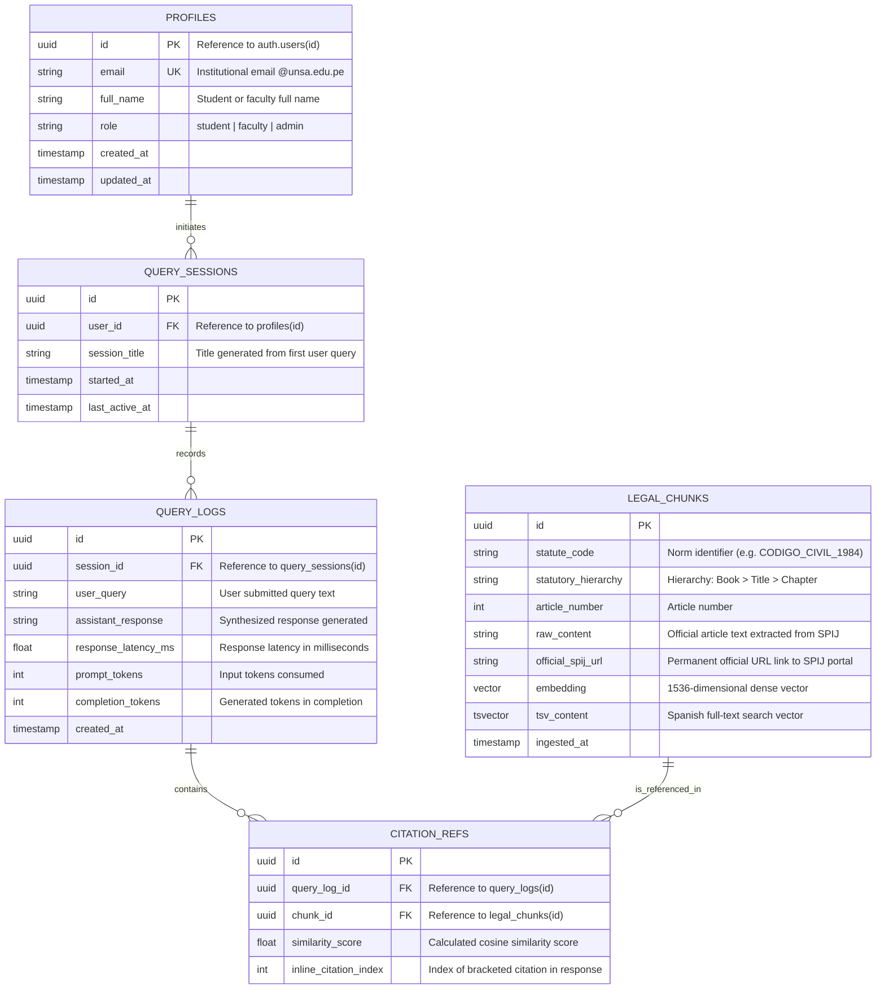

# Data Model: Relational and Vector Entities

> **System:** Inti - Legal AI Assistant  
> **Database Engine:** PostgreSQL 15+ with `pgvector` extension on Supabase  
> **Strategy:** Unified schema for transactional data, audit logs, and vector retrieval

---

## 1. Entity-Relationship Diagram (ERD)



---

## 2. Primary Table DDL Definitions

### 2.1. Extension Enablement
```sql
-- Enable vector extension for embedding calculations
CREATE EXTENSION IF NOT EXISTS vector;
-- Enable UUID generation extension
CREATE EXTENSION IF NOT EXISTS "uuid-ossp";
```

### 2.2. Table `profiles` (Institutional Profiles)
Stores user account profile information linked to the Supabase GoTrue authentication identity.
```sql
CREATE TABLE public.profiles (
    id UUID PRIMARY KEY REFERENCES auth.users(id) ON DELETE CASCADE,
    email VARCHAR(255) NOT NULL UNIQUE,
    full_name VARCHAR(255) NOT NULL,
    role VARCHAR(50) NOT NULL DEFAULT 'student' CHECK (role IN ('student', 'faculty', 'admin')),
    created_at TIMESTAMPTZ NOT NULL DEFAULT NOW(),
    updated_at TIMESTAMPTZ NOT NULL DEFAULT NOW(),
    CONSTRAINT chk_unsa_email CHECK (email LIKE '%@unsa.edu.pe')
);
```

### 2.3. Table `query_sessions` (Query Sessions)
Groups conversational interactions and historical queries per user.
```sql
CREATE TABLE public.query_sessions (
    id UUID PRIMARY KEY DEFAULT uuid_generate_v4(),
    user_id UUID NOT NULL REFERENCES public.profiles(id) ON DELETE CASCADE,
    session_title VARCHAR(255) NOT NULL DEFAULT 'New Query',
    started_at TIMESTAMPTZ NOT NULL DEFAULT NOW(),
    last_active_at TIMESTAMPTZ NOT NULL DEFAULT NOW()
);

CREATE INDEX idx_query_sessions_user_id ON public.query_sessions(user_id);
```

### 2.4. Table `query_logs` (Question and Answer History)
Records individual query interactions, latency telemetry, and token metrics.
```sql
CREATE TABLE public.query_logs (
    id UUID PRIMARY KEY DEFAULT uuid_generate_v4(),
    session_id UUID NOT NULL REFERENCES public.query_sessions(id) ON DELETE CASCADE,
    user_query TEXT NOT NULL,
    assistant_response TEXT NOT NULL,
    response_latency_ms NUMERIC(8, 2) NOT NULL,
    prompt_tokens INT DEFAULT 0,
    completion_tokens INT DEFAULT 0,
    created_at TIMESTAMPTZ NOT NULL DEFAULT NOW()
);

CREATE INDEX idx_query_logs_session_id ON public.query_logs(session_id);
```

### 2.5. Table `legal_chunks` (Statutory Chunks, Vectors and Lexical Inverted Index)
Contains Civil Code articles chunked hierarchically with corresponding 1536-dimensional dense embeddings and generated `tsvector` columns for hybrid search.
```sql
CREATE TABLE public.legal_chunks (
    id UUID PRIMARY KEY DEFAULT uuid_generate_v4(),
    statute_code VARCHAR(100) NOT NULL,
    statutory_hierarchy VARCHAR(500) NOT NULL,
    article_number INT NOT NULL,
    raw_content TEXT NOT NULL,
    official_spij_url TEXT NOT NULL,
    embedding VECTOR(1536) NOT NULL,
    tsv_content TSVECTOR GENERATED ALWAYS AS (
        to_tsvector('spanish', coalesce(statutory_hierarchy, '') || ' ' || coalesce(raw_content, ''))
    ) STORED,
    ingested_at TIMESTAMPTZ NOT NULL DEFAULT NOW(),
    CONSTRAINT uq_statute_article UNIQUE (statute_code, article_number)
);

-- Optimized HNSW index for cosine distance queries (<=>)
CREATE INDEX idx_legal_chunks_embedding ON public.legal_chunks 
USING hnsw (embedding vector_cosine_ops)
WITH (m = 16, ef_construction = 64);

-- GIN index for Spanish full-text search (BM25-style lexical search)
CREATE INDEX idx_legal_chunks_tsv ON public.legal_chunks 
USING gin (tsv_content);

CREATE INDEX idx_legal_chunks_article ON public.legal_chunks(statute_code, article_number);
```

### 2.6. Table `citation_refs` (Citation Traceability)
Links assistant responses with specific statutory chunks that grounded the generated legal answer.
```sql
CREATE TABLE public.citation_refs (
    id UUID PRIMARY KEY DEFAULT uuid_generate_v4(),
    query_log_id UUID NOT NULL REFERENCES public.query_logs(id) ON DELETE CASCADE,
    chunk_id UUID NOT NULL REFERENCES public.legal_chunks(id) ON DELETE RESTRICT,
    similarity_score NUMERIC(5, 4) NOT NULL,
    inline_citation_index INT NOT NULL,
    created_at TIMESTAMPTZ NOT NULL DEFAULT NOW()
);

CREATE INDEX idx_citation_refs_query_log ON public.citation_refs(query_log_id);
```

---

## 3. Row Level Security Policies (RLS)

To guarantee student privacy, strict Row Level Security policies are enforced:

```sql
-- Enable RLS across all transactional tables
ALTER TABLE public.profiles ENABLE ROW LEVEL SECURITY;
ALTER TABLE public.query_sessions ENABLE ROW LEVEL SECURITY;
ALTER TABLE public.query_logs ENABLE ROW LEVEL SECURITY;
ALTER TABLE public.legal_chunks ENABLE ROW LEVEL SECURITY;
ALTER TABLE public.citation_refs ENABLE ROW LEVEL SECURITY;

-- 1. Profiles: Users can only read and update their own profile
CREATE POLICY profiles_user_policy ON public.profiles
    FOR ALL USING (auth.uid() = id);

-- 2. Query sessions: Users can only access their own sessions
CREATE POLICY query_sessions_user_policy ON public.query_sessions
    FOR ALL USING (auth.uid() = user_id);

-- 3. Query logs: Accessible only via the owner's sessions
CREATE POLICY query_logs_user_policy ON public.query_logs
    FOR ALL USING (
        EXISTS (
            SELECT 1 FROM public.query_sessions qs 
            WHERE qs.id = query_logs.session_id AND qs.user_id = auth.uid()
        )
    );

-- 4. Legal chunks: Read access granted to all authenticated users
CREATE POLICY legal_chunks_read_policy ON public.legal_chunks
    FOR SELECT TO authenticated USING (true);
```

---

## 4. Retrieval Functions (Vector and Hybrid Search)

### 4.1. Hybrid Search Function via Reciprocal Rank Fusion (RRF)

Primary retrieval function combining dense semantic embeddings (`pgvector`) and sparse lexical search (`tsvector`) via Reciprocal Rank Fusion (RRF). This addresses the critical legal domain requirement of accurately resolving specific article numbers and exact legal terminology while retaining semantic recall for conceptual queries.

```sql
CREATE OR REPLACE FUNCTION match_legal_chunks_hybrid(
    query_text TEXT,
    query_embedding VECTOR(1536),
    match_count INT DEFAULT 5,
    full_text_weight FLOAT DEFAULT 1.0,
    vector_weight FLOAT DEFAULT 1.0,
    rrf_k INT DEFAULT 60
)
RETURNS TABLE (
    id UUID,
    statute_code VARCHAR,
    statutory_hierarchy VARCHAR,
    article_number INT,
    raw_content TEXT,
    official_spij_url TEXT,
    semantic_similarity FLOAT,
    combined_score FLOAT
)
LANGUAGE sql
AS $$
WITH vector_search AS (
    SELECT 
        lc.id,
        1 - (lc.embedding <=> query_embedding) AS sim,
        ROW_NUMBER() OVER (ORDER BY lc.embedding <=> query_embedding) AS rank
    FROM public.legal_chunks lc
    ORDER BY lc.embedding <=> query_embedding
    LIMIT match_count * 3
),
text_search AS (
    SELECT 
        lc.id,
        ts_rank_cd(lc.tsv_content, plainto_tsquery('spanish', query_text)) AS rank_score,
        ROW_NUMBER() OVER (ORDER BY ts_rank_cd(lc.tsv_content, plainto_tsquery('spanish', query_text)) DESC) AS rank
    FROM public.legal_chunks lc
    WHERE lc.tsv_content @@ plainto_tsquery('spanish', query_text)
    ORDER BY rank_score DESC
    LIMIT match_count * 3
)
SELECT
    lc.id,
    lc.statute_code,
    lc.statutory_hierarchy,
    lc.article_number,
    lc.raw_content,
    lc.official_spij_url,
    coalesce(vs.sim, 0.0)::FLOAT AS semantic_similarity,
    (
        coalesce(1.0 / (rrf_k + vs.rank), 0.0) * vector_weight +
        coalesce(1.0 / (rrf_k + ts.rank), 0.0) * full_text_weight
    )::FLOAT AS combined_score
FROM public.legal_chunks lc
LEFT JOIN vector_search vs ON lc.id = vs.id
LEFT JOIN text_search ts ON lc.id = ts.id
WHERE vs.id IS NOT NULL OR ts.id IS NOT NULL
ORDER BY combined_score DESC
LIMIT match_count;
$$;
```

### 4.2. Pure Semantic Vector Search Function (Fallback)

Invoked via RPC from the FastAPI backend when full-text query tokens are empty or for pure conceptual similarity evaluation:

```sql
CREATE OR REPLACE FUNCTION match_legal_chunks(
    query_embedding VECTOR(1536),
    match_threshold FLOAT,
    match_count INT
)
RETURNS TABLE (
    id UUID,
    statute_code VARCHAR,
    statutory_hierarchy VARCHAR,
    article_number INT,
    raw_content TEXT,
    official_spij_url TEXT,
    similarity FLOAT
)
LANGUAGE plpgsql
AS $$
BEGIN
    RETURN QUERY
    SELECT
        lc.id,
        lc.statute_code,
        lc.statutory_hierarchy,
        lc.article_number,
        lc.raw_content,
        lc.official_spij_url,
        1 - (lc.embedding <=> query_embedding) AS similarity
    FROM public.legal_chunks lc
    WHERE 1 - (lc.embedding <=> query_embedding) >= match_threshold
    ORDER BY lc.embedding <=> query_embedding
    LIMIT match_count;
END;
$$;
```
