# Modelo de Datos: Entidades Relacionales y Vectoriales

> **Sistema:** Inti - Asistente Jurídico Inteligente  
> **Motor de Base de Datos:** PostgreSQL 15+ con extensión `pgvector` en Supabase  
> **Estrategia:** Esquema unificado para datos transaccionales, auditoría y búsqueda vectorial

---

## 1. Diagrama Entidad-Relación (ERD)

```mermaid
erDiagram
    PROFILES ||--o{ QUERY_SESSIONS : "inicia"
    QUERY_SESSIONS ||--o{ QUERY_LOGS : "registra"
    QUERY_LOGS ||--o{ CITATION_REFS : "contiene"
    LEGAL_CHUNKS ||--o{ CITATION_REFS : "es_referenciado_en"

    PROFILES {
        uuid id PK "Referencia a auth.users(id)"
        string email UK "Correo institucional @unsa.edu.pe"
        string full_name "Nombre del estudiante o docente"
        string role "student | faculty | admin"
        timestamp created_at
        timestamp updated_at
    }

    QUERY_SESSIONS {
        uuid id PK
        uuid user_id FK "Referencia a profiles(id)"
        string session_title "Título generado a partir de la primera consulta"
        timestamp started_at
        timestamp last_active_at
    }

    QUERY_LOGS {
        uuid id PK
        uuid session_id FK "Referencia a query_sessions(id)"
        string user_query "Pregunta enviada por el usuario"
        string assistant_response "Respuesta sintetizada generada"
        float response_latency_ms "Tiempo de respuesta en milisegundos"
        int prompt_tokens "Tokens de entrada consumidos"
        int completion_tokens "Tokens generados en la respuesta"
        timestamp created_at
    }

    LEGAL_CHUNKS {
        uuid id PK
        string statute_code "Identificador de la norma (e.g. CODIGO_CIVIL_1984)"
        string statutory_hierarchy "Jerarquía: Libro > Título > Capítulo"
        int article_number "Número de artículo"
        string raw_content "Texto oficial del artículo extraído del SPIJ"
        string official_spij_url "Enlace URL oficial permanente al portal SPIJ"
        vector embedding "Vector denso de 1536 dimensiones"
        timestamp ingested_at
    }

    CITATION_REFS {
        uuid id PK
        uuid query_log_id FK "Referencia a query_logs(id)"
        uuid chunk_id FK "Referencia a legal_chunks(id)"
        float similarity_score "Puntaje de similitud coseno calculado"
        int inline_citation_index "Índice de la cita entre corchetes en la respuesta"
    }
```



---

## 2. Definición DDL de Tablas Principales

### 2.1. Habilitación de Extensiones
```sql
-- Habilitar extensión para cálculo vectorial
CREATE EXTENSION IF NOT EXISTS vector;
-- Habilitar extensión para identificadores UUID
CREATE EXTENSION IF NOT EXISTS "uuid-ossp";
```

### 2.2. Tabla `profiles` (Perfiles Institucionales)
Almacena la información del usuario vinculada a la cuenta de autenticación de Supabase GoTrue.
```sql
CREATE TABLE public.profiles (
    id UUID PRIMARY KEY REFERENCES auth.users(id) ON DELETE CASCADE,
    email VARCHAR(255) NOT NULL UNIQUE,
    full_name VARCHAR(255) NOT NULL,
    role VARCHAR(50) NOT NULL DEFAULT 'student' CHECK (role IN ('student', 'faculty', 'admin')),
    created_at TIMESTAMPTZ NOT NULL DEFAULT NOW(),
    updated_at TIMESTAMPTZ NOT NULL DEFAULT NOW(),
    CONSTRAINT chk_unsa_email CHECK (email LIKE '%@unsa.edu.pe')
);
```

### 2.3. Tabla `query_sessions` (Sesiones de Consulta)
Agrupa las interacciones conversacionales de los estudiantes.
```sql
CREATE TABLE public.query_sessions (
    id UUID PRIMARY KEY DEFAULT uuid_generate_v4(),
    user_id UUID NOT NULL REFERENCES public.profiles(id) ON DELETE CASCADE,
    session_title VARCHAR(255) NOT NULL DEFAULT 'Nueva Consulta',
    started_at TIMESTAMPTZ NOT NULL DEFAULT NOW(),
    last_active_at TIMESTAMPTZ NOT NULL DEFAULT NOW()
);

CREATE INDEX idx_query_sessions_user_id ON public.query_sessions(user_id);
```

### 2.4. Tabla `query_logs` (Historial de Preguntas y Respuestas)
Registra cada interacción, latencia y consumo de tokens.
```sql
CREATE TABLE public.query_logs (
    id UUID PRIMARY KEY DEFAULT uuid_generate_v4(),
    session_id UUID NOT NULL REFERENCES public.query_sessions(id) ON DELETE CASCADE,
    user_query TEXT NOT NULL,
    assistant_response TEXT NOT NULL,
    response_latency_ms NUMERIC(8, 2) NOT NULL,
    prompt_tokens INT DEFAULT 0,
    completion_tokens INT DEFAULT 0,
    created_at TIMESTAMPTZ NOT NULL DEFAULT NOW()
);

CREATE INDEX idx_query_logs_session_id ON public.query_logs(session_id);
```

### 2.5. Tabla `legal_chunks` (Fragmentos Normativos y Vectores)
Contiene los artículos del Código Civil segmentados jerárquicamente con sus respectivos embeddings densos.
```sql
CREATE TABLE public.legal_chunks (
    id UUID PRIMARY KEY DEFAULT uuid_generate_v4(),
    statute_code VARCHAR(100) NOT NULL,
    statutory_hierarchy VARCHAR(500) NOT NULL,
    article_number INT NOT NULL,
    raw_content TEXT NOT NULL,
    official_spij_url TEXT NOT NULL,
    embedding VECTOR(1536) NOT NULL,
    ingested_at TIMESTAMPTZ NOT NULL DEFAULT NOW(),
    CONSTRAINT uq_statute_article UNIQUE (statute_code, article_number)
);

-- Índice HNSW optimizado para distancia coseno (<=>)
CREATE INDEX idx_legal_chunks_embedding ON public.legal_chunks 
USING hnsw (embedding vector_cosine_ops)
WITH (m = 16, ef_construction = 64);

CREATE INDEX idx_legal_chunks_article ON public.legal_chunks(statute_code, article_number);
```

### 2.6. Tabla `citation_refs` (Trazabilidad de Citas Generadas)
Vincula cada respuesta del asistente con los fragmentos normativos específicos que fundamentaron la respuesta.
```sql
CREATE TABLE public.citation_refs (
    id UUID PRIMARY KEY DEFAULT uuid_generate_v4(),
    query_log_id UUID NOT NULL REFERENCES public.query_logs(id) ON DELETE CASCADE,
    chunk_id UUID NOT NULL REFERENCES public.legal_chunks(id) ON DELETE RESTRICT,
    similarity_score NUMERIC(5, 4) NOT NULL,
    inline_citation_index INT NOT NULL,
    created_at TIMESTAMPTZ NOT NULL DEFAULT NOW()
);

CREATE INDEX idx_citation_refs_query_log ON public.citation_refs(query_log_id);
```

---

## 3. Políticas de Seguridad a Nivel de Fila (RLS)

Para garantizar la privacidad entre estudiantes, se configuran políticas estrictas de Row-Level Security:

```sql
-- Activar RLS en todas las tablas transaccionales
ALTER TABLE public.profiles ENABLE ROW LEVEL SECURITY;
ALTER TABLE public.query_sessions ENABLE ROW LEVEL SECURITY;
ALTER TABLE public.query_logs ENABLE ROW LEVEL SECURITY;
ALTER TABLE public.legal_chunks ENABLE ROW LEVEL SECURITY;
ALTER TABLE public.citation_refs ENABLE ROW LEVEL SECURITY;

-- 1. Perfiles: Los usuarios solo pueden ver y editar su propio perfil
CREATE POLICY profiles_user_policy ON public.profiles
    FOR ALL USING (auth.uid() = id);

-- 2. Sesiones de consulta: Los usuarios solo pueden acceder a sus propias sesiones
CREATE POLICY query_sessions_user_policy ON public.query_sessions
    FOR ALL USING (auth.uid() = user_id);

-- 3. Historial de consultas: Accesible únicamente a través de las sesiones del usuario
CREATE POLICY query_logs_user_policy ON public.query_logs
    FOR ALL USING (
        EXISTS (
            SELECT 1 FROM public.query_sessions qs 
            WHERE qs.id = query_logs.session_id AND qs.user_id = auth.uid()
        )
    );

-- 4. Fragmentos legales: Lectura pública para cualquier usuario autenticado
CREATE POLICY legal_chunks_read_policy ON public.legal_chunks
    FOR SELECT TO authenticated USING (true);
```

---

## 4. Función de Búsqueda Semántica Vectorial

Función invocada vía RPC desde el backend FastAPI para ejecutar la recuperación por distancia coseno filtrando por umbral de similitud:

```sql
CREATE OR REPLACE FUNCTION match_legal_chunks(
    query_embedding VECTOR(1536),
    match_threshold FLOAT,
    match_count INT
)
RETURNS TABLE (
    id UUID,
    statute_code VARCHAR,
    statutory_hierarchy VARCHAR,
    article_number INT,
    raw_content TEXT,
    official_spij_url TEXT,
    similarity FLOAT
)
LANGUAGE plpgsql
AS $$
BEGIN
    RETURN QUERY
    SELECT
        lc.id,
        lc.statute_code,
        lc.statutory_hierarchy,
        lc.article_number,
        lc.raw_content,
        lc.official_spij_url,
        1 - (lc.embedding <=> query_embedding) AS similarity
    FROM public.legal_chunks lc
    WHERE 1 - (lc.embedding <=> query_embedding) >= match_threshold
    ORDER BY lc.embedding <=> query_embedding
    LIMIT match_count;
END;
$$;
```
