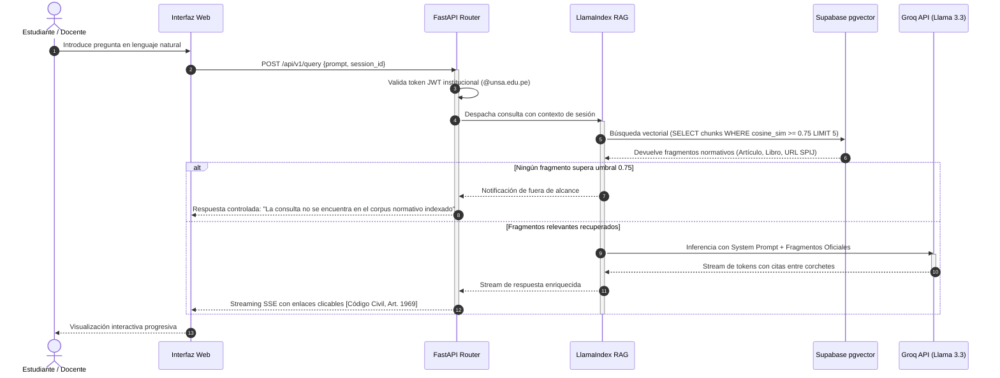

# Arquitectura del Sistema: Inti

> **Sistema:** Inti - Asistente Jurídico Inteligente (RAG)  
> **Patrón Arquitectónico:** Arquitectura en 4 Capas Desacopladas (Presentation, API Application, Persistence, Ingestion/Inference)

---

## 1. Visión General de la Arquitectura

**Inti** es una solución de búsqueda y generación aumentada por recuperación (RAG) diseñada específicamente para responder consultas sobre la legislación civil peruana y jurisprudencia vinculante.

El diseño del sistema busca garantizar tres invariantes fundamentales:
1. **Cero especulación jurídica:** Si una respuesta no está sustentada en un fragmento normativo recuperado, el sistema declina responder.
2. **Trazabilidad absoluta:** Cada afirmación debe acompañarse de un enlace interactivo al texto original del Sistema Peruano de Información Jurídica (SPIJ).
3. **Latencia interactiva:** El tiempo total de respuesta desde el envío de la consulta hasta el inicio del streaming no debe superar los 2 segundos, y la respuesta completa debe completarse en menos de 5 segundos.

---

## 2. Diagrama de Capas del Sistema

```mermaid
flowchart TD
    subgraph Tier1["1. Capa de Presentación (Client Tier)"]
        WebUI["Web Responsiva (HTML5 / Vanilla CSS / ES6 JavaScript)"]
        SSEConsumer["Consumidor de Server-Sent Events (SSE)"]
        CitationModal["Visor Interactivo de Citas y Fuentes Oficiales"]
        WebUI --- SSEConsumer
        WebUI --- CitationModal
    end

    subgraph Tier2["2. Capa de Aplicación (Application Tier - FastAPI)"]
        AuthRouter["Router de Autenticación\n(Validación JWT + Filtro @unsa.edu.pe)"]
        QueryRouter["Router de Consultas Jurídicas\n(Streaming SSE / REST)"]
        RAGOrchestrator["Orquestador RAG\n(Pipeline LlamaIndex)"]
        CitationFormatter["Formateador y Validador de Citas\n(Grounding Engine)"]
        
        QueryRouter --> RAGOrchestrator
        RAGOrchestrator --> CitationFormatter
    end

    subgraph Tier3["3. Capa de Persistencia (Persistence Tier - Supabase)"]
        PostgresRelational[("PostgreSQL 15+\n(Perfiles, Sesiones, Logs de Consulta)")]
        VectorStore[("Extensión pgvector\n(Embeddings de Fragmentos 1536d)")]
        RLSPolicies["Políticas de Seguridad a Nivel de Fila (RLS)"]
    end

    subgraph Tier4["4. Servicios Externos e Ingesta (External & Ingestion Tier)"]
        SPIJScraper["Pipeline de Ingesta SPIJ\n(Extracción asíncrona + Backoff)"]
        HierarchicalParser["Parser Jerárquico\n(Libro > Título > Capítulo > Artículo)"]
        EmbeddingService["Servicio de Vectorización\n(OpenAI text-embedding-3-small)"]
        GroqInference["Inferencia Primaria Ultrarrápida\n(Groq Cloud API - Llama 3.3 70B)"]
        OpenRouterFallback["Inferencia de Contingencia\n(OpenRouter - DeepSeek-V4.1 / GPT-6 Luna)"]
    end

    WebUI <-->|HTTPS / REST| AuthRouter
    SSEConsumer <-->|HTTPS / Streaming SSE| QueryRouter
    AuthRouter <--> PostgresRelational
    RAGOrchestrator <-->|Búsqueda Coseno (<=>)| VectorStore
    RAGOrchestrator -->|Inferencia Principal| GroqInference
    GroqInference -.->|Falla o Rate-Limit| OpenRouterFallback
    SPIJScraper --> HierarchicalParser --> EmbeddingService --> VectorStore
```

---

## 3. Responsabilidades de las Capas

### 3.1. Capa de Presentación (Client Tier)
- Implementada como una aplicación web ligera y accesible desde navegadores móviles y de escritorio sin requerir empaquetado nativo (conforme a [`decisions.md#adr-005`](decisions.md#adr-005-mobile-responsive-web-application-over-native-mobile-implementations)).
- Manejo de flujo de autenticación, almacenamiento del token de sesión en memoria/storage seguro.
- Renderizado de tokens en tiempo real mediante Server-Sent Events (SSE).
- Renderizado de citas jurídicas con hipervínculos estructurados (`[Código Civil, Art. 1969]`) y vista previa modal.

### 3.2. Capa de Aplicación (FastAPI Backend)
- **FastAPI 0.110+**: Proporciona validación estricta de esquemas mediante modelos Pydantic v2.
- **Seguridad**: Middleware de verificación de firma JWT emitido por Supabase GoTrue; rechazo de correos que no pertenezcan al dominio institucional `@unsa.edu.pe` ([`decisions.md#adr-004`](decisions.md#adr-004-unsa-institutional-email-validation-strategy-unsaedupe)).
- **Orquestación RAG**: Conexión con LlamaIndex para recuperar los fragmentos normativos más relevantes a partir de la similitud coseno.
- **Validador de Anclaje (Grounding)**: Verifica que la respuesta generada por el LLM contenga únicamente afirmaciones respaldadas por los fragmentos provistos en el prompt.

### 3.3. Capa de Persistencia (Supabase PostgreSQL + pgvector)
- Almacenamiento unificado para datos relacionales (cuentas, historiales de búsqueda) y vectores semánticos en la misma base de datos ([`decisions.md#adr-001`](decisions.md#adr-001-unified-relational-and-vector-storage-with-supabase-postgresql--pgvector)).
- Tabla `legal_chunks` con columna de tipo `vector(1536)` indexada con algoritmo HNSW para consultas por distancia coseno (`<=>`) en menos de 500 ms.
- Aislamiento de sesiones mediante Row Level Security (RLS).

### 3.4. Capa de Ingesta e Inferencia (External Tier)
- **Scraper SPIJ**: Módulo de extracción web en Python con pausas y retroceso exponencial (1.5s backoff) para respetar las políticas del servidor oficial del MINJUS.
- **Parser Jerárquico**: Segmentador sintáctico que preserva la estructura del Código Civil (Libro > Título > Capítulo > Artículo), evitando cortes arbitrarios de texto ([`decisions.md#adr-002`](decisions.md#adr-002-hierarchical-chunking-pipeline-for-peruvian-codified-norms)).
- **Motor de Inferencia**: Llamada a Groq Cloud (Meta Llama 3.3 70B Versatile) con latencia por token extremadamente reducida; conmutación automática por fallback a OpenRouter si se satura el rate limit ([`decisions.md#adr-003`](decisions.md#adr-003-multi-tiered-llm-inference-engine-groq-llama-33-with-openrouter-contingency)).

---

## 4. Ciclo de Vida de una Consulta Jurídica


