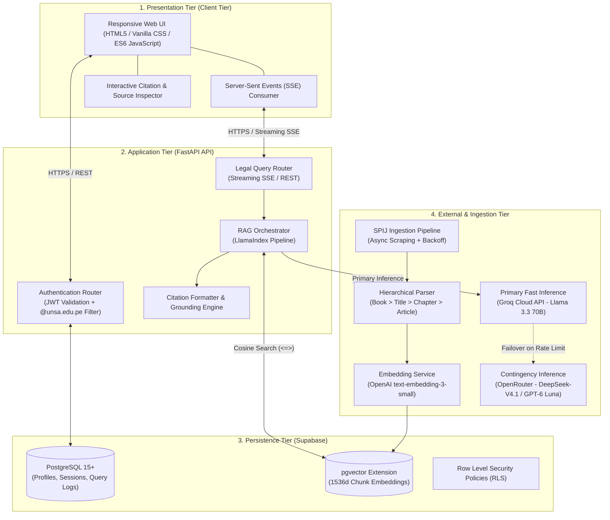
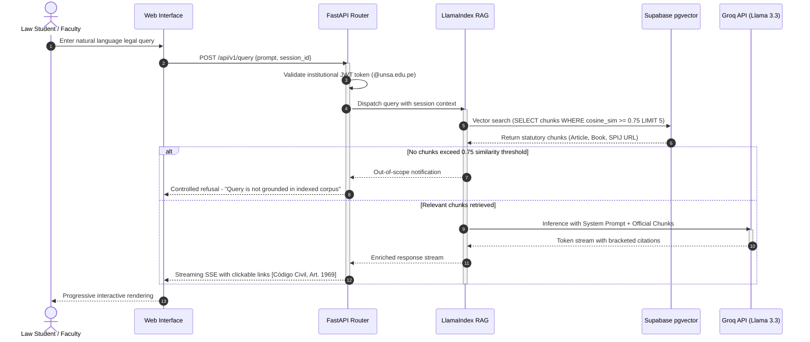

# System Architecture: Inti

> **System:** Inti - Legal AI Assistant (RAG)  
> **Architectural Pattern:** 4-Tier Decoupled Architecture (Presentation, Application API, Persistence, Ingestion/Inference)

---

## 1. Architectural Overview

**Inti** is a retrieval-augmented generation (RAG) solution purpose-built to answer legal queries regarding Peruvian civil legislation and binding jurisprudence for undergraduate law students and academic faculty at Universidad Nacional de San Agustín (UNSA).

The system architecture is engineered around three non-negotiable invariants:
1. **Zero Legal Hallucination:** If a submitted query is not supported by indexed statutory chunks, the system explicitly declines to answer rather than speculating.
2. **Absolute Traceability:** Every legal assertion must be backed by an interactive hyperlink pointing directly to the official Sistema Peruano de Información Jurídica (SPIJ) repository.
3. **Interactive Low Latency:** Time-to-first-token (TTFT) must remain under 2 seconds, with full response completion delivered in under 5 seconds.

---

## 2. System Tier Architecture

---

## 3. Tier Responsibilities

### 3.1. Presentation Tier (Client Tier)
- Implemented as a lightweight web application fully accessible from desktop and mobile browsers without requiring native packaging ([`decisions.md#adr-005`](decisions.md#adr-005-mobile-responsive-web-application-over-native-mobile-implementations)).
- Manages authentication state and stores session tokens securely in browser storage.
- Renders tokens in real time using standard Server-Sent Events (SSE).
- Displays structured statutory citations (`[Código Civil, Art. 1969]`) with interactive preview popovers and direct official links.

### 3.2. Application Tier (FastAPI Backend)
- **FastAPI 0.110+**: Provides strict request/response data validation via Pydantic v2 schemas.
- **Security Middleware**: Verifies Supabase GoTrue JWT signatures and rejects accounts that do not belong to the `@unsa.edu.pe` institutional domain ([`decisions.md#adr-004`](decisions.md#adr-004-unsa-institutional-email-validation-strategy-unsaedupe)).
- **RAG Orchestrator**: Coordinates LlamaIndex to query nearest vector neighbors via cosine similarity.
- **Grounding Engine**: Enforces anti-hallucination rules, validating that all synthesized claims are grounded in retrieved statutory chunks before presentation.

### 3.3. Persistence Tier (Supabase PostgreSQL + pgvector)
- Unified relational and vector database combining transactional records (user accounts, session history) and embeddings in a single cluster ([`decisions.md#adr-001`](decisions.md#adr-001-unified-relational-and-vector-storage-with-supabase-postgresql--pgvector)).
- `legal_chunks` table stores 1536-dimensional embeddings indexed with HNSW for sub-500ms cosine distance (`<=>`) queries.
- Strict isolation of student conversation histories enforced through Row Level Security (RLS) policies.

### 3.4. Ingestion & Inference Tier (External Tier)
- **SPIJ Scraper**: Python extraction pipeline equipped with adaptive exponential backoff (1.5s base pause) to respect MINJUS government portal rate limits.
- **Hierarchical Parser**: Syntactic chunker that preserves the hierarchical codification of the Civil Code (*Book > Title > Chapter > Article*), avoiding arbitrary mid-article splits ([`decisions.md#adr-002`](decisions.md#adr-002-hierarchical-chunking-pipeline-for-peruvian-codified-norms)).
- **Inference Engine**: Primary inference executed via Groq Cloud API (Meta Llama 3.3 70B Versatile) for ultra-low token latency at zero cost; automatic contingency failover to OpenRouter upon rate-limit triggers ([`decisions.md#adr-003`](decisions.md#adr-003-multi-tiered-llm-inference-engine-groq-llama-33-with-openrouter-contingency)).

---

## 4. Lifecycle of a Legal Query

