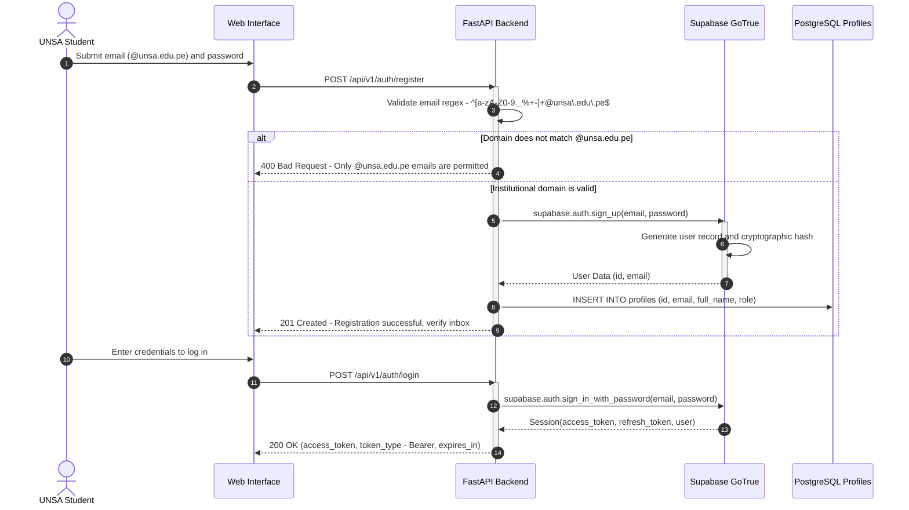

# Authentication and Authorization Module

> **Subsystem:** Access Control and Institutional Identity Management  
> **User Story:** `HU-05` (Institutional Registration and Authentication restricted to `@unsa.edu.pe`)  
> **Architecture Decision:** [`../architecture/decisions.md#adr-004`](../architecture/decisions.md#adr-004-unsa-institutional-email-validation-strategy-unsaedupe)

---

## 1. Purpose and Scope

The authentication module restricts access to the **Inti** assistant exclusively to members of the Universidad Nacional de San Agustín (UNSA) academic community, ensuring every user account is linked to an official `@unsa.edu.pe` email address.

Technical responsibilities include:
- User registration enforced with strong password policies ($\ge 8$ characters, alphanumeric with special symbols).
- Institutional domain verification enforced at the FastAPI API layer via regex and at the persistence layer via database constraints.
- JSON Web Token (JWT) generation and session management via Supabase GoTrue.
- Dependency injection in protected FastAPI endpoints to extract and validate user claims.

---

## 2. Authentication and Registration Flow



---

## 3. API Contracts (Endpoints)

### 3.1. `POST /api/v1/auth/register`
Registers a new institutional user.
- **Request Body:**
  ```json
  {
    "email": "student@unsa.edu.pe",
    "password": "Password123*",
    "full_name": "Juan Perez Quispe",
    "role": "student"
  }
  ```
- **Responses:**
  - `201 Created`: User successfully registered. Returns profile metadata.
  - `400 Bad Request`: Non-institutional domain or password does not fulfill complexity requirements.
  - `409 Conflict`: Email is already registered.

### 3.2. `POST /api/v1/auth/login`
Authenticates user credentials and issues a JWT session token.
- **Request Body:**
  ```json
  {
    "email": "student@unsa.edu.pe",
    "password": "Password123*"
  }
  ```
- **Responses:**
  - `200 OK`:
    ```json
    {
      "access_token": "eyJhbGciOiJIUzI1NiIsInR5cCI6IkpXVCJ9...",
      "token_type": "bearer",
      "expires_in": 3600,
      "user": {
        "id": "a0eebc99-9c0b-4ef8-bb6d-6bb9bd380a11",
        "email": "student@unsa.edu.pe",
        "full_name": "Juan Perez Quispe",
        "role": "student"
      }
    }
    ```
  - `401 Unauthorized`: Invalid credentials.

### 3.3. `GET /api/v1/auth/me`
Retrieves the profile data of the currently authenticated user.
- **Headers:** `Authorization: Bearer <access_token>`
- **Responses:**
  - `200 OK`: User profile data.
  - `401 Unauthorized`: Missing, expired, or invalid token.

---

## 4. Security Middleware and Token Verification

In FastAPI, token validation is implemented via the `get_current_user` dependency:

```python
from fastapi import Depends, HTTPException, status
from fastapi.security import HTTPBearer, HTTPAuthorizationCredentials
import jwt

security = HTTPBearer()

async def get_current_user(
    credentials: HTTPAuthorizationCredentials = Depends(security)
) -> dict:
    token = credentials.credentials
    try:
        # Decode and verify signature using the Supabase JWT secret
        payload = jwt.decode(
            token,
            SUPABASE_JWT_SECRET,
            algorithms=["HS256"],
            audience="authenticated"
        )
        email = payload.get("email", "")
        if not email.endswith("@unsa.edu.pe"):
            raise HTTPException(
                status_code=status.HTTP_403_FORBIDDEN,
                detail="Access restricted to institutional accounts @unsa.edu.pe"
            )
        return payload
    except jwt.ExpiredSignatureError:
        raise HTTPException(
            status_code=status.HTTP_401_UNAUTHORIZED,
            detail="Access token has expired"
        )
    except jwt.InvalidTokenError:
        raise HTTPException(
            status_code=status.HTTP_401_UNAUTHORIZED,
            detail="Invalid access token"
        )
```
