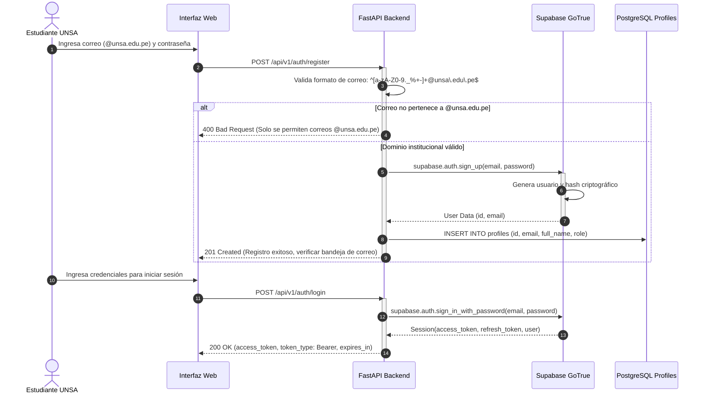

# Módulo de Autenticación y Autorización

> **Subsistema:** Control de Acceso y Gestión de Identidad Institucional  
> **Historia de Usuario:** `HU-05` (Registro y Autenticación Institucional UNSA)  
> **Decisión de Arquitectura:** [`../architecture/decisions.md#adr-004`](../architecture/decisions.md#adr-004-unsa-institutional-email-validation-strategy-unsaedupe)

---

## 1. Propósito y Alcance

El módulo de autenticación restringe el acceso al asistente **Inti** exclusivamente a los miembros de la comunidad académica de la Universidad Nacional de San Agustín de Arequipa (UNSA), validando que cada cuenta esté asociada a un correo oficial con dominio `@unsa.edu.pe`.

Sus responsabilidades técnicas incluyen:
- Registro de usuarios con validación de contraseña fuerte ($\ge 8$ caracteres, alfanumérica).
- Verificación de dominio institucional mediante validación regex en backend y constraint de base de datos.
- Generación y verificación de tokens de acceso JSON Web Token (JWT) mediante Supabase GoTrue.
- Inyección de dependencias en endpoints protegidos de FastAPI para extraer la identidad del estudiante.

---

## 2. Flujo de Autenticación y Registro



---

## 3. Contratos de la API (Endpoints)

### 3.1. `POST /api/v1/auth/register`
Registra un nuevo usuario institucional.
- **Request Body:**
  ```json
  {
    "email": "estudiante@unsa.edu.pe",
    "password": "Password123*",
    "full_name": "Juan Perez Quispe",
    "role": "student"
  }
  ```
- **Responses:**
  - `201 Created`: Usuario creado exitosamente. Retorna metadata del perfil.
  - `400 Bad Request`: Dominio no institucional o contraseña no cumple con políticas de complejidad.
  - `409 Conflict`: Correo ya registrado previamente.

### 3.2. `POST /api/v1/auth/login`
Autentica al usuario y devuelve el token de sesión JWT.
- **Request Body:**
  ```json
  {
    "email": "estudiante@unsa.edu.pe",
    "password": "Password123*"
  }
  ```
- **Responses:**
  - `200 OK`:
    ```json
    {
      "access_token": "eyJhbGciOiJIUzI1NiIsInR5cCI6IkpXVCJ9...",
      "token_type": "bearer",
      "expires_in": 3600,
      "user": {
        "id": "a0eebc99-9c0b-4ef8-bb6d-6bb9bd380a11",
        "email": "estudiante@unsa.edu.pe",
        "full_name": "Juan Perez Quispe",
        "role": "student"
      }
    }
    ```
  - `401 Unauthorized`: Credenciales inválidas.

### 3.3. `GET /api/v1/auth/me`
Obtiene los datos del perfil del usuario autenticado.
- **Headers:** `Authorization: Bearer <access_token>`
- **Responses:**
  - `200 OK`: Datos del perfil.
  - `401 Unauthorized`: Token ausente, expirado o con firma inválida.

---

## 4. Middleware de Seguridad y Verificación

En FastAPI, la verificación del token se realiza a través de una dependencia `get_current_user`:

```python
from fastapi import Depends, HTTPException, status
from fastapi.security import HTTPBearer, HTTPAuthorizationCredentials
import jwt

security = HTTPBearer()

async def get_current_user(
    credentials: HTTPAuthorizationCredentials = Depends(security)
) -> dict:
    token = credentials.credentials
    try:
        # Decodifica y verifica firma usando la clave secreta JWT de Supabase
        payload = jwt.decode(
            token,
            SUPABASE_JWT_SECRET,
            algorithms=["HS256"],
            audience="authenticated"
        )
        email = payload.get("email", "")
        if not email.endswith("@unsa.edu.pe"):
            raise HTTPException(
                status_code=status.HTTP_403_FORBIDDEN,
                detail="Acceso restringido a cuentas institucionales @unsa.edu.pe"
            )
        return payload
    except jwt.ExpiredSignatureError:
        raise HTTPException(
            status_code=status.HTTP_401_UNAUTHORIZED,
            detail="El token de acceso ha expirado"
        )
    except jwt.InvalidTokenError:
        raise HTTPException(
            status_code=status.HTTP_401_UNAUTHORIZED,
            detail="Token de acceso inválido"
        )
```
