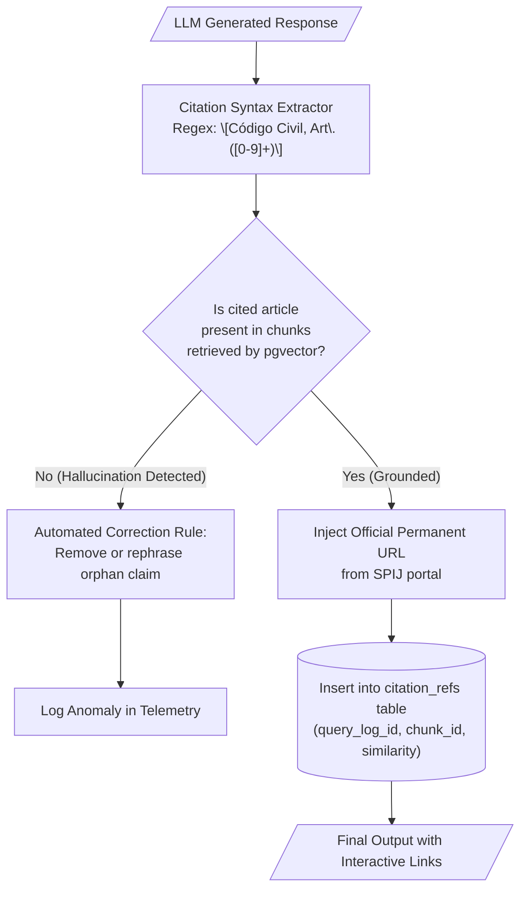

# Verifiable Citations and Hallucination Control Module

> **Subsystem:** Legal Citation Generator and Grounding Engine  
> **User Story:** `HU-02` (Citation Traceability with Direct Links to Official Sources)  
> **Quality Target:** Reduction of hallucination rate from 40–50% (generalist LLMs) to $< 5\%$

---

## 1. Purpose and Scope

The academic and professional validity of a legal assistant depends entirely on the accuracy and grounding of its statutory citations. The citations module ensures that **no legal assertion is presented without verified statutory support**, linking every synthesized claim directly to its exact article in the official Sistema Peruano de Información Jurídica (SPIJ).

---

## 2. Canonical Citation Format

Every answer emitted by the RAG pipeline must structure legal references adhering to the interactive project standard:

### 2.1. Inline Markdown Syntax
```markdown
[Código Civil, Art. {number}](https://spij.minjus.gob.pe/#/detallenorma/H682695)
```

### 2.2. Concrete Generated Response Example
> "Under the Peruvian tort liability regime, whoever by intent or fault causes damage to another is obliged to indemnify it [[Código Civil, Art. 1969](https://spij.minjus.gob.pe/spij-ext-web/#/detallenorma/H682695)]. Furthermore, if the damage is caused through the exercise of a hazardous or risky activity, the author bears strict liability [[Código Civil, Art. 1970](https://spij.minjus.gob.pe/spij-ext-web/#/detallenorma/H682695)]."

---

## 3. Grounding Verifier Architecture



---

## 4. Persistence and Traceability

Every generated citation reference is persisted in the relational `citation_refs` table, linked to the interaction log (`query_log_id`) and the retrieved chunk (`chunk_id`).

This provides:
1. **Academic Auditing:** Faculty and evaluators can verify the AI response against the official statutory text with a single click.
2. **Continuous Quality Benchmarking:** Enables automated computation of RAG triad metrics, specifically *faithfulness* and *citation recall*.
3. **Feedback Loop Telemetry:** If a student reports an erroneous citation via the user feedback interface (`HU-11`), developers can immediately pinpoint which chunk triggered the discrepancy.
