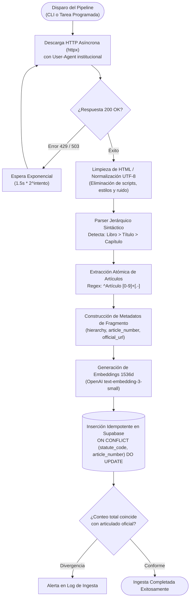

# Módulo de Ingesta Legal y Chunking Jerárquico

> **Subsistema:** Pipeline de Ingesta y Vectorización de Normativa  
> **Historia de Usuario:** `HU-03` (Ingesta Automatizada de Normativa desde SPIJ)  
> **Decisión de Arquitectura:** [`../architecture/decisions.md#adr-002`](../architecture/decisions.md#adr-002-hierarchical-chunking-pipeline-for-peruvian-codified-norms)

---

## 1. Propósito y Alcance

El módulo de ingesta es responsable de extraer, limpiar, estructurar y vectorizar el Código Civil peruano (y posteriormente fuentes jurisprudenciales) desde el portal oficial del Sistema Peruano de Información Jurídica (SPIJ).

Su diseño resuelve dos limitaciones clave del dominio legal:
1. **Pérdida de contexto jurídico:** Los splitters genéricos de texto cortan párrafos por número de caracteres, fragmentando artículos y desvinculándolos de su Título o Libro.
2. **Restricciones del servidor oficial:** SPIJ no dispone de API pública y bloquea ráfagas de tráfico, requiriendo un scraping controlado con pausas adaptativas.

---

## 2. Flujo del Pipeline de Ingesta



---

## 3. Algoritmo de Segmentación Jerárquica (*Hierarchical Chunking*)

El parser no segmenta por longitud fija de tokens, sino por fronteras canónicas del articulado legal:

```text
[CÓDIGO CIVIL DE 1984]
 └── LIBRO VII: Fuentes de las Obligaciones
      └── SECCIÓN SEGUNDA: Contratos Nominados
           └── TÍTULO I: Compraventa
                └── CAPÍTULO PRIMERO: Disposiciones Generales
                     └── ARTÍCULO 1529: Definición del contrato de compraventa
```

### Estructura del Fragmento Legal (JSON Payload)
```json
{
  "statute_code": "CODIGO_CIVIL_1984",
  "statutory_hierarchy": "Libro VII: Fuentes de las Obligaciones > Sección Segunda: Contratos Nominados > Título I: Compraventa > Capítulo Primero",
  "article_number": 1529,
  "raw_content": "Por la compraventa el vendedor se obliga a transferir la propiedad de un bien al comprador y este a pagar su precio en dinero.",
  "official_spij_url": "https://spij.minjus.gob.pe/spij-ext-web/#/detallenorma/H682695",
  "metadata": {
    "total_words": 26,
    "has_modifications": false,
    "last_amendment": null
  }
}
```

### Texto Compuesto para Inferencia y Vectorización
Para que el modelo vectorial capture la semántica completa de la norma, el texto enviado a vectorización concatena la ruta jerárquica con el contenido del artículo:

```text
Norma: Código Civil de 1984
Jerarquía: Libro VII: Fuentes de las Obligaciones > Título I: Compraventa
Artículo 1529: Por la compraventa el vendedor se obliga a transferir la propiedad de un bien al comprador y este a pagar su precio en dinero.
```

---

## 4. Estrategia de Descarga y Prevención de Bloqueos

- **Librería de red:** `httpx` asíncrono con timeouts explícitos de 30 segundos.
- **Pausa obligatoria entre solicitudes:** Mínimo 1.5 segundos entre peticiones sucesivas.
- **Backoff exponencial:** Si el servidor responde con código HTTP 429 (Too Many Requests) o 503, se aplica una pausa creciente:
  $$\text{Pausa} = 1.5 \times 2^{\text{intento}} + \text{jitter aleatorio}$$
- **Máximo de reintentos:** 3 intentos antes de abortar y registrar el fallo en el log de auditoría.
- **Idempotencia:** La clave única `(statute_code, article_number)` en la tabla `legal_chunks` asegura que re-ejecutar el pipeline actualice los fragmentos existentes sin duplicar registros ni corromper el índice HNSW.
