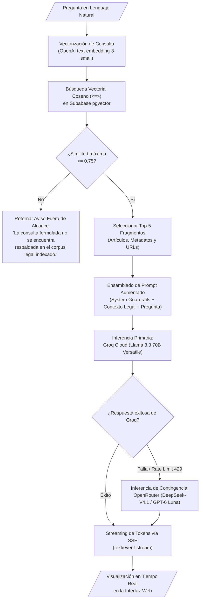

# Módulo Motor RAG y Recuperación Semántica

> **Subsistema:** Pipeline de Recuperación y Generación Aumentada  
> **Historia de Usuario:** `HU-01` (Consulta en Lenguaje Natural con Respuesta Contextualizada)  
> **Decisiones de Arquitectura:** [`../architecture/decisions.md#adr-001`](../architecture/decisions.md#adr-001-unified-relational-and-vector-storage-with-supabase-postgresql--pgvector) y [`../architecture/decisions.md#adr-003`](../architecture/decisions.md#adr-003-multi-tiered-llm-inference-engine-groq-llama-33-with-openrouter-contingency)

---

## 1. Propósito y Alcance

El **Motor RAG** es el núcleo analítico de Inti. Su función es transformar preguntas en lenguaje natural formuladas por estudiantes o docentes en consultas semánticas, recuperar los fragmentos pertinentes del Código Civil peruano y sintetizar una respuesta jurídica precisa, fundamentada y libre de alucinaciones.

---

## 2. Arquitectura del Pipeline RAG



---

## 3. Especificación del Proceso de Recuperación

### 3.1. Umbral de Similitud Coseno ($\ge 0.75$)
Para evitar alucinaciones generadas por la recuperación forzada de artículos no relacionados, el sistema aplica un filtro rígido de similitud coseno:
$$\text{Similitud} = 1 - (\vec{u} \cdot \vec{v})$$
- Si ningún fragmento alcanza el umbral de **0.75**, la consulta se considera fuera de alcance y el LLM no es invocado para especular, respondiendo inmediatamente con un mensaje de declinación estándar.

### 3.2. Parámetro Top-K
Se recuperan como máximo **5 artículos** normativos por consulta para mantener el tamaño del contexto dentro del límite presupuestario y evitar diluir la atención del modelo.

---

## 4. Ensamblado del Prompt y Guardrails del Sistema

El prompt inyectado al modelo de lenguaje impone restricciones de fundamentación legal estricta:

```text
Eres "Inti", el asistente jurídico inteligente de la Facultad de Derecho de la UNSA.
Tu función es responder consultas legales basándote EXCLUSIVAMENTE en los fragmentos del Código Civil peruano provistos a continuación.

REGLAS INVARIABLES:
1. Responde únicamente con información fundamentada en los fragmentos legales adjuntos.
2. Cada afirmación o regla jurídica que expliques debe incluir inmediatamente su cita oficial en formato [Código Civil, Art. X] con el enlace correspondiente.
3. Si los fragmentos no contienen información suficiente para absolver la consulta con certeza jurídica, responde textualmente: "La información disponible en el corpus oficial indexado no permite responder a esta consulta con certeza jurídica."
4. Queda terminantemente prohibido especular, citar jurisprudencia no provista o inventar artículos.
5. Mantén un tono formal, académico y pedagógico, adecuado para estudiantes de Derecho.

FRAGMENTOS LEGALES RECUPERADOS:
{retrieved_context}

PREGUNTA DEL ESTUDIANTE:
{user_query}
```

---

## 5. Streaming de Respuestas (Server-Sent Events)

El endpoint de consulta (`POST /api/v1/query/stream`) utiliza el protocolo **Server-Sent Events (SSE)** para enviar tokens de texto conforme son generados:

```python
from fastapi import APIRouter, Depends
from fastapi.responses import StreamingResponse
import json

router = APIRouter(prefix="/api/v1/query", tags=["query"])

@router.post("/stream")
async def stream_rag_query(
    request: QueryRequest,
    current_user: dict = Depends(get_current_user)
):
    async def event_generator():
        async for token_chunk in rag_orchestrator.execute_stream(
            query=request.query,
            session_id=request.session_id
        ):
            payload = json.dumps({"token": token_chunk})
            yield f"data: {payload}\n\n"
        yield "data: [DONE]\n\n"

    return StreamingResponse(
        event_generator(),
        media_type="text/event-stream"
    )
```
