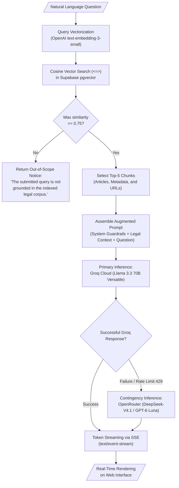

# RAG Engine and Semantic Retrieval Module

> **Subsystem:** Retrieval-Augmented Generation Pipeline  
> **User Story:** `HU-01` (Natural Language Legal Query with Contextualized Answer)  
> **Architecture Decisions:** [`../architecture/decisions.md#adr-001`](../architecture/decisions.md#adr-001-unified-relational-and-vector-storage-with-supabase-postgresql--pgvector) and [`../architecture/decisions.md#adr-003`](../architecture/decisions.md#adr-003-multi-tiered-llm-inference-engine-groq-llama-33-with-openrouter-contingency)

---

## 1. Purpose and Scope

The **RAG Engine** is the analytical core of Inti. It transforms natural language questions submitted by law students or faculty into semantic queries, retrieves pertinent articles from the Peruvian Civil Code via vector similarity, and synthesizes a precise, well-founded, and hallucination-free legal answer.

---

## 2. RAG Pipeline Architecture



---

## 3. Retrieval Process Specification

### 3.1. Cosine Similarity Cutoff ($\ge 0.75$)
To prevent hallucinations triggered by forcing generation over ungrounded chunks, the pipeline enforces a strict cosine similarity threshold:
$$\text{Similarity} = 1 - (\vec{u} \cdot \vec{v})$$
- If no indexed chunk achieves a similarity score of **$0.75$ or higher**, the query is classified as out of scope. The LLM is prevented from generating speculative output, returning an immediate refusal notice.

### 3.2. Top-K Parameter
The retriever selects at most **5 statutory chunks** per query. This balances comprehensive legal context against prompt budget limits and model attention dispersion.

---

## 4. Prompt Assembly and System Guardrails

The augmented prompt injected into the LLM enforces strict statutory grounding:

```text
You are "Inti", the specialized legal AI assistant for the UNSA Faculty of Law.
Your role is to answer legal queries based EXCLUSIVELY on the Peruvian Civil Code excerpts provided below.

STRICT INVARIANTS:
1. Ground your answer solely on the provided statutory excerpts.
2. Every legal claim or rule you state must be immediately followed by its official citation formatted as [Código Civil, Art. X] with the corresponding SPIJ URL.
3. If the retrieved chunks do not provide sufficient statutory foundation to answer the question with legal certainty, state verbatim: "The information available in the indexed official corpus is insufficient to answer this query with legal certainty."
4. Never speculate, invent non-existent articles, or cite unprovided jurisprudence.
5. Maintain a formal, academic, and pedagogical tone appropriate for university law students.

RETRIEVED STATUTORY EXCERPTS:
{retrieved_context}

STUDENT QUERY:
{user_query}
```

---

## 5. Streaming Responses via Server-Sent Events (SSE)

The streaming endpoint (`POST /api/v1/query/stream`) utilizes **Server-Sent Events (SSE)** to stream generated tokens to the client with minimal Time-To-First-Token (TTFT):

```python
from fastapi import APIRouter, Depends
from fastapi.responses import StreamingResponse
import json

router = APIRouter(prefix="/api/v1/query", tags=["query"])

@router.post("/stream")
async def stream_rag_query(
    request: QueryRequest,
    current_user: dict = Depends(get_current_user)
):
    async def event_generator():
        async for token_chunk in rag_orchestrator.execute_stream(
            query=request.query,
            session_id=request.session_id
        ):
            payload = json.dumps({"token": token_chunk})
            yield f"data: {payload}\n\n"
        yield "data: [DONE]\n\n"

    return StreamingResponse(
        event_generator(),
        media_type="text/event-stream"
    )
```
