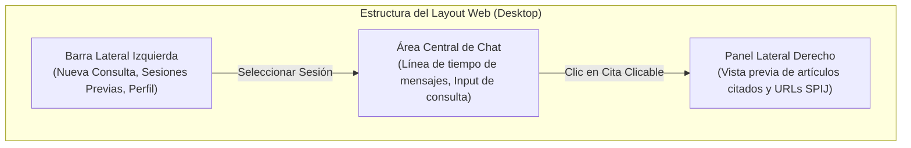

# Interfaz Web Responsiva y Cliente Frontend

> **Subsistema:** Capa de Presentación del Usuario  
> **Historia de Usuario:** `HU-08` (Interfaz Adaptada a Dispositivos Móviles - Web Responsiva)  
> **Decisión de Arquitectura:** [`../architecture/decisions.md#adr-005`](../architecture/decisions.md#adr-005-mobile-responsive-web-application-over-native-mobile-implementations)

---

## 1. Propósito y Alcance

La interfaz web proporciona una experiencia de usuario moderna, fluida y accesible para estudiantes y docentes de Derecho tanto en dispositivos móviles (smartphones) como en computadoras de escritorio de salas de estudio y bibliotecas de la UNSA.

Conforme a la decisión de arquitectura [`ADR-005`](../architecture/decisions.md#adr-005-mobile-responsive-web-application-over-native-mobile-implementations), se descartó el desarrollo de aplicaciones móviles nativas (Android/iOS) para concentrar el esfuerzo en una **Single Page Application (SPA) responsiva** basada en estándares web abiertos (HTML5, Vanilla CSS y Vanilla JS), eliminando barreras de instalación y costos de mantenimiento en tiendas de aplicaciones.

---

## 2. Puntos de Quiebre Responsivos (Breakpoints)

El diseño utiliza una metodología *mobile-first*:

| Dispositivo | Rango de Ancho | Adaptaciones de Interfaz |
|---|---|---|
| **Móvil (Smartphones)** | $< 768\text{ px}$ | Barra lateral colapsable (menú hamburguesa), área de chat a pantalla completa, panel de citas en hoja inferior (*bottom sheet*), tamaño de toque táctil mínimo de $48\times 48\text{ px}$. |
| **Tablet / Portátil Pequeña** | $768\text{ px} - 1024\text{ px}$ | Barra lateral colapsada en iconos, panel de chat centralizado, citas en panel lateral derecho desplegable. |
| **Escritorio (Desktop)** | $> 1024\text{ px}$ | Vista completa de 3 columnas: (1) Historial de sesiones, (2) Ventana principal de conversación y streaming, (3) Inspector lateral de artículos normativos citados. |

---

## 3. Componentes Principales de la Interfaz



### 3.1. Cliente de Streaming en JavaScript (ES6)
El cliente frontend consume las respuestas progresivas mediante la API estándar `fetch` y `ReadableStream`:

```javascript
async function submitLegalQuery(queryText, sessionId, authToken) {
  const response = await fetch('/api/v1/query/stream', {
    method: 'POST',
    headers: {
      'Content-Type': 'application/json',
      'Authorization': `Bearer ${authToken}`
    },
    body: JSON.stringify({ query: queryText, session_id: sessionId })
  });

  const reader = response.body.getReader();
  const decoder = new TextDecoder('utf-8');
  let assistantMessageElement = createAssistantMessageBubble();

  while (true) {
    const { value, done } = await reader.read();
    if (done) break;
    const chunk = decoder.decode(value, { stream: true });
    
    // Procesa eventos Server-Sent Events (SSE)
    const lines = chunk.split('\n');
    for (const line of lines) {
      if (line.startsWith('data: ') && !line.includes('[DONE]')) {
        const payload = JSON.parse(line.replace('data: ', ''));
        assistantMessageElement.innerHTML += renderFormattedTokens(payload.token);
      }
    }
  }
}
```

### 3.2. Renderizado de Enlaces a Fuentes Oficiales
Cuando el backend emite una cita con el patrón `[Código Civil, Art. X](https://spij.minjus.gob.pe/...)`, el parser de frontend la transforma en un enlace con estilo de píldora interactiva:
```html
<a href="https://spij.minjus.gob.pe/#/detallenorma/H682695" target="_blank" rel="noopener noreferrer" class="legal-citation-pill">
  <span class="citation-badge">Art.</span> Código Civil, Art. 1969
</a>
```
Al hacer clic, abre la fuente oficial del SPIJ en una nueva pestaña o despliega el texto completo en el panel lateral de previsualización sin abandonar la conversación.
