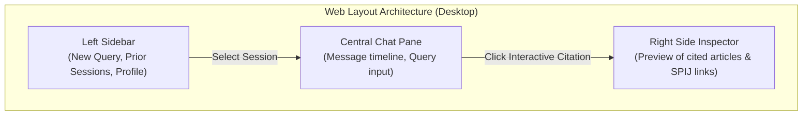

# Responsive Web Interface and Frontend Client

> **Subsystem:** User Presentation Layer  
> **User Story:** `HU-08` (Mobile-Adapted Responsive Web Interface)  
> **Architecture Decision:** [`../architecture/decisions.md#adr-005`](../architecture/decisions.md#adr-005-mobile-responsive-web-application-over-native-mobile-implementations)

---

## 1. Purpose and Scope

The web interface provides an accessible, low-latency, and fluid user experience for law students and academic faculty across both mobile smartphones and library/study hall desktop workstations at UNSA.

In accordance with [`ADR-005`](../architecture/decisions.md#adr-005-mobile-responsive-web-application-over-native-mobile-implementations), native iOS/Android development was rejected in favor of a **responsive Single Page Application (SPA)** built with open standards (HTML5, Vanilla CSS, and Vanilla JavaScript). This eliminates app store distribution fees ($124 USD) and platform review cycles while guaranteeing instant updates across all browsers.

---

## 2. Responsive Breakpoints

The UI follows a *mobile-first* design strategy:

| Device Category | Viewport Width | Interface Adaptations |
|---|---|---|
| **Mobile (Smartphones)** | $< 768\text{ px}$ | Collapsible drawer menu, full-screen conversation pane, citations displayed in an overlay bottom sheet, minimum touch target of $48\times 48\text{ px}$. |
| **Tablet / Small Laptop** | $768\text{ px} - 1024\text{ px}$ | Sidebar collapsed to icon rail, centered chat pane, expandable right-hand slide-over inspector for legal citations. |
| **Desktop Workstations** | $> 1024\text{ px}$ | Full 3-column layout: (1) Query history and session navigation, (2) Main streaming conversation view, (3) Persistent statutory citation inspector. |

---

## 3. Primary Interface Components



### 3.1. JavaScript Streaming Client (ES6)
The frontend consumes token streams directly using the standard `fetch` and `ReadableStream` APIs:

```javascript
async function submitLegalQuery(queryText, sessionId, authToken) {
  const response = await fetch('/api/v1/query/stream', {
    method: 'POST',
    headers: {
      'Content-Type': 'application/json',
      'Authorization': `Bearer ${authToken}`
    },
    body: JSON.stringify({ query: queryText, session_id: sessionId })
  });

  const reader = response.body.getReader();
  const decoder = new TextDecoder('utf-8');
  let assistantMessageElement = createAssistantMessageBubble();

  while (true) {
    const { value, done } = await reader.read();
    if (done) break;
    const chunk = decoder.decode(value, { stream: true });
    
    // Process Server-Sent Events (SSE) data lines
    const lines = chunk.split('\n');
    for (const line of lines) {
      if (line.startsWith('data: ') && !line.includes('[DONE]')) {
        const payload = JSON.parse(line.replace('data: ', ''));
        assistantMessageElement.innerHTML += renderFormattedTokens(payload.token);
      }
    }
  }
}
```

### 3.2. Official Statutory Citation Rendering
When the backend yields a grounded citation matching `[Código Civil, Art. X](https://spij.minjus.gob.pe/...)`, the client parser formats it into an interactive citation pill:

```html
<a href="https://spij.minjus.gob.pe/#/detallenorma/H682695" target="_blank" rel="noopener noreferrer" class="legal-citation-pill">
  <span class="citation-badge">Art.</span> Código Civil, Art. 1969
</a>
```

Clicking a citation pill opens the official SPIJ statute in a secure tab or populates the right-hand citation inspector panel without navigating away from the conversational session.
