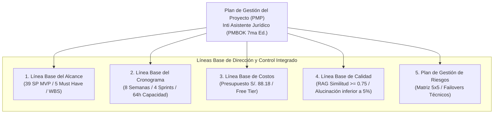

# 01-00 Índice y Resumen Ejecutivo del Plan de Gestión del Proyecto (PMP)

> **Proyecto:** Inti - Asistente Jurídico Inteligente  
> **Área:** Gestión de la Integración (PMBOK 7ma Edición)  
> **Documento Wiki:** `01-00-indice-pmp`  
> **Estado:** Aprobado formalmente por el equipo de proyecto

---

## 1. Resumen Ejecutivo del PMP

El **Plan de Gestión del Proyecto (PMP)** articula los estándares, líneas base y procesos de control que rigen el desarrollo del sistema **Inti**, una plataforma RAG orientada a la asistencia jurídica fáctica y sin alucinaciones para la Universidad Nacional de San Agustín (UNSA).

Este documento integra las cinco líneas base esenciales de dirección, adaptadas al marco de ejecución ágil **Scrumban** (Scrum con visualización Kanban y límites WIP):

---

## 2. Mapa de Documentos de la Línea Base del PMP

A continuación se presentan los enlaces a la memoria técnica exhaustiva de cada línea base desarrollada en este módulo:

| Componente del PMP | Documento Detallado en Wiki | Resumen de Decisiones y Compromisos Clave |
| :--- | :--- | :--- |
| **Línea Base del Alcance** | [01-01 Línea Base del Alcance](01-01-linea-base-alcance.md) | **39 Story Points** comprometidos en 5 historias *Must Have* (`HU-05`, `HU-03`, `HU-01`, `HU-02`, `HU-08`). Exclusión explícita de apps nativas, scraping CEJ y OCR pre-2004. |
| **Línea Base del Cronograma** | [01-02 Línea Base del Cronograma](01-02-linea-base-cronograma.md) | **8 semanas calendario** organizadas en 4 Sprints quincenales vinculados a los Milestones M1 a M4 en GitHub. Capacidad de **64 horas/sprint** para el equipo de 4 ingenieros. |
| **Línea Base de Costos** | [01-03 Línea Base de Costos](01-03-linea-base-costos.md) | Presupuesto monetario de bolsillo acotado a **S/. 88.18** (Dominio S/. 50.00, Embeddings S/. 1.54, OpenRouter S/. 6.64, Reserva S/. 30.00). Infraestructura base 100% en *Free Tier*. |
| **Línea Base de Calidad** | [01-04 Línea Base de Calidad](01-04-linea-base-calidad.md) | Estándar dual: Cobertura de tests unitarios $\ge 80\%$, similitud semántica coseno $\ge 0.75$, tasa de alucinación legal $< 5\%$, precisión de citas normativas al 100% y latencia $\le 3.0$ s. |
| **Plan de Gestión de Riesgos** | [01-05 Plan de Gestión de Riesgos](01-05-plan-gestion-riesgos.md) | Matriz $5\times 5$ con mitigaciones activas ante bloqueo de scrapers SPIJ (R-01), alucinación jurídica (R-02), cuotas de API (R-03), acceso no autorizado (R-04) y corrupción del alcance (R-05). |

---

## 3. Relación con el Control Integrado de Cambios

Las cinco líneas base formuladas en este módulo constituyen el **punto de referencia oficial e inmutable** contra el cual se mide el desempeño del proyecto. Conforme a las directrices del PMBOK y del estándar IEEE Std 828-2012:

1. **Inmutabilidad Operativa:** Ningún miembro del equipo, cliente o interesado puede alterar de forma unilateral los Story Points, la capacidad horaria, las fechas de entrega o el presupuesto aprobado.
2. **Activación del Protocolo:** Cualquier solicitud que busque incorporar nuevos requisitos, adelantar historias evolutivas o modificar los criterios de calidad debe tramitarse obligatoriamente a través del [Protocolo de Gestión de Cambios (Módulo 02)](../02-gestion-cambios/02-00-indice-gestion-cambios.md) y someterse a la deliberación del Comité de Control de Cambios (CCB).
