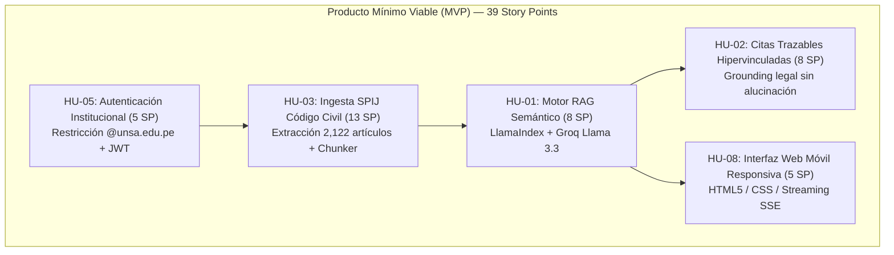

# 01-01 Línea Base del Alcance (Scope Baseline)

> **Proyecto:** Inti - Asistente Jurídico Inteligente  
> **Área:** Gestión del Alcance (PMBOK 7ma Edición)  
> **Documento Wiki:** `01-01-linea-base-alcance`  
> **Estado:** Aprobado por el Product Owner y Línea Base Congelada

---

## 1. Declaración del Alcance del Proyecto

La Línea Base del Alcance (*Scope Baseline*) formaliza los límites del producto de software **Inti**, definiendo con precisión qué entregables forman parte del compromiso contractual del equipo y qué elementos quedan explícitamente excluidos. 

El alcance ha sido modelado combinando los principios de la Gestión del Alcance del **PMBOK 7ma edición** con el marco ágil **Scrumban**, garantizando que cada requerimiento responda a un dolor validado de los estudiantes y docentes de Derecho de la Universidad Nacional de San Agustín (UNSA).

---

## 2. Product Backlog Priorizado (MoSCoW)

El Backlog General del Producto contiene **12 Historias de Usuario**, estructuradas bajo el cono de valor y estimadas en **74 Story Points (SP)** utilizando la escala de Fibonacci modificada (1, 2, 3, 5, 8, 13):

| Identificador | Historia de Usuario | Prioridad MoSCoW | Componente Arquitectónico | Story Points | Sprint Objetivo | Issue de Seguimiento |
| :--- | :--- | :---: | :--- | :---: | :---: | :---: |
| **HU-01** | Búsqueda en lenguaje natural con respuesta contextualizada | **Must Have** | Motor RAG | 8 SP | Sprint 3 | [#1](https://github.com/jorghee/inti-rag/issues/1) |
| **HU-02** | Citas jurídicas trazables con hipervínculos a fuentes oficiales | **Must Have** | Motor RAG | 8 SP | Sprint 4 | [#2](https://github.com/jorghee/inti-rag/issues/2) |
| **HU-03** | Ingesta y chunking jerárquico del Código Civil desde SPIJ | **Must Have** | Ingestión / BD | 13 SP | Sprint 1 y 2 | [#3](https://github.com/jorghee/inti-rag/issues/3) |
| **HU-04** | Ingesta de jurisprudencia vinculante del Tribunal Constitucional | **Should Have** | Ingestión / TC | 8 SP | Sprint 5 (Post-MVP) | [#4](https://github.com/jorghee/inti-rag/issues/4) |
| **HU-05** | Registro y autenticación JWT restringida a `@unsa.edu.pe` | **Must Have** | Backend / Auth | 5 SP | Sprint 1 | [#5](https://github.com/jorghee/inti-rag/issues/5) |
| **HU-06** | Persistencia y recuperación del historial de consultas | **Could Have** | Base de Datos | 3 SP | Sprint 2 | [#6](https://github.com/jorghee/inti-rag/issues/6) |
| **HU-07** | Preguntas de seguimiento en contexto conversacional | **Should Have** | Motor RAG | 8 SP | Sprint 4 | [#7](https://github.com/jorghee/inti-rag/issues/7) |
| **HU-08** | Interfaz de usuario web adaptada a dispositivos móviles | **Must Have** | Frontend Web | 5 SP | Sprint 3 | [#8](https://github.com/jorghee/inti-rag/issues/8) |
| **HU-09** | Panel de monitoreo de salud del pipeline de ingesta | **Could Have** | Backend / Admin | 5 SP | Sprint 5 (Post-MVP) | [#9](https://github.com/jorghee/inti-rag/issues/9) |
| **HU-10** | Exportación estructurada de respuestas y citas (PDF/Markdown) | **Could Have** | Frontend | 3 SP | Sprint 4 | [#10](https://github.com/jorghee/inti-rag/issues/10) |
| **HU-11** | Bucle de retroalimentación de usuario sobre exactitud jurídica | **Could Have** | Backend / Calidad | 3 SP | Sprint 5 (Post-MVP) | [#11](https://github.com/jorghee/inti-rag/issues/11) |
| **HU-12** | Pre-filtrado semántico por ramas del derecho peruano | **Should Have** | Motor RAG | 5 SP | Sprint 5 (Post-MVP) | [#12](https://github.com/jorghee/inti-rag/issues/12) |

---

## 3. Alcance Comprometido del Producto Mínimo Viable (MVP)

El compromiso formal de entrega para el cierre del proyecto en la Semana 8 abarca exclusivamente las **5 Historias de Usuario Must Have**, totalizando exactamente **39 Story Points**:

$$\text{Alcance MVP} = \text{HU-05 (5 SP)} + \text{HU-03 (13 SP)} + \text{HU-01 (8 SP)} + \text{HU-02 (8 SP)} + \text{HU-08 (5 SP)} = 39\text{ Story Points}$$

### Justificación Estratégica del Alcance MVP:
1. **HU-05 (Acceso Institucional):** Protege las cuotas de API de inferencia (Groq) contra abusos y garantiza que el sistema atienda exclusivamente a la comunidad universitaria autorizada.
2. **HU-03 (Ingesta del Código Civil):** Constituye la base documental fáctica. Sin la ingesta completa y jerárquica de los 2,122 artículos del Código Civil peruano, el motor RAG carece de corpus normativo de referencia.
3. **HU-01 (Búsqueda Semántica):** Representa el valor diferencial frente a la búsqueda léxica tradicional por palabras clave, interpretando lenguaje cotidiano de estudiantes.
4. **HU-02 (Citas Trazables):** Es el mecanismo anti-alucinación que valida académicamente las respuestas ante los docentes, vinculando cada párrafo con el SPIJ.
5. **HU-08 (Interfaz Responsiva):** Garantiza que los alumnos puedan consultar el asistente en teléfonos móviles durante clases prácticas y talleres jurídicos.

---

## 4. Estructura de Descomposición del Trabajo (EDT / WBS Ágil)

La EDT descompone el alcance del MVP en paquetes de trabajo y tareas técnicas atomizadas con una granularidad de 2 a 6 horas de esfuerzo de ingeniería:

```mermaid
flowchart TD
    PROJ["1. Proyecto Inti RAG"] --> PKG1["1.1 Seguridad y Acceso (HU-05)"]
    PROJ --> PKG2["1.2 Ingestión Normativa (HU-03)"]
    PROJ --> PKG3["1.3 Motor RAG (HU-01 y HU-02)"]
    PROJ --> PKG4["1.4 Experiencia de Usuario (HU-08)"]

    PKG1 --> T051["1.1.1 Schema Supabase y RLS (TASK-05.1)"]
    PKG1 --> T052["1.1.2 Router JWT FastAPI (TASK-05.2)"]
    PKG1 --> T053["1.1.3 Vistas Login/Registro (TASK-05.3)"]
    PKG1 --> T054["1.1.4 Persistencia de Sesión (TASK-05.4)"]
    PKG1 --> T055["1.1.5 Tests Unitarios Auth (TASK-05.5)"]

    PKG2 --> T031["1.2.1 Scraper httpx SPIJ (TASK-03.1)"]
    PKG2 --> T032["1.2.2 Normalizador HTML Legal (TASK-03.2)"]
    PKG2 --> T033["1.2.3 Chunker Jerárquico (TASK-03.3)"]
    PKG2 --> T034["1.2.4 Test Cobertura 2,122 Arts (TASK-03.4)"]

    PKG3 --> T011["1.3.1 Pipeline LlamaIndex + pgvector (TASK-01.1)"]
    PKG3 --> T012["1.3.2 Conector Groq Llama 3.3 API (TASK-01.2)"]
    PKG3 --> T021["1.3.3 Parser de Citas y URLs SPIJ (TASK-02.1)"]
    PKG3 --> T022["1.3.4 Validación de Grounding Legal (TASK-02.2)"]

    PKG4 --> T081["1.4.1 Layout Web Mobile-First (TASK-08.1)"]
    PKG4 --> T082["1.4.2 Lector de Streaming SSE (TASK-08.2)"]
    PKG4 --> T083["1.4.3 Popovers de Citas Normativas (TASK-08.3)"]
```

---

## 5. Exclusiones Explícitas del Alcance (Won't Have — Invariantes)

Conforme a la decisión documentada en la issue [#13](https://github.com/jorghee/inti-rag/issues/13) y los registros arquitectónicos (`ADR-005` y `ADR-006`), los siguientes requerimientos quedan **estrictamente excluidos del alcance**:

1. **Desarrollo de Aplicaciones Móviles Nativas (Android / iOS):**
   - *Razón Técnica:* Genera duplicidad de código fuente y costos de publicación innecesarios ($25 Google Play, $99/año Apple Store). Se satisface íntegramente mediante la interfaz web móvil responsiva (`HU-08`).
2. **Raspado Automatizado del Sistema CEJ (Poder Judicial):**
   - *Razón Técnica:* El portal de Consulta de Expedientes Judiciales (CEJ) impone barreras de acceso mediante Captchas dinámicos complejos y validación obligatoria de Documento Nacional de Identidad (DNI), impidiendo el scraping automatizado continuo en la capa de ingesta.
3. **Reconocimiento Óptico de Caracteres (OCR) sobre Resoluciones Judiciales Previas a 2004:**
   - *Razón Técnica:* Las sentencias judiciales digitalizadas anteriores al año 2004 consisten en escaneos degradados a baja resolución, requiriendo procesamiento de visión computacional y GPU fuera del presupuesto operativo y del horizonte de 8 semanas.

---

## 6. Criterios de Aceptación de la Línea Base y DoR

Para que cualquier nuevo requerimiento aspire a ingresar a esta línea base, debe satisfacer la **Definition of Ready (DoR)**:
- [x] Narrativa estructurada en formato Cono de Valor (*Como / Quiero / Para*).
- [x] Escenarios de prueba exhaustivos en sintaxis Gherkin (*Given-When-Then*).
- [x] Estimación aprobada por consenso en Story Points.
- [x] Matriz de dependencias técnicas resuelta y trazada en [00-03 Matriz de Trazabilidad](../00-marco-gobernanza/00-03-matriz-trazabilidad.md).
