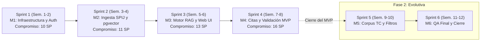
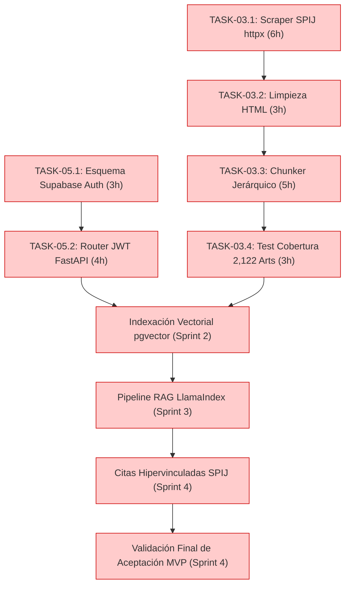

# 01-02 Línea Base del Cronograma (Schedule Baseline)

> **Proyecto:** Inti - Asistente Jurídico Inteligente  
> **Área:** Gestión del Cronograma (PMBOK 7ma Edición)  
> **Documento Wiki:** `01-02-linea-base-cronograma`  
> **Estado:** Aprobado por el Scrum Master y Línea Base Congelada

---

## 1. Parámetros del Cronograma y Cadencia Temporal

La Línea Base del Cronograma establece la distribución temporal formal para la ejecución y entrega del proyecto **Inti**, acotada a un ciclo de vida académico estricto de **8 semanas calendario** (octubre a noviembre de 2026).

El marco metodológico adoptado es **Scrumban**, combinando la cadencia de iteraciones de duración fija (*timeboxes*) con la disciplina de flujo continuo de Kanban y la supervisión de hitos contractuales (*Milestones*).

### 1.1. Capacidad Laboral del Equipo de Ingeniería

El equipo de desarrollo está compuesto por 4 ingenieros de sistemas con asignación a tiempo parcial:

$$\text{Dedicación individual} = 8\text{ horas/semana por persona}$$
$$\text{Capacidad semanal del equipo} = 4 \times 8 = 32\text{ horas/semana}$$
$$\text{Capacidad neta por Sprint (2 semanas)} = 32 \times 2 = 64\text{ horas de ingeniería por Sprint}$$
$$\text{Capacidad total disponible para el MVP (4 Sprints)} = 64 \times 4 = 256\text{ horas hombre netas}$$

---

## 2. Estructura de Iteraciones y Hitos Contractuales (Milestones)

El horizonte de 8 semanas se organiza en **4 Sprints quincenales** de 10 días laborables cada uno, vinculados de manera biunívoca con los **Milestones contractuales de GitHub**:

### Detalle de Sprints y Entregables del MVP:

| Hito / Milestone | Sprint | Fechas de Ejecución | Historias / Tareas Comprometidas | Story Points | Entregable Verificable (Línea Base) |
| :--- | :---: | :---: | :--- | :---: | :--- |
| **Milestone 1** | Sprint 1 | Semanas 1 y 2 | `HU-05` (5 SP) + `HU-03` Fase 1 (5 SP) | **10 SP** | Módulo de autenticación JWT `@unsa.edu.pe` operativo y primer extractor funcional del Código Civil. |
| **Milestone 2** | Sprint 2 | Semanas 3 y 4 | `HU-03` Fase 2 (8 SP) + `HU-06` (3 SP) | **11 SP** | 2,122 artículos del Código Civil segmentados e indexados vectorialmente en `pgvector`. Historial de usuario en Supabase. |
| **Milestone 3** | Sprint 3 | Semanas 5 y 6 | `HU-01` (8 SP) + `HU-08` (5 SP) | **13 SP** | Motor RAG en FastAPI/LlamaIndex respondiendo consultas en streaming e interfaz web móvil responsiva. |
| **Milestone 4** | Sprint 4 | Semanas 7 y 8 | `HU-02` (8 SP) + `HU-07` (8 SP) | **16 SP** | Motor de citas con hipervínculos oficiales al SPIJ, soporte multi-turno y **validación formal del MVP con usuarios**. |

---

## 3. Secuenciamiento de Actividades y Ruta Crítica (CPM)

El análisis del Método de la Ruta Crítica (*Critical Path Method* - CPM) determinó las dependencias tecnológicas obligatorias que no admiten holgura sin retrasar la fecha de lanzamiento:

*Las actividades resaltadas en rojo conforman la **Ruta Crítica**. Cualquier retraso en la ingesta del SPIJ (`TASK-03.1` a `TASK-03.3`) o en la indexación vectorial impacta directamente en la puesta en marcha del motor RAG en el Sprint 3.*

---

## 4. Reserva de Contingencia y Gestión de Holguras

Para mitigar los riesgos derivados de caídas en portales estatales externos o problemas de conectividad de APIs, se implementa una política de reserva temporal:
- **Reserva de Contingencia por Sprint:** Se programa un máximo de **44 a 50 horas de trabajo efectivo** por Sprint sobre la capacidad teórica de 64 horas, reservando una holgura técnica del **20% al 30%** (~14 a 20 horas hombre).
- **Destino de la Holgura:**
  - Resolución de bloqueos e impedimentos no previstos en el Daily Scrum.
  - Refactorización de código y mantenimiento de cobertura mínima de pruebas ($\ge 80\%$).
  - Nivelación de carga en tareas con disparidad técnica entre Backend y Frontend.
- **Inmutabilidad del Timebox:** La duración del Sprint (14 días calendario) es estrictamente inmutable. Si una tarea no satisface la Definition of Done al cierre del sprint, se devuelve al Backlog y se reprograma; jamás se amplía la fecha límite del Sprint.
