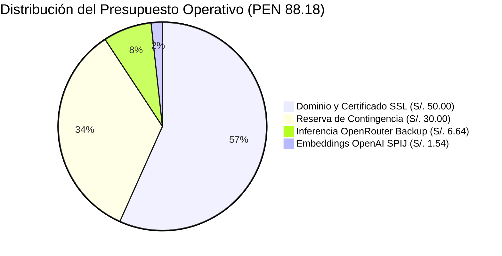

# 01-03 Línea Base de Costos (Cost Baseline)

> **Proyecto:** Inti - Asistente Jurídico Inteligente  
> **Área:** Gestión de los Costos (PMBOK 7ma Edición)  
> **Documento Wiki:** `01-03-linea-base-costos`  
> **Estado:** Aprobado por el Product Owner y Línea Base Congelada

---

## 1. Modelo Económico y Filosofía de Presupuesto

El proyecto **Inti** opera bajo un enfoque de **alta eficiencia de recursos** (*Lean Cost Engineering*), combinando el aprovechamiento integral de plataformas en la nube bajo capa gratuita (*Free Tier*) con un presupuesto financiero de bolsillo (*Out-of-Pocket*) estrictamente acotado a **S/. 88.18**.

Esta línea base diferencia explícitamente entre el **desembolso monetario directo** (costo real asumido por el equipo) y el **costo contable teórico de horas de ingeniería** (esfuerzo humano valorizado a precios de mercado).

---

## 2. Presupuesto Operativo de Bolsillo (Out-of-Pocket)

El capital de trabajo monetario asciende exactamente a **S/. 88.18**, distribuido en cuatro partidas específicas:

| Partida Presupuestaria | Proveedor / Servicio | Justificación Técnica | Moneda Origen | Costo en Soles (S/.) | % del Presupuesto |
| :--- | :--- | :--- | :---: | :---: | :---: |
| **Dominio y Seguridad SSL** | Namecheap + Cloudflare | Nombre de dominio propio institucional con cifrado TLS 1.3 | S/. 50.00 | **S/. 50.00** | 56.70% |
| **Vectorización de Normas** | OpenAI API (`text-embedding-3-small`) | Generación de embeddings para 20.3 millones de tokens del Código Civil | $0.41 USD | **S/. 1.54** | 1.75% |
| **Inferencia de Contingencia** | OpenRouter (DeepSeek / GPT-6 Luna) | Fondo de reserva para 6,000 consultas legales si Groq satura su cuota | $1.77 USD | **S/. 6.64** | 7.53% |
| **Reserva Financiera de Contingencia** | Fondo líquido del equipo | Colchón financiero para picos de tráfico imprevistos o re-indexación | S/. 30.00 | **S/. 30.00** | 34.02% |
| **TOTAL DESEMBOLSO MONETARIO** | -- | -- | -- | **S/. 88.18** | **100.00%** |

*Tipo de cambio de referencia: $1.00 USD = S/. 3.75 PEN.*

---

## 3. Infraestructura Cloud en Capa Gratuita (Costo Monetario: S/. 0.00)

La arquitectura de Inti se sostiene sobre plataformas de nivel empresarial que ofrecen niveles de servicio gratuitos (*Free Tiers*) suficientes para la escala académica del proyecto (facultad de ~1,200 estudiantes):

| Componente Arquitectónico | Plataforma / Proveedor | Límites de la Capa Gratuita | Consumo Proyectado Inti | Costo Mensual |
| :--- | :--- | :--- | :--- | :---: |
| **Persistencia Relacional y Vectores** | Supabase (PostgreSQL 15 + `pgvector`) | 500 MB base de datos, 5 GB ancho de banda, 50,000 usuarios activos | ~180 MB de datos y vectores HNSW del Código Civil | **S/. 0.00** |
| **Servidor de Aplicación (API REST)** | Render Cloud Services | 750 horas de cómputo gratuitas al mes, 512 MB RAM | 1 instancia web en FastAPI con auto-sleep en inactividad | **S/. 0.00** |
| **Despliegue de Frontend** | Netlify Global CDN | 100 GB ancho de banda mensual, 300 minutos de build | ~2 GB de transferencia mensual (HTML/CSS estático) | **S/. 0.00** |
| **Inferencia Primaria de LLM** | Groq Cloud API | 30 solicitudes por minuto (RPM), 14,400 solicitudes/día | ~200 consultas diarias de estudiantes (Llama 3.3 70B) | **S/. 0.00** |

---

## 4. Valorización Contable del Esfuerzo de Ingeniería

Para fines de auditoría financiera según el PMBOK, el costo del capital humano aportado por los 4 integrantes del equipo se valora simbólicamente tomando como referencia el costo hora de un desarrollador junior de software en el mercado nacional (S/. 25.00/hora):

$$\text{Horas totales de ingeniería para el MVP} = 256\text{ horas hombre}$$
$$\text{Valor del esfuerzo técnico} = 256\text{ horas} \times \text{S/. 25.00/hora} = \mathbf{\text{S/. 6,400.00}}$$

*Este valor constituye una inversión no monetaria (costo de oportunidad académica), manteniendo el requerimiento de desembolso de caja estrictamente en **S/. 88.18**.*

---

## 5. Curva de Gasto y Flujo de Caja por Sprint

La ejecución del gasto monetario se distribuye a lo largo de los cuatro hitos temporales del cronograma:
- **Sprint 1 (Milestone 1):** S/. 50.00 (Compra de dominio y configuración DNS en Cloudflare) + S/. 1.54 (Tokens de prueba para embeddings iniciales) = **S/. 51.54 ejecutados**.
- **Sprint 2 (Milestone 2):** S/. 0.00 (Indexación completa del Código Civil finalizada con créditos iniciales).
- **Sprint 3 (Milestone 3):** S/. 0.00 (Despliegue de frontend y backend en Netlify/Render en capa gratuita).
- **Sprint 4 (Milestone 4):** S/. 6.64 (Fondo disponible de OpenRouter activado para pruebas de campo masivas con estudiantes) + S/. 30.00 (Reserva de contingencia en custodia).
