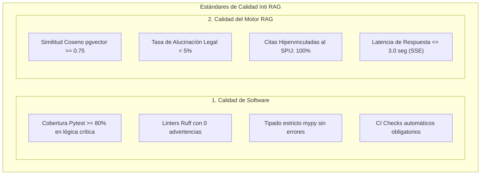

# 01-04 Línea Base de Calidad (Quality Baseline)

> **Proyecto:** Inti - Asistente Jurídico Inteligente  
> **Área:** Gestión de la Calidad (PMBOK 7ma Edición)  
> **Documento Wiki:** `01-04-linea-base-calidad`  
> **Estado:** Aprobado por el Lead QA y Línea Base Congelada

---

## 1. Enfoque Dual de Calidad

La Línea Base de Calidad del proyecto **Inti** establece un estándar riguroso que abarca dos dimensiones complementarias:
1. **Calidad de Ingeniería de Software:** Gobernanza del código fuente, arquitectura, mantenibilidad y automatización de pruebas conforme a las normas ISO/IEC 25010 e IEEE Std 828-2012.
2. **Calidad del Dominio Jurídico (Motor RAG):** Precisión semántica, erradicación de alucinaciones normativas y trazabilidad de citas jurídicas conforme a las exigencias académicas de la Facultad de Derecho de la UNSA.

---

## 2. Métricas y Estándares Cuantitativos de Calidad

### 2.1. Métricas de Ingeniería de Software

| Indicador de Calidad | Meta Cuantitativa | Herramienta de Medición | Frecuencia de Control | Impacto en Release |
| :--- | :---: | :--- | :--- | :--- |
| **Cobertura de Pruebas Unitarias** | **$\ge 80\%$** | `pytest --cov=backend --cov=ingestion` | En cada Pull Request | Bloqueante (CI status check falla si $< 80\%$) |
| **Calidad y Estilo de Código** | **0 advertencias** | `ruff check .` | En pre-commit y CI | Bloqueante (No permite merge a `main`) |
| **Seguridad de Tipos** | **100% tipado** | `mypy backend/` | En pipeline de CI | Bloqueante en funciones públicas y endpoints |
| **Deuda Técnica** | **$\le 5\%$** | Análisis estático de duplicidad | Al cierre de cada Sprint | No bloqueante (se programa refactor en holgura) |

### 2.2. Métricas del Motor de Recuperación y Generación (RAG)

| Métrica Jurídica / RAG | Umbral Aceptable | Método de Verificación Técnica | Consecuencia ante Incumplimiento |
| :--- | :---: | :--- | :--- |
| **Umbral de Similitud Semántica** | **$\ge 0.75$** | Distancia coseno en `pgvector` (1536 dimensiones) | Si similitud $< 0.75$, el sistema declina responder explícitamente en lugar de especular. |
| **Tasa de Alucinación Legal** | **$< 5.0\%$** | Suite de evaluación con 50 casos jurídicos tipo validados por docentes | Rechazo de la versión del prompt y re-afinación de los parámetros de temperatura del LLM. |
| **Precisión de Citación Normativa** | **100.0%** | Validador sintáctico de enlaces a artículos oficiales del SPIJ | Prohibición de despliegue si alguna cita no conduce a un hipervínculo activo. |
| **Tiempo de Respuesta (Latencia)** | **$\le 3.0$ s** | Tiempo al Primer Token (*Time To First Token* - TTFT) mediante SSE | Optimización de índices HNSW y compresión de embeddings en caché Redis/memoria. |

---

## 3. Puntos de Control y Puertas de Calidad (Quality Gates)

La calidad se asegura mediante tres filtros secuenciales que impiden el paso de defectos entre etapas del flujo Scrumban:

### Puerta 1: Criterio de Entrada (Definition of Ready - DoR)
Antes de que una Historia de Usuario ingrese al Sprint Backlog:
- [x] La historia cuenta con narrativa *Como / Quiero / Para*.
- [x] Los criterios de aceptación están definidos en sintaxis Gherkin (*Given-When-Then*).
- [x] Cuenta con estimación en Story Points y tareas técnicas descompuestas (2--6 horas).
- [x] Se cuenta con los datos o APIs necesarios sin bloqueos externos.

### Puerta 2: Revisión por Pares (Peer Review)
Durante la etapa de `Review` en el tablero Kanban:
- [x] El Pull Request enlaza a la issue correspondiente (`Closes #ID`).
- [x] Al menos un desarrollador par (distinto al autor) inspecciona la legibilidad, modularidad y apego a la arquitectura.
- [x] El pipeline automatizado de GitHub Actions ejecuta los tests y linters con resultado verde.

### Puerta 3: Criterio de Salida (Definition of Done - DoD)
Para mover cualquier tarea a `Done`:
- [x] Cobertura de pruebas $\ge 80\%$ comprobada en el reporte de CI.
- [x] Sin advertencias de linter ni errores de tipado.
- [x] Criterios Given-When-Then verificados positivamente en entorno de prueba.
- [x] Docstrings en inglés ASCII y documentación técnica actualizada.
