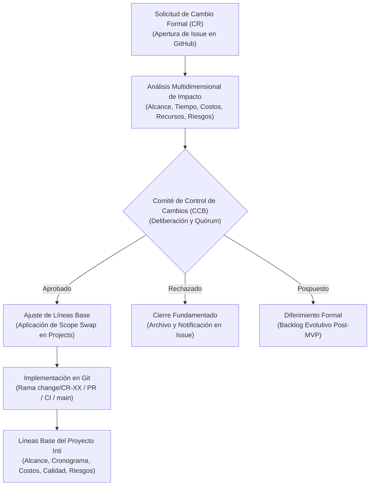

# 02-00 Índice y Resumen Ejecutivo del Plan de Gestión de Cambios

> **Proyecto:** Inti - Asistente Jurídico Inteligente  
> **Área:** Control Integrado de Cambios (PMBOK 7ma Edición & IEEE Std 828-2012)  
> **Documento Wiki:** `02-00-indice-gestion-cambios`  
> **Estado:** Aprobado formalmente por el Comité de Control de Cambios (CCB)

---

## 1. Resumen Ejecutivo del Plan de Cambios

El **Plan de Gestión de Cambios** (*Change Management Plan*) formaliza las políticas, estructuras de gobernanza y procedimientos operativos requeridos para gestionar cualquier modificación propuesta a las líneas base del proyecto **Inti**.

En proyectos de software con restricciones severas de tiempo (horizonte inamovible de 8 semanas), presupuesto acotado (S/. 88.18 monetarios de bolsillo) y capacidad fija de equipo (4 ingenieros a tiempo parcial con 16 horas/sprint cada uno = 64 horas netas por iteración), las solicitudes de cambio no controladas constituyen la causa principal de corrupción del alcance (*scope creep*), desestabilización de la ruta crítica y degradación de la calidad.

Para conciliar la adaptabilidad ágil con la certeza ingenieril, el equipo adopta los principios de **Gobernanza Ágil Adaptativa** bajo el marco **Scrumban**:
- **Protección del Sprint Activo:** Durante la ejecución de un sprint de 14 días calendario, el alcance comprometido para satisfacer la Meta del Sprint (*Sprint Goal*) está estrictamente protegido. Ningún cambio externo puede inyectarse a mitad de iteración, salvo fallos de emergencia de Nivel 1.
- **Adaptabilidad en el Product Backlog:** Nuevas solicitudes e ideas de mejora son bienvenidas y se registran formalmente como *Change Requests* (CR) para ser analizadas y priorizadas en la planificación de los siguientes ciclos.
- **Principio de Compensación de Alcance (*Scope Swap*):** Si se aprueba la incorporación de un nuevo ítem de trabajo de $N$ Story Points en un sprint futuro, se retiran requisitos de valor equivalente para no desbordar la capacidad laboral del equipo de 64 horas por sprint.

---

## 2. Mapa Documental del Módulo de Gestión de Cambios

El presente módulo se estructura en tres documentos técnicos exhaustivos, disponibles en la Wiki del repositorio institucional:

| Documento en Wiki | Título Técnico | Propósito y Contenido Fundamental |
| :--- | :--- | :--- |
| [`02-01-protocolo-tipologia-cambios`](02-01-protocolo-tipologia-cambios.md) | Protocolo y Tipología de Cambios | Clasificación en tres niveles (Nivel 1: Emergencia/Hotfix, Nivel 2: Menor/Técnico, Nivel 3: Mayor/Línea Base), criterios de aceptabilidad y causales de rechazo categórico. |
| [`02-02-estatuto-ccb`](02-02-estatuto-ccb.md) | Estatuto del Comité de Control de Cambios (CCB) | Conformación de los 4 integrantes, atribuciones, derecho de veto técnico y funcional, quórum estricto (4/4), reglas de votación cualificada y modelo de actas. |
| [`02-03-flujo-control-cambios`](02-03-flujo-control-cambios.md) | Flujo de Control de Cambios Paso a Paso | Ciclo de vida en 5 fases (Solicitud, Impacto, Deliberación CCB, Reprogramación e Implementación/Cierre), matriz RACI y directivas de integración en GitHub. |

---

## 3. Integración con el Ecosistema de GitHub

El protocolo de control de cambios se ejecuta utilizando exclusivamente las primitivas técnicas y automatizaciones de GitHub:
- **GitHub Issues:** Punto de entrada único mediante la plantilla estructurada `.github/ISSUE_TEMPLATE/change_request.yml`.
- **GitHub Projects (v2):** Visualización del estado del cambio a través de columnas de flujo (`Change Requested`, `Under Impact Analysis`, `CCB Review`, `Approved`, `Rejected`, `Deferred`).
- **Milestones:** Reajuste dinámico de compromisos temporales y salvaguarda de las fechas de entrega.
- **Git Branches efímeras:** Aislamiento del código bajo la nomenclatura `change/CR-XXX-<descripcion>`.
- **Pull Requests y Status Checks:** Inspección por pares (*Peer Review*), validación de suite de pruebas unitarias (`pytest --cov >= 80%`) y linters (`ruff check`) mediante GitHub Actions antes de autorizar la fusión a `main`.
