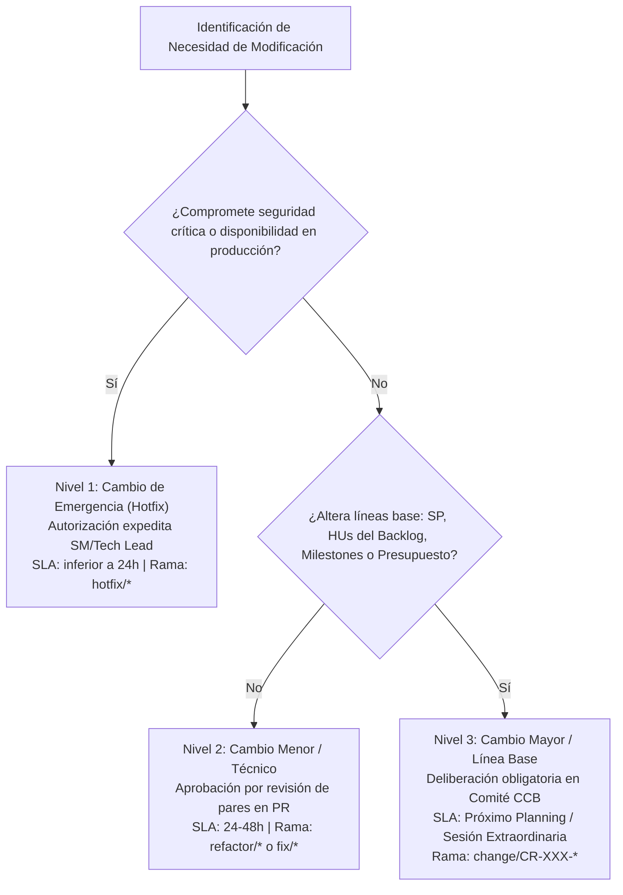

# 02-01 Protocolo y Tipología de Cambios

> **Proyecto:** Inti - Asistente Jurídico Inteligente  
> **Área:** Control Integrado de Cambios (PMBOK 7ma Edición & IEEE Std 828-2012)  
> **Documento Wiki:** `02-01-protocolo-tipologia-cambios`  
> **Estado:** Aprobado formalmente por el Comité de Control de Cambios (CCB)

---

## 1. Fundamento y Objetivos del Protocolo

El presente protocolo define las reglas de clasificación, evaluación y tramitación aplicables a cualquier propuesta de modificación que afecte el código fuente, los esquemas de persistencia, las interfaces públicas, la infraestructura o los compromisos de entrega del proyecto **Inti**.

El objetivo central es eliminar la burocracia en ajustes cotidianos de bajo riesgo mientras se ejerce un control técnico estricto e inquebrantable sobre las cinco líneas base formuladas en el Plan de Gestión del Proyecto (PMP).

---

## 2. Taxonomía de Cambios: Tres Niveles de Impacto

Para garantizar agilidad operativa sin comprometer la estabilidad del sistema, los cambios se clasifican en tres niveles mutuamente excluyentes:

### 2.1. Nivel 1: Cambio de Emergencia (Hotfix / Critical Severity)
- **Definición:** Modificación urgente requerida para mitigar fallos catastróficos que comprometen la seguridad, la confidencialidad de datos institucionales o la operatividad del sistema en producción.
- **Ejemplos Típicos en Inti:**
  - Fuga accidental o exposición de llaves de API (`OPENAI_API_KEY`, `GROQ_API_KEY`, `SUPABASE_SERVICE_ROLE_KEY`).
  - Vulnerabilidad en la validación de dominios de correo permitiendo el registro de usuarios ajenos a `@unsa.edu.pe` (vulneración del R-04).
  - Caída del endpoint de streaming RAG en FastAPI (`HTTP 500` generalizado).
- **Vía de Autorización:** Aprobación expedita unipersonal por el **Scrum Master** o el **Lead Developer**. No requiere convocar sesión plenaria previa del CCB para no demorar la contención.
- **SLA Operativo:** Despliegue y estabilización en menos de 4 a 12 horas.
- **Obligación Documental:** El cambio debe registrarse formalmente de manera retrospectiva en un plazo máximo de 24 horas mediante un issue con etiquetas `type:change-request` y `severity:critical`, emitiendo un informe post-mortem.
- **Estrategia en Git:** Rama efímera originada desde `main`: `hotfix/<issue-id>-<descripcion>`.

### 2.2. Nivel 2: Cambio Menor / Técnico (Low Impact / Standard Flow)
- **Definición:** Modificaciones internas de código, optimizaciones de rendimiento o correcciones menores que no alteran los contratos de API pública, no modifican Story Points, no agregan dependencias externas y no desplazan las fechas de los Milestones.
- **Ejemplos Típicos en Inti:**
  - Optimización de consultas SQL en PostgreSQL añadiendo un índice b-tree secundario sobre metadatos de artículos normativos.
  - Refactorización de funciones auxiliares del chunker jerárquico para mejorar la legibilidad del código sin alterar la segmentación resultante.
  - Corrección de estilos CSS en componentes móviles o ajuste de márgenes en ventanas modales.
  - Corrección ortográfica o sintáctica en mensajes de la interfaz gráfica o documentación interna.
- **Vía de Autorización:** Aprobación estándar por revisión de pares (*Peer Review*) en Pull Request, requiriendo al menos una aprobación formal de un revisor técnico par.
- **SLA Operativo:** Revisión y fusión en un plazo estándar de 24 a 48 horas dentro del sprint en curso.
- **Estrategia en Git:** Ramas `feat/<issue-id>-<desc>`, `fix/<issue-id>-<desc>` o `refactor/<issue-id>-<desc>`.

### 2.3. Nivel 3: Cambio Mayor / Impacto en Línea Base (High Impact / Baseline Modification)
- **Definición:** Cualquier modificación que afecte directamente las líneas base del proyecto: incorporación o supresión de Historias de Usuario en el Product Backlog, variación en la estimación de Story Points, reprogramación de fechas de entrega de Milestones, consumo de fondos de la reserva financiera de contingencia (S/. 30.00) o alteración de Decisiones Arquitectónicas Registradas (ADR).
- **Ejemplos Típicos en Inti:**
  - Solicitud de adelanto de la ingesta de sentencias del Tribunal Constitucional (`HU-04`, 8 SP) al Sprint 3 (caso simulado en el laboratorio).
  - Sustitución del proveedor de inferencia LLM principal (Groq Cloud API) por una alternativa comercial de pago ante cambios en sus términos gratuitos.
  - Incorporación de filtros de búsqueda por materias jurídicas adicionales no contempladas en el alcance del MVP.
  - Modificación de la estructura relacional de la tabla `normative_chunks` que rompa retrocompatibilidad con embeddings ya indexados.
- **Vía de Autorización:** **Exclusiva y colegiada del Comité de Control de Cambios (CCB)** en sesión formal con quórum reglamentario y registro de acta oficial.
- **SLA Operativo:** Análisis técnico previo en un plazo de 3 a 5 días y deliberación formal en la siguiente reunión de Refinamiento de Backlog o en sesión extraordinaria.
- **Estrategia en Git:** Ramas dedicadas e identificadas con el código de cambio: `change/CR-XXX-<descripcion>`.

---

## 3. Matriz Comparativa de Clasificación de Cambios

| Criterio de Control | Nivel 1: Cambio de Emergencia | Nivel 2: Cambio Menor / Técnico | Nivel 3: Cambio Mayor (Línea Base) |
| :--- | :--- | :--- | :--- |
| **Impacto Técnico** | Crítico sobre seguridad o producción | Nulo sobre líneas base; interno | Alto sobre alcance, tiempo, costo o ADRs |
| **Variación en Story Points** | 0 SP (absorbido como incidente) | 0 SP (trabajo ordinario del sprint) | $> 0\text{ SP}$ o redistribución de carga |
| **Afectación a Milestones** | Ninguna (salvaguarda inmediata) | Ninguna (holgura interna del sprint) | Posible desplazamiento o reprogramación |
| **Impacto Presupuestario** | Potencial uso de reserva de emergencia | S/. 0.00 (sin desembolso adicional) | Requiere evaluar partidas de costo |
| **Autoridad Decisora** | Scrum Master o Lead Developer | Revisor par técnico (Peer Review) | Comité de Control de Cambios (CCB) pleno |
| **Quórum Requerido** | Unipersonal (1 integrante) | Unilateral (1 revisor par calificado) | 4 integrantes (100% quórum reglamentario) |
| **SLA de Resolución** | $< 24\text{ horas}$ | $24\text{ a }48\text{ horas}$ | 3 a 5 días hábiles / Sesión CCB |
| **Artefacto de Registro** | Issue `type:change-request` + Post-Mortem | Pull Request estándar con `Closes #ID` | Formulario `change_request.yml` + Acta CCB |
| **Etiqueta en GitHub** | `change:emergency`, `severity:critical` | `change:minor`, `type:refactor`, `type:fix` | `change:major`, `status:ccb-review` |
| **Nomenclatura de Rama** | `hotfix/<id>-<desc>` | `feat/*`, `fix/*`, `refactor/*` | `change/CR-XXX-<desc>` |

---

## 4. Criterios de Aceptabilidad de Cambios

Para que una Solicitud de Cambio (CR) de Nivel 3 sea evaluada positivamente por el CCB, debe satisfacer los siguientes **criterios obligatorios de viabilidad**:

1. **Alineación con la Visión del Producto y Cono de Valor:**
   El cambio debe solucionar una necesidad directa de la comunidad académica de Derecho de la UNSA, contribuyendo a la reducción del tiempo de investigación jurídica o al aseguramiento fáctico de citas normativas.
2. **Respeto a la Capacidad del Sprint (Principio de Compensación):**
   Si la solicitud demanda horas de desarrollo que exceden la holgura técnica disponible del sprint objetivo (14 a 20 horas de reserva sobre las 64 horas netas), el solicitante y el Product Owner deben aceptar la aplicación estricta de una **permuta de alcance (*scope swap*)**, retirando del backlog comprometido historias o tareas de valor equivalente de esfuerzo.
3. **Sostenibilidad Financiera y Arquitectónica:**
   El cambio no puede comprometer la política de presupuesto de bolsillo (máximo S/. 88.18) ni inducir costos recurrentes de infraestructura que desborden las cuotas del plan gratuito (*Free Tier*) de Supabase, Render, Netlify o Groq, a menos que se apruebe una partida específica de la reserva de contingencia.
4. **Preservación de los Estándares de Calidad RAG:**
   El cambio debe garantizar que no se degradará la similitud semántica por debajo del umbral de $0.75$, que la tasa de alucinación se mantendrá inferior al $5\%$ y que toda respuesta jurídica continuará enlazada al 100% con hipervínculos verificables hacia el portal SPIJ.

---

## 5. Causales de Rechazo Categórico Invariante

El Comité de Control de Cambios desestimará de plano, sin necesidad de evaluación de impacto extendida, aquellas solicitudes que incurran en alguna de las siguientes causales:

- **Incurrir en las Exclusiones Invariantes (*Won't Have* — Issue #13):**
  - Solicitudes para desarrollar aplicaciones móviles nativas (Android/iOS) en lugar de optimizar la interfaz web responsiva (`ADR-005`).
  - Solicitudes que requieran raspado automatizado del sistema de Consulta de Expedientes Judiciales (CEJ) del Poder Judicial violando barreras Captcha o exigiendo DNI (`ADR-006`).
  - Requerimientos de OCR sobre resoluciones previas al año 2004 (`ADR-006`).
- **Sobrecarga de Capacidad sin Compensación:**
  Cualquier solicitud de incorporación que demande horas hombre adicionales sin proponer qué elementos del alcance se retirarán o pospondrán, violentando el límite de 64 horas por sprint.
- **Ruptura de la Definición de Terminado (DoD):**
  Solicitudes que propongan omitir pruebas unitarias, reducir el umbral de cobertura del $80\%$ o prescindir de la revisión por pares con el propósito de acelerar entregas.
