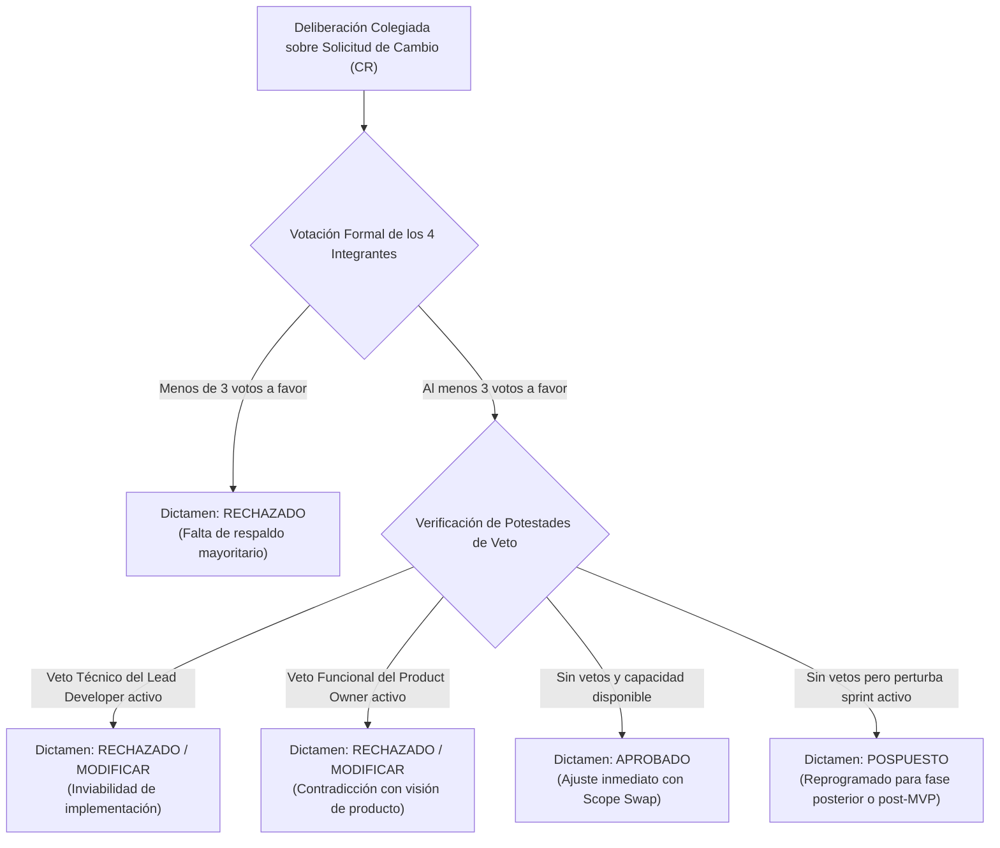

# 02-02 Estatuto del Comité de Control de Cambios (CCB)

> **Proyecto:** Inti - Asistente Jurídico Inteligente  
> **Área:** Control Integrado de Cambios (PMBOK 7ma Edición & IEEE Std 828-2012)  
> **Documento Wiki:** `02-02-estatuto-ccb`  
> **Estado:** Aprobado formalmente y vigente

---

## 1. Naturaleza y Propósito del CCB

El **Comité de Control de Cambios** (*Change Control Board* - CCB) es la autoridad colegiada formalmente constituida responsable de revisar, evaluar, aprobar, posponer o rechazar las solicitudes de cambio que afecten las líneas base del proyecto **Inti**, así como de registrar y difundir las decisiones adoptadas @pmi2021, @ieee828.

En un entorno adaptativo como Scrumban, el CCB no actúa como una barrera burocrática, sino como un **mecanismo de gobernanza estratégico** que protege al equipo contra la sobrecarga laboral y garantiza que cada modificación aprobada cuente con viabilidad técnica, compensación de recursos y respaldo unánime.

---

## 2. Conformación Multidisciplinaria del Comité

Para garantizar un balance objetivo entre la satisfacción del usuario de Derecho, el rigor técnico y la disciplina de gestión, el CCB de Inti está integrado por los cuatro miembros del equipo, cada uno con atribuciones y potestades específicas:

| Integrante | Rol en el CCB | Rol en el Proyecto | Perfil Técnico | Atribuciones y Responsabilidades Clave | Potestad de Veto |
| :--- | :--- | :--- | :--- | :--- | :---: |
| **Jhonatan David Arias Quispe** | Presidente del CCB | Product Owner (PO) | Frontend / Requerimientos | Evalúa la alineación estratégica con los dolores de estudiantes y docentes de Derecho. Custodia el cono de valor del Product Backlog y valida que el cambio preserve la experiencia de usuario. | **Veto Funcional** (Alineación de Negocio) |
| **Jorge Luis Mamani Huarsaya** | Coordinador y Moderador | Scrum Master (SM) | Gobernanza / Backend | Convoca las sesiones, modera las deliberaciones, evalúa el impacto sobre el cronograma (Milestones), calcula la velocidad del equipo (Story Points), custodia los límites WIP y vela por el cumplimiento del protocolo. | **Veto de Proceso** (Límites WIP y Capacidad) |
| **Rodrigo Alexander Fernandez Huarca** | Vocal Técnico | Lead Backend & AI | Ingestión / RAG / Groq API | Analiza la factibilidad algorítmica, la latencia de inferencia, la estabilidad de los scrapers del SPIJ/TC, el consumo de cuotas de tokens y la modularidad de la arquitectura FastAPI. | **Veto Técnico** (Factibilidad e Inferencia) |
| **Rafael Diego Nina Calizaya** | Vocal de Calidad | Lead DB & QA | PostgreSQL / pgvector / Tests | Evalúa el impacto sobre esquemas relacionales, índices vectoriales HNSW, tiempos de consulta semántica, cobertura de pruebas unitarias (`pytest >= 80%`) y seguridad institucional. | **Veto de Calidad** (Pruebas y Base de Datos) |

---

## 3. Reglas de Operación, Quórum y Calendario de Sesiones

### 3.1. Modalidades de Sesión
1. **Sesiones Ordinarias:**
   - **Frecuencia:** Quincenal, celebradas el último día de cada Sprint durante la sesión formal de *Refinamiento del Backlog* (*Backlog Refinement*).
   - **Objetivo:** Analizar solicitudes de cambio de Nivel 3 acumuladas durante la iteración y evaluar su incorporación en el siguiente sprint mediante permuta de alcance (*scope swap*).
2. **Sesiones Extraordinarias:**
   - **Convocatoria:** Solicitadas por el Scrum Master o el Product Owner ante situaciones imprevistas o requerimientos de alto impacto que no admiten espera quincenal.
   - **Plazo de Convocatoria:** Máximo 48 horas tras la formalización del análisis técnico de impacto.

### 3.2. Quórum Reglamentario
- Para que una sesión del CCB se declare válidamente instalada y sus acuerdos tengan fuerza vinculante, **se exige la asistencia presencial o síncrona del 100% de sus integrantes (4 de 4)**.
- No se admiten votos por delegación ni sesiones con miembros ausentes, garantizando que todas las perspectivas (Negocio, Proceso, Backend/IA y DB/QA) participen activamente en la deliberación.

---

## 4. Mecanismo de Votación y Principio de Doble Veto

El proceso de adopción de acuerdos se rige por un esquema de mayoría cualificada con salvaguardas de veto técnico y funcional:



### 4.1. Regla de Mayoría Cualificada
- Para la aprobación de una Solicitud de Cambio se requiere un **mínimo de tres (3) votos favorables** de los cuatro integrantes habilitados.

### 4.2. Principio Invariante de Doble Veto
Aun cuando una propuesta obtenga tres votos a favor, **la solicitud queda bloqueada y no puede ser aprobada** si incurre en alguna de las siguientes condiciones de veto:
1. **Veto Técnico (Lead Backend & AI):** Si la implementación del cambio compromete la estabilidad arquitectónica, excede las capacidades de cómputo en la capa gratuita o introduce dependencias tecnológicas no viables.
2. **Veto Funcional (Product Owner):** Si la modificación contradice la visión estratégica del asistente jurídico para la comunidad universitaria de Derecho o degrada la experiencia de usuario.

---

## 5. Tipología de Dictámenes Oficiales

El CCB puede emitir únicamente uno de los siguientes tres dictámenes formales:

1. **Aprobado (*Approved*):**
   - Se autoriza la incorporación formal del cambio en la línea base del proyecto.
   - Si el cambio demanda horas hombre que exceden la reserva del sprint objetivo, la aprobación queda estrictamente condicionada a la formalización inmediata de una **permuta de alcance (*scope swap*)**, identificando qué tareas o historias se retirarán para mantener la carga laboral en 64 horas netas.
2. **Rechazado (*Rejected*):**
   - Se desestima la solicitud de manera definitiva y fundamentada por inviabilidad técnica, contradicción funcional o inviabilidad financiera. La resolución es irrevocable dentro del ciclo de vida del MVP.
3. **Pospuesto (*Deferred*):**
   - El CCB reconoce el valor intrínseco y la pertinencia de la solicitud, pero determina que su incorporación en el sprint solicitado pondría en riesgo la ruta crítica del cronograma o desbordaría la capacidad del equipo.
   - La solicitud se reprograma de forma planificada para un sprint posterior o se transfiere formalmente al Backlog evolutivo de la Fase 2 (Post-MVP), blindando la iteración en curso.

---

## 6. Formalización Documental: Modelo de Acta del CCB

Toda resolución adoptada por el CCB debe documentarse obligatoriamente mediante un acta numerada con nomenclatura estándar `ACTA-CCB-2026-XXX`, estructurada bajo la siguiente plantilla institucional:

```markdown
### Acta de Resolución del Comité de Control de Cambios (CCB)
- **Código de Acta:** ACTA-CCB-2026-XXX
- **Fecha y Hora de Sesión:** AAAA-MM-DD HH:MM
- **Solicitud de Cambio Evaluada:** [CR-XXX: Título del Cambio] (Issue #ID)
- **Asistencia y Quórum:** 4/4 integrantes presentes (Arias, Mamani, Fernandez, Nina)

#### Resumen de la Deliberación Técnica:
[Síntesis del análisis de impacto en alcance, tiempo, costo, calidad y riesgos]

#### Registro de Votación:
- Arias Quispe, Jhonatan David (PO): [A favor / En contra / Abstención / VETO]
- Mamani Huarsaya, Jorge Luis (SM): [A favor / En contra / Abstención]
- Fernandez Huarca, Rodrigo A. (Tech Lead): [A favor / En contra / Abstención / VETO]
- Nina Calizaya, Rafael Diego (QA Lead): [A favor / En contra / Abstención]
- **Resultado:** X votos a favor, Y votos en contra.

#### Dictamen Oficial:
**[APROBADO / RECHAZADO / POSPUESTO]**

#### Fundamentación Técnica del Dictamen:
[Justificación detallada de los motivos que sustentan la decisión colegiada]

#### Acciones Derivadas y Ajustes de Línea Base:
- Estado del Issue: Actualizado a [status:approved / status:rejected / status:deferred]
- Permuta de Alcance (Scope Swap): [Detallar historias retiradas si aplica]
- Asignación de Rama en Git: `change/CR-XXX-<desc>` (si fue aprobado)
- Milestone Afectado: [Milestone X / Post-MVP]
```

El acta se publica como un **comentario oficial fijado (*pinned comment*)** en el issue correspondiente de GitHub y se compila en el repositorio de gobernanza institucional.
