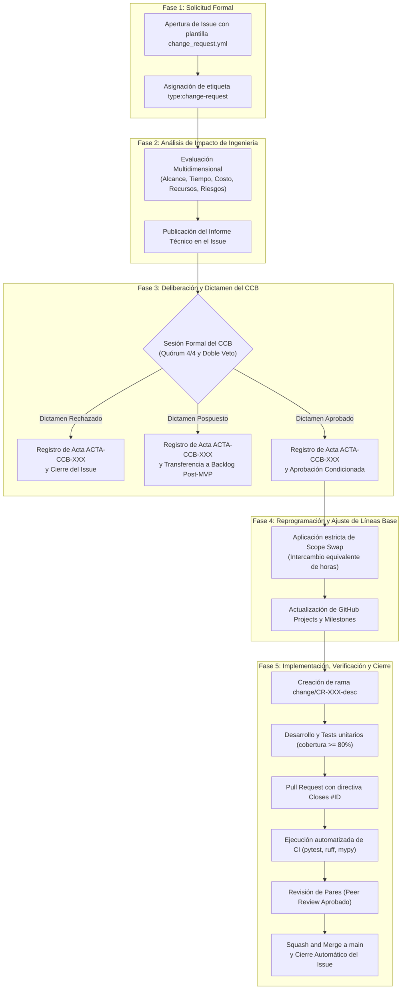

# 02-03 Flujo de Control de Cambios Paso a Paso

> **Proyecto:** Inti - Asistente Jurídico Inteligente  
> **Área:** Control Integrado de Cambios (PMBOK 7ma Edición & IEEE Std 828-2012)  
> **Documento Wiki:** `02-03-flujo-control-cambios`  
> **Estado:** Aprobado formalmente y vigente

---

## 1. Visión General del Proceso

El ciclo de vida de una Solicitud de Cambio (*Change Request* - CR) de Nivel 3 sigue un flujo secuencial riguroso y transparente estructurado en **cinco fases operativas**, diseñado para ejecutarse íntegramente sobre las herramientas de GitHub.



---

## 2. Descripción Pormenorizada de las Cinco Fases

### Fase 1: Solicitud Formal (Change Request - CR)
- **Actores Intervinientes:** Solicitante (usuario de Derecho, cliente o integrante del equipo) y Scrum Master.
- **Procedimiento Operativo:**
  1. El solicitante accede a la pestaña de *Issues* del repositorio GitHub y selecciona el formulario oficial: `Solicitud de Cambio (Change Request)` (`change_request.yml`).
  2. Completa obligatoriamente:
     - Título estandarizado: `[CR-XXX] <Título descriptivo del requerimiento>`.
     - Tipo de cambio estimado: Nivel 1 (Emergencia), Nivel 2 (Menor) o Nivel 3 (Mayor).
     - Justificación de negocio y dolor de usuario detectado.
     - Descripción detallada de componentes, pantallas o endpoints afectados.
  3. Al registrar el issue, se le asignan automáticamente las etiquetas `type:change-request` y `status:change-requested`.
- **Criterio de Salida (DoRC - Definition of Ready for Change):** El Scrum Master valida que la solicitud esté debidamente formulada; en caso de ambigüedad, solicita precisiones al solicitante antes de pasar a la siguiente fase.

### Fase 2: Evaluación Técnica y Multidimensional de Impacto
- **Actores Intervinientes:** Scrum Master (coordinador), Lead Backend & AI (evaluador técnico) y Lead DB & QA (evaluador de calidad).
- **Procedimiento Operativo:**
  El equipo de ingeniería analiza analítica y cuantitativamente las repercusiones del cambio propuesto contrastándolas contra las cinco líneas base del proyecto:
  1. **Impacto en Alcance:** Estimación del esfuerzo en Story Points (escala de Fibonacci) y desglose preliminar en tareas técnicas de la EDT.
  2. **Impacto en Tiempo y Cronograma:** Cálculo de horas hombre netas requeridas frente a la capacidad máxima del sprint objetivo (64 horas netas para el equipo). Análisis de afectación sobre la ruta crítica (CPM) y holguras de las tareas dependientes.
  3. **Impacto en Costos e Infraestructura:** Proyección del consumo de tokens en OpenAI (`text-embedding-3-small`), costos de inferencia de respaldo en OpenRouter, volumen de almacenamiento vectorial en PostgreSQL/`pgvector` y verificación de disponibilidad de la reserva de contingencia (S/. 30.00).
  4. **Impacto en Recursos y Especialidad:** Distribución de la carga de trabajo por perfil (Backend, Frontend, Base de Datos/QA) para detectar y prevenir sobrecargas asimétricas individuales (ej. > 16h/sprint por desarrollador).
  5. **Impacto en Calidad y Riesgos:** Identificación de nuevos riesgos introducidos (ej. aumento de alucinación legal, incremento de latencia TTFT > 3.0s, caídas de scrapers externos) y formulación de planes de mitigación.
- **Entregable de la Fase:** El equipo redacta y publica el *Informe Técnico de Impacto* como un comentario estructurado en el issue, actualizando la etiqueta a `status:impact-analysis`.

### Fase 3: Deliberación y Dictamen del CCB
- **Actores Intervinientes:** Comité de Control de Cambios pleno (Product Owner, Scrum Master, Lead Developer, Lead QA).
- **Procedimiento Operativo:**
  1. El Scrum Master convoca al comité (sesión ordinaria al final del sprint o extraordinaria en menos de 48 horas).
  2. Se revisa el Informe Técnico de Impacto y se evalúan las alternativas de decisión:
     - *Alternativa A: Aprobación incondicional* (únicamente viable si la demanda de horas cabe holgadamente en la reserva del 20% al 30% del sprint sin desplazar la ruta crítica).
     - *Alternativa B: Aprobación con permuta de alcance (Scope Swap)* (se seleccionan las historias o tareas de valor equivalente que serán retiradas del sprint).
     - *Alternativa C: Rechazo fundamentado* (inviabilidad técnica, económica o contradicción con el cono de valor).
     - *Alternativa D: Posposición formal* (el cambio es valioso pero se difiere para el Sprint 5 o la fase post-MVP para no desestabilizar la iteración activa).
  3. Se realiza la votación formal de los cuatro miembros, verificando la ausencia de vetos técnicos o funcionales.
  4. Se redacta el acta oficial `ACTA-CCB-2026-XXX` y se publica como comentario formal en el issue.
- **Entregable de la Fase:** Actualización de la etiqueta del issue a `status:approved`, `status:rejected` o `status:deferred`.

### Fase 4: Reprogramación y Ajuste de Líneas Base
- **Actores Intervinientes:** Scrum Master y Product Owner.
- **Procedimiento Operativo:**
  - **En caso de Rechazo:** Se cierra el issue en GitHub con estado *Closed as not planned* y se notifica formalmente al solicitante.
  - **En caso de Posposición:** Se traslada la tarjeta en GitHub Projects a la columna `Deferred` (Backlog evolutivo post-MVP) y se reprograma su Milestone correspondiente.
  - **En caso de Aprobación:**
    1. Se aplica formalmente el *Scope Swap*: el Product Owner retira del Sprint Backlog comprometido tareas o historias equivalentes en Story Points y horas hombre, trasladándolas al Product Backlog general.
    2. El Scrum Master actualiza el tablero de GitHub Projects, recalcula las asignaciones horarias individuales (asegurando un máximo de 16h/persona por sprint) y ajusta las fechas límite en los Milestones de GitHub.
    3. Se cambia el estado del issue a `status:ready-for-dev`.

### Fase 5: Implementación, Verificación y Cierre
- **Actores Intervinientes:** Desarrollador asignado, Revisor par técnico y Lead QA.
- **Procedimiento Operativo:**
  1. El desarrollador crea una rama efímera aislada desde la última versión estable de `main`:
     ```bash
     git checkout main && git pull origin main
     git checkout -b change/CR-XXX-<descripcion-corta>
     ```
  2. Implementa la solución de código y las suites de pruebas unitarias correspondientes en `tests/`, asegurando que la cobertura se mantenga $\ge 80\%$.
  3. Realiza commits atómicos bajo la convención de Conventional Commits:
     ```bash
     git commit -m "feat(change): implement TC jurisprudence ingestion endpoint for CR-001"
     ```
  4. Abre un Pull Request (PR) hacia la rama `main`, enlazando explícitamente el issue mediante la palabra clave de cierre:
     `Closes #<ID-del-issue>`
  5. GitHub Actions ejecuta automáticamente el pipeline de integración continua (CI):
     - `pytest --cov=backend/app --cov-fail-under=80`
     - `ruff check .`
     - `mypy backend/`
  6. Al menos un revisor técnico par ejecuta la revisión de código (*Peer Review*) en GitHub, verificando que se cumpla la *Definition of Done* (DoD).
  7. Con la aprobación técnica explícita y los chequeos de CI en verde, se ejecuta la fusión mediante **Squash and Merge**.
  8. El issue de GitHub se cierra automáticamente, cerrando el ciclo de vida del cambio.

---

## 3. Matriz RACI del Proceso de Gestión de Cambios

La siguiente matriz delimita con exactitud el nivel de responsabilidad de cada rol a lo largo de las cinco fases del flujo, garantizando que no existan vacíos de gestión:
- **R (Responsible):** El rol que ejecuta materialmente la actividad.
- **A (Accountable):** La autoridad última que aprueba y rinde cuentas sobre la actividad (único por fase).
- **C (Consulted):** El rol técnico o de negocio que aporta información y criterio especializado.
- **I (Informed):** El rol que es notificado formalmente sobre el avance y los resultados.

| Fase del Flujo de Control de Cambios | Product Owner (PO) | Scrum Master (SM) | Lead Backend & AI | Lead DB & QA | Solicitante / Stakeholders |
| :--- | :---: | :---: | :---: | :---: | :---: |
| **Fase 1: Solicitud Formal (CR)** | C | A | I | I | R |
| **Fase 2: Evaluación Técnica de Impacto** | C | A | R | R | I |
| **Fase 3: Deliberación y Dictamen del CCB** | R (Veto) | A | R (Veto) | R | I |
| **Fase 4: Reprogramación y Scope Swap** | R | A | C | C | I |
| **Fase 5: Implementación y Verificación CI** | I | A | R | R | I |

---

## 4. Gobernanza de Estados en GitHub Projects

El progreso de cada Solicitud de Cambio se refleja en tiempo real en el campo de selección única `Status` del tablero de GitHub Projects, transitando por los siguientes estados controlados:

1. `Change Requested`: Issue registrado formalmente mediante plantilla, pendiente de evaluación de impacto.
2. `Under Impact Analysis`: El equipo de ingeniería se encuentra calculando el impacto en alcance, horas, costos y riesgos.
3. `CCB Review`: Análisis de impacto concluido; issue sometido a deliberación y votación del CCB.
4. `Approved`: Cambio formalmente autorizado por el CCB con plan de *scope swap* validado; listo para desarrollo.
5. `Rejected`: Solicitud desestimada de forma fundamentada por el comité; issue cerrado.
6. `Deferred`: Solicitud validada en su valor pero postergada a la Fase 2 (Post-MVP); tarjeta reubicada en Backlog evolutivo.
