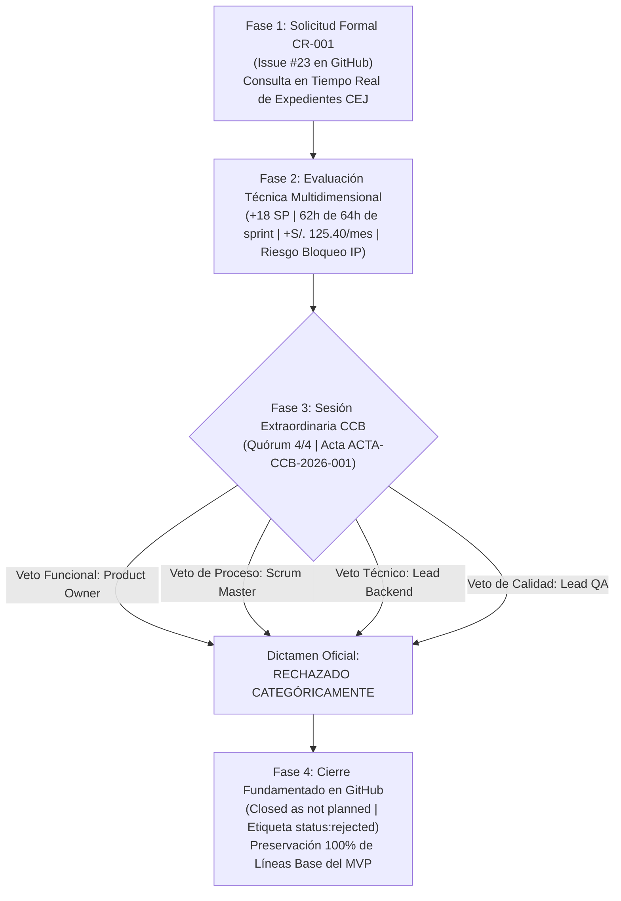

# 03-00 Índice y Resumen Ejecutivo de la Simulación de Caso de Cambio (CR-001)

> **Proyecto:** Inti - Asistente Jurídico Inteligente  
> **Área:** Control Integrado de Cambios (PMBOK 7ma Edición & IEEE Std 828-2012)  
> **Documento Wiki:** `03-00-indice-simulacion`  
> **Caso Práctico:** Solicitud de Cambio `CR-001` — Consulta en Tiempo Real de Expedientes del Poder Judicial (CEJ)  
> **Resolución Oficial:** **RECHAZADO CATEGÓRICAMENTE** por el Comité de Control de Cambios (CCB)

---

## 1. Resumen Ejecutivo del Caso Práctico

En cumplimiento de los requerimientos de la **Actividad 3 del Laboratorio 05**, se ejecutó de principio a fin un caso práctico real de solicitud de cambio mayor (Nivel 3) para la plataforma **Inti**. 

La propuesta consistió en incorporar un módulo de consulta en tiempo real de expedientes judiciales en trámite en la Corte Superior de Justicia de Arequipa a través del portal de la **Consulta de Expedientes Judiciales (CEJ)** del Poder Judicial, promovida por docentes de Práctica Forense y estudiantes practicantes del Consultorio Jurídico de la UNSA.

A través de la aplicación rigurosa de las cinco fases del protocolo de control de cambios documentado en [`02-03-flujo-control-cambios`](02-03-flujo-control-cambios.md), el equipo de ingeniería evaluó analítica y cuantitativamente las implicaciones del cambio sobre las cinco líneas base del proyecto (alcance, cronograma, costos, recursos y calidad/riesgos). El análisis demostró que el requerimiento presentaba una **inviabilidad técnica, financiera, temporal y de cumplimiento legal insalvable**, motivando la deliberación formal del Comité de Control de Cambios (CCB), el ejercicio unánime de las potestades de veto técnico y funcional, y la emisión del dictamen oficial de **RECHAZO**.

---

## 2. Mapa Documental del Módulo de Simulación

El caso de estudio se encuentra desarrollado en detalle en los siguientes tres documentos técnicos complementarios, alojados en la Wiki del repositorio:

| Documento en Wiki | Título Técnico | Contenido Fundamental y Evidencias |
| :--- | :--- | :--- |
| [`03-01-solicitud-cambio-cr001`](03-01-solicitud-cambio-cr001.md) | Ficha de Solicitud de Cambio CR-001 | Registro formal del requerimiento, dolor de usuario, alcance técnico propuesto, justificación de negocio y captura de pantalla del registro inicial del Issue #23. |
| [`03-02-evaluacion-impacto-cr001`](03-02-evaluacion-impacto-cr001.md) | Evaluación Multidimensional de Impacto | Análisis cuantitativo de trade-offs en las cinco líneas base (alcance, cronograma/CPM, costos/presupuesto, carga laboral y riesgos), matriz comparativa y captura del informe técnico publicado en GitHub. |
| [`03-03-acta-resolucion-ccb`](03-03-acta-resolucion-ccb.md) | Acta de Resolución y Cierre del CCB | Acta formal `ACTA-CCB-2026-001`, registro nominal de votación (0 a favor, 4 en contra), cuádruple veto activo, fundamentación técnico-jurídica, captura del cierre del issue y acciones derivadas. |

---

## 3. Trazabilidad Digital y Evidencias en GitHub

El caso completo está respaldado por evidencia digital auditable en el repositorio oficial:
- **Issue Oficial en GitHub:** [`[CR-001] Integración de Consulta en Tiempo Real de Expedientes del Poder Judicial (CEJ) #23`](https://github.com/jorghee/inti-rag/issues/23)
- **Informe Técnico de Impacto:** [Comentario oficial #6296934968 en Issue #23](https://github.com/jorghee/inti-rag/issues/23#issuecomment-6296934968)
- **Acta de Resolución y Cierre:** [Comentario oficial #6296947784 en Issue #23](https://github.com/jorghee/inti-rag/issues/23#issuecomment-6296947784)
- **Estado Final:** `Closed as not planned` con etiquetas `type: change-request`, `change:major` y `status:rejected`.
