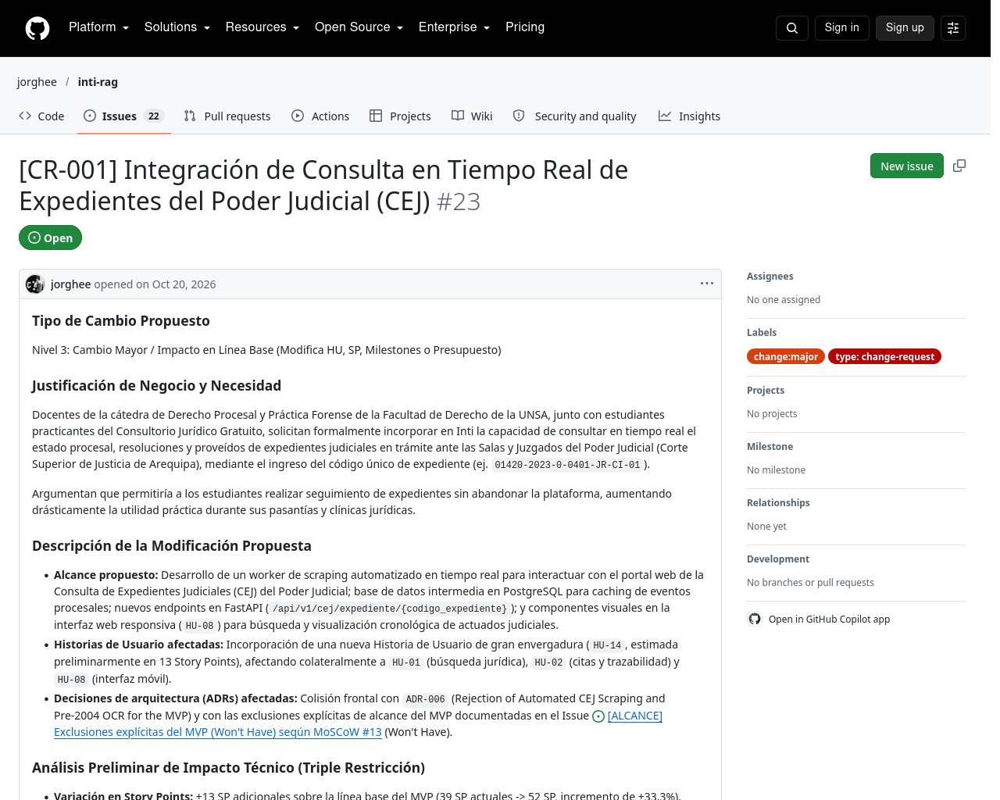

# 03-01 Ficha de Solicitud de Cambio CR-001

> **Proyecto:** Inti - Asistente Jurídico Inteligente  
> **Área:** Control Integrado de Cambios (PMBOK 7ma Edición & IEEE Std 828-2012)  
> **Documento Wiki:** `03-01-solicitud-cambio-cr001`  
> **Registro Oficial en GitHub:** [Issue #23](https://github.com/jorghee/inti-rag/issues/23)  
> **Fase del Flujo:** Fase 1 — Solicitud Formal (DoRC Superada)

---

## 1. Datos Generales de la Solicitud

| Parámetro | Detalle Registrado |
| :--- | :--- |
| **Identificador del Cambio** | `CR-001` |
| **Título del Requerimiento** | Integración de Consulta en Tiempo Real de Expedientes del Poder Judicial (CEJ) |
| **Número de Issue en GitHub** | [#23](https://github.com/jorghee/inti-rag/issues/23) |
| **Fecha de Registro Inicial** | 2026-10-20 |
| **Solicitante Formal** | Dr. Juan Carlos Ramos (Docente de Práctica Forense y Derecho Procesal Civil, Facultad de Derecho UNSA) en representación de los estudiantes practicantes del Consultorio Jurídico Gratuito |
| **Clasificación Estimada** | **Nivel 3: Cambio Mayor / Impacto en Línea Base** |
| **Etiquetas en GitHub** | `type: change-request`, `change:major` |
| **Milestone Propuesto** | M3: Core RAG Engine & Responsive UI (Semanas 5-6) |

---

## 2. Justificación de Negocio y Necesidad Detectada

Durante los talleres de retroalimentación con docentes de la cátedra de Derecho Procesal y litigantes del Consultorio Jurídico Gratuito de la UNSA, se manifestó una necesidad recurrente: los estudiantes de 4to y 5to año que realizan prácticas preprofesionales en los juzgados civiles y laborales de Arequipa dedican entre **20 y 45 minutos diarios** a ingresar manualmente al portal web de la Consulta de Expedientes Judiciales (CEJ) del Poder Judicial para verificar si sus expedientes han emitido nuevos autos, decretos o sentencias.

El solicitante propuso que **Inti** integre una funcionalidad que permita ingresar directamente el Código Único de Expediente judicial (por ejemplo, `01420-2023-0-0401-JR-CI-01`) y obtenga de forma automatizada e instantánea el estado procesal, las notificaciones y los actuados en texto legible, correlacionándolos con la normativa aplicable del Código Civil.

---

## 3. Descripción Técnica de la Modificación Propuesta

Para materializar el requerimiento, la solicitud técnica especifica la implementación de cuatro componentes de software:

1. **Worker de Extracción Dinámica (Web Scraper):** Desarrollo de un servicio en segundo plano basado en Python y navegadores automatizados headless (Playwright / Selenium) diseñado para emular la interacción de un usuario humano, sortear el mecanismo de validación de Google reCAPTCHA v2 / Cloudflare Turnstile del Poder Judicial y suministrar el DNI requerido.
2. **Capa de Persistencia Relacional:** Nuevas tablas en PostgreSQL (`judicial_cases` y `procedural_events`) para almacenar el historial de actuaciones judiciales y evitar consultas redundantes a la web judicial.
3. **Endpoints de API REST en FastAPI:** Creación de rutas de consulta `/api/v1/cej/expediente/{codigo_expediente}` con validadores de formato de código único mediante Pydantic.
4. **Componentes Visuales en el Frontend Web:** Nueva vista especializada en la interfaz web responsiva (`HU-08`), con buscador de expedientes y visualizador cronológico tipo *timeline* de las actuaciones procesales.

### Afectación a Historias de Usuario y Decisiones de Arquitectura
- **Historias Afectadas:** Incorporación de una nueva Historia de Usuario nuclear de gran escala (`HU-14`, estimada preliminarmente en 13 Story Points), con impacto colateral sobre `HU-01` (Búsqueda semántica), `HU-02` (Trazabilidad) y `HU-08` (Interfaz web).
- **Decisiones Arquitectónicas Afectadas:** Colisión frontal con **`ADR-006`** (*Rejection of Automated CEJ Scraping and Pre-2004 OCR for the MVP*), la cual excluyó expresamente esta funcionalidad del alcance inicial por inviabilidad legal y técnica.

---

## 4. Control de Entrada: Verificación de la Definition of Ready for Change (DoRC)

Previo al traslado de la solicitud a la fase de análisis de impacto de ingeniería, el Scrum Master (Jorge Luis Mamani Huarsaya) ejecutó la auditoría de calidad de entrada (DoRC), verificando los siguientes criterios:

- [x] Título unívoco bajo la convención estandarizada: `[CR-001] Integración de Consulta en Tiempo Real...`.
- [x] Clasificación tipológica justificada por el solicitante como Nivel 3.
- [x] Dolor de usuario y necesidad de la comunidad de Derecho claramente descrita.
- [x] Detalle técnico de los componentes de arquitectura que se verían modificados.
- [x] Identificación de colisiones preliminares con ADRs preexistentes.

Al satisfacer el 100% de los requisitos formales de entrada, la solicitud fue declarada admisible para su tramitación formal, procediéndose al inicio de la **Fase 2: Evaluación Técnica Multidimensional de Impacto**.

---

## 5. Evidencia Digital del Registro Inicial en GitHub

Inmediatamente después de su registro formal mediante el formulario declarativo de GitHub Issues, se capturó la evidencia digital del estado inicial de la solicitud:

> **Descripción de la Evidencia 1:** Captura de pantalla real de la apertura formal del [Issue #23](https://github.com/jorghee/inti-rag/issues/23) en el repositorio institucional `jorghee/inti-rag`. La evidencia demuestra la adhesión estricta a la plantilla tipada `.github/ISSUE_TEMPLATE/change_request.yml`, la asignación de las etiquetas tipológicas oficiales `type: change-request` y `change:major`, y el desglose estructurado de la necesidad, los componentes afectados y los supuestos preliminares de triple restricción antes de la intervención de los evaluadores técnicos.
