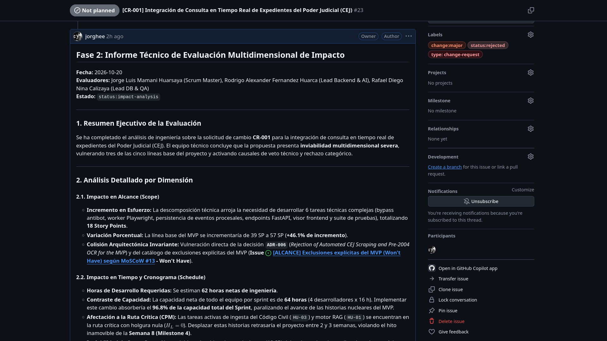

# 03-02 Evaluación Multidimensional de Impacto de Ingeniería (CR-001)

> **Proyecto:** Inti - Asistente Jurídico Inteligente  
> **Área:** Control Integrado de Cambios (PMBOK 7ma Edición & IEEE Std 828-2012)  
> **Documento Wiki:** `03-02-evaluacion-impacto-cr001`  
> **Registro Oficial en GitHub:** [Comentario #6296934968 en Issue #23](https://github.com/jorghee/inti-rag/issues/23#issuecomment-6296934968)  
> **Fase del Flujo:** Fase 2 — Evaluación Técnica de Impacto  
> **Equipo Evaluador:** Jorge Luis Mamani Huarsaya (SM), Rodrigo Alexander Fernandez Huarca (Lead Backend), Rafael Diego Nina Calizaya (Lead QA)

---

## 1. Alcance del Análisis Técnico

Conforme a las directivas establecidas en [`02-03-flujo-control-cambios`](02-03-flujo-control-cambios.md), el equipo de ingeniería procedió a contrastar cuantitativamente la solicitud **CR-001** frente a las cinco líneas base formuladas en el Plan de Gestión del Proyecto (PMP).

A continuación se expone la memoria analítica y los supuestos de cálculo aplicados.

---

## 2. Análisis Cuantitativo por Dimensión de Impacto

### 2.1. Dimensión de Alcance y Complejidad Técnica (Scope)
Para materializar la interacción no supervisada con el portal del CEJ del Poder Judicial, el requerimiento se descompuso en seis paquetes de trabajo técnicos:

| Código | Tarea Técnica Requerida | Perfil Principal | Story Points |
| :--- | :--- | :--- | :---: |
| **T-CEJ.1** | Arquitectura de emulación de navegador y bypass de antibot con Playwright | Lead Backend & AI | 5 SP |
| **T-CEJ.2** | Motor de navegación automatizada y extracción de resoluciones del CEJ | Lead Backend & AI | 3 SP |
| **T-CEJ.3** | Modelado de esquema relacional para expedientes y actuaciones en PostgreSQL | Lead DB & QA | 2 SP |
| **T-CEJ.4** | Endpoints REST en FastAPI con validadores Pydantic de formato judicial | Lead Backend & AI | 2 SP |
| **T-CEJ.5** | Componentes de interfaz web responsiva (timeline y visor de actuados) | Product Owner / Frontend | 3 SP |
| **T-CEJ.6** | Suite automatizada de pruebas unitarias y mocks de respuestas de red | Lead DB & QA | 3 SP |
| **TOTAL** | **Incremento Neto en Esfuerzo de Alcance** | **Equipo Pleno** | **18 SP** |

- **Variación Porcentual:** La línea base comprometida del MVP (39 Story Points) se incrementaría a **57 Story Points**, lo que representa una **expansión no planificada del +46.1% en alcance**.
- **Colisión con Decisiones Arquitectónicas:** El requerimiento viola de forma flagrante la decisión **`ADR-006`** (*Rejection of Automated CEJ Scraping and Pre-2004 OCR for the MVP*), la cual tipificó el raspado del CEJ como una exclusión inmutable (*Won't Have*, Issue #13) debido a las barreras dinámicas de Captcha y validación obligatoria de DNI.

---

### 2.2. Dimensión de Tiempo, Esfuerzo y Cronograma (Schedule)
El dimensionamiento horario para la ejecución de las seis tareas técnicas arroja el siguiente consumo de tiempo de ingeniería:

$$\text{Horas Netas Estimadas} = 14\text{ h (T-CEJ.1)} + 12\text{ h (T-CEJ.2)} + 8\text{ h (T-CEJ.3)} + 8\text{ h (T-CEJ.4)} + 10\text{ h (T-CEJ.5)} + 10\text{ h (T-CEJ.6)} = \mathbf{62\text{ horas netas}}$$

- **Contraste frente a la Capacidad del Sprint:**  
  La capacidad máxima neta del equipo de cuatro ingenieros es de **64 horas por sprint** (4 desarrolladores $\times$ 16 horas netas). Incorporar este cambio demandaría **62 de las 64 horas disponibles**, consumiendo el **96.8% de la capacidad de toda la iteración**.
- **Afectación de la Ruta Crítica (CPM):**  
  Las tareas nucleares del Sprint 3 (ingesta del Código Civil `HU-03` y motor RAG `HU-01`) forman parte de la ruta crítica estricta con **holgura nula ($H_L = 0$)**. Dedicar el 96.8% del esfuerzo del sprint a la integración del CEJ paralizaría el desarrollo del motor semántico, provocando un retraso en cascada de **2 a 3 semanas** sobre los Milestones 3 y 4.
- **Inviabilidad de Permuta de Alcance (*Scope Swap*):**  
  Para neutralizar el sobreesfuerzo de 18 SP, el equipo se vería obligado a retirar del Sprint Backlog historias como la autenticación institucional (`HU-05`, 8 SP) y la ingesta normativa (`HU-03`, 8 SP), desvirtuando por completo la funcionalidad nuclear del producto mínimo viable.

---

### 2.3. Dimensión de Costos y Presupuesto Operativo (Cost)
El portal oficial de la Consulta de Expedientes Judiciales implementa mecanismos de defensa activa contra bots (Google reCAPTCHA v2 / Cloudflare Turnstile) y exige ingresar un número de DNI válido. Para mantener un scraper automatizado en producción, se requerirían partidas de gasto recurrente no previstas en la línea base:

| Concepto de Costo Recurrente | Proveedor / Servicio Técnico | Costo Mensual en USD | Costo Mensual en Soles (TC 3.80) |
| :--- | :--- | :---: | :---: |
| **API de Resolución de Captchas** | 2Captcha / Anti-Captcha (~3,000 resoluciones/mes a $2.00 / 1k) | $6.00 USD | S/. 22.80 |
| **Pool de Proxies Residenciales Rotativos** | BrightData / Webshare (evita listas negras por tasa de consulta) | $17.00 USD | S/. 64.60 |
| **Cómputo Dedicado con RAM para Headless** | Render Web Service Standard (Playwright headless requiere > 1.5 GB RAM) | $10.00 USD | S/. 38.00 |
| **TOTAL SOBRECOSTO MENSUAL** | **Infraestructura no planificada de scraping CEJ** | **$33.00 USD** | **S/. 125.40 / mes** |

- **Quiebre Presupuestario:**  
  El proyecto dispone de un **presupuesto total de bolsillo de S/. 88.18**, del cual solo **S/. 30.00 corresponden a la reserva financiera de contingencia**. El sobrecosto operativo mensual de S/. 125.40 supera en un **142.2% el presupuesto total de todo el proyecto** y consumiría la totalidad de la reserva de contingencia en menos de ocho días de operación.

---

### 2.4. Dimensión de Recursos y Especialidades (Resources)
La distribución de la carga de trabajo requerida generaría un desbalance severo:
- El **Lead Backend & AI (Rodrigo Fernandez)** tendría que asumir directamente las tareas T-CEJ.1, T-CEJ.2 y T-CEJ.4, que demandan **34 horas netas de trabajo**.
- Dado que su asignación contractual es de 16 horas por sprint, sufriría una **sobrecarga individual del +112.5%**, vulnerando las políticas de asignación simétrica del marco Scrumban.

---

### 2.5. Dimensión de Calidad y Nuevos Riesgos Introducidos (Quality & Risks)
La integración forzada del CEJ introduciría riesgos inaceptables para la continuidad del proyecto y la reputación institucional:

1. **Riesgo R-06 (Nuevo - Crítico): Bloqueo de Infraestructura Institucional UNSA.**  
   *Evaluación:* Probabilidad = 5, Impacto = 5 $\rightarrow$ **Severidad = 25 (Zona Roja - Catastrófico)**.  
   *Consecuencia:* La detección de tráfico masivo automatizado hacia el CEJ desde los servidores universitarios activaría las defensas perimetrales de la Gerencia de Informática del Poder Judicial, resultando en el bloqueo de la subred institucional de la UNSA y posibles sanciones administrativas.
2. **Riesgo R-07 (Nuevo - Alto): Fragilidad Operativa y Degradación de Calidad.**  
   *Evaluación:* Probabilidad = 4, Impacto = 4 $\rightarrow$ **Severidad = 16 (Zona Roja - Crítico)**.  
   *Consecuencia:* El portal CEJ no ofrece una API pública estable y sufre caídas de servicio habituales. Cualquier variación no anunciada en los identificadores DOM o en los desafíos de captcha rompería el flujo de scraping, arrojando una **tasa estimada de fallo superior al 40%** y frustrando a los usuarios de Derecho.
3. **Implicancias Ético-Legales:**  
   Vulneración deliberada de los Términos de Uso de los portales informáticos del Estado peruano mediante ingeniería inversa de mecanismos de protección digital.

---

## 3. Matriz Comparativa: Escenario Actual vs. Escenario con Cambio CR-001

A continuación se comparan cuantitativamente los dos escenarios de gestión:

| Parámetro de Gestión | Escenario Actual (Línea Base MVP) | Escenario Proyectado con Cambio CR-001 | Variación Cuantitativa Neta | Evaluación de Viabilidad |
| :--- | :---: | :---: | :---: | :---: |
| **Story Points Totales** | 39 SP | 57 SP | +18 SP (+46.1%) | **Inviable** (Sobrecarga de alcance) |
| **Horas Netas del Sprint** | 64 h (distribuidas) | 126 h requeridas | +62 h (+96.8% de capacidad) | **Inviable** (Parálisis del sprint) |
| **Holgura en Ruta Crítica (CPM)** | 0 días (en cronograma) | -14 a -21 días | Retraso de 2 a 3 semanas | **Inviable** (Incumplimiento de hito M4) |
| **Presupuesto Out-of-Pocket** | S/. 88.18 (Reserva: S/. 30.00) | S/. 213.58 acumulado | +S/. 125.40 (+142.2%) | **Inviable** (Bancarrota presupuestaria) |
| **Carga Lead Developer** | 16 h / sprint | 34 h / sprint | +18 h (+112.5%) | **Inviable** (Sobrecarga individual) |
| **Alineación con ADR-006** | 100% de cumplimiento | Violación de decisión arquitectónica | Colisión directa de diseño | **Causal de Rechazo Categórico** |
| **Exclusiones Won't Have** | Respetadas (Issue #13) | Incorporación de exclusión explícita | Ruptura de frontera de proyecto | **Causal de Rechazo Categórico** |

---

## 4. Evidencia Digital del Informe Técnico en GitHub

El informe técnico de evaluación multidimensional fue formalizado y publicado por el equipo de ingeniería como comentario estructurado en el issue correspondiente:

> **Descripción de la Evidencia 2:** Captura de pantalla del primer comentario en el [Issue #23 (Fase 2)](https://github.com/jorghee/inti-rag/issues/23#issuecomment-6296934968). Muestra la formalización del *Informe Técnico de Evaluación Multidimensional de Impacto*, el desglose analítico en alcance (18 SP), cronograma (62 horas de desarrollo sobre la capacidad de 64h), costos de scraping, recursos y riesgos, y la recomendación fundamentada de emitir un dictamen de rechazo categórico.
