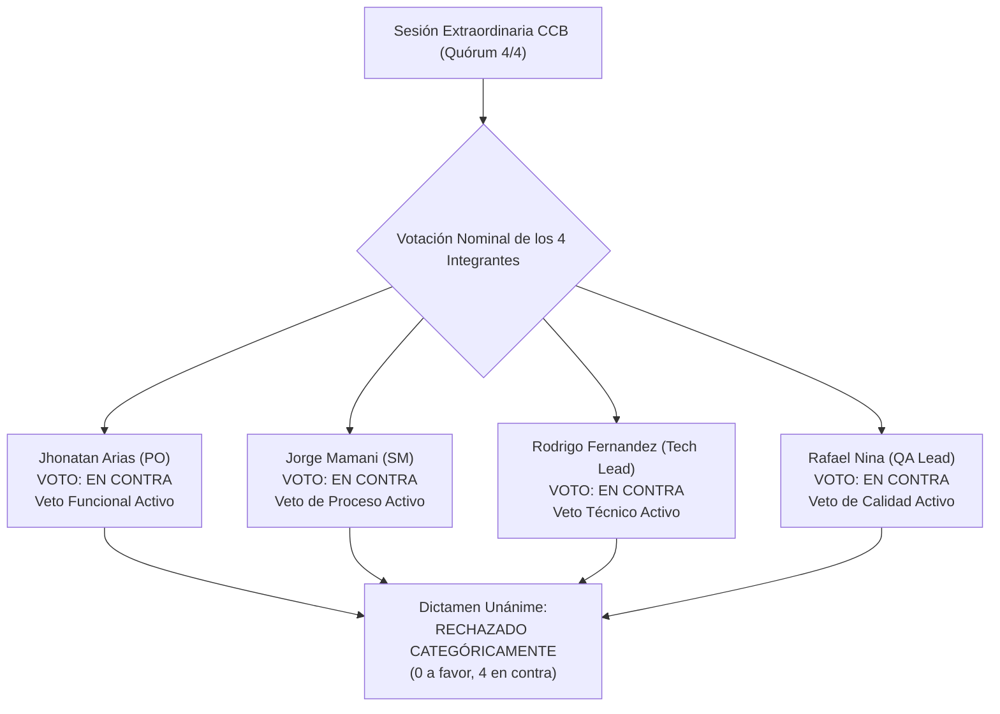
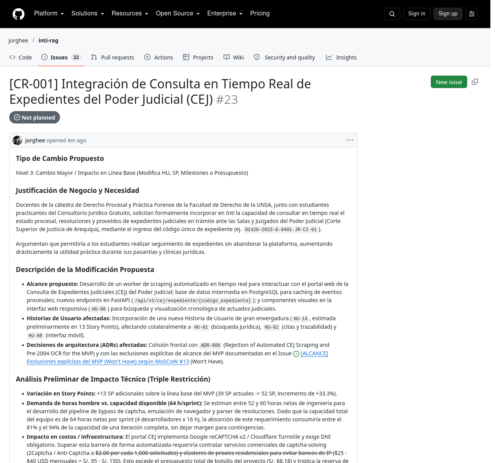

# 03-03 Acta de Resolución del CCB y Cierre de la Solicitud (CR-001)

> **Proyecto:** Inti - Asistente Jurídico Inteligente  
> **Área:** Control Integrado de Cambios (PMBOK 7ma Edición & IEEE Std 828-2012)  
> **Documento Wiki:** `03-03-acta-resolucion-ccb`  
> **Registro Oficial en GitHub:** [Comentario #6296947784 en Issue #23](https://github.com/jorghee/inti-rag/issues/23#issuecomment-6296947784)  
> **Fase del Flujo:** Fases 3 y 4 — Deliberación del CCB, Dictamen Oficial y Cierre en GitHub  
> **Estado Final:** `Closed as not planned` | Etiqueta `status:rejected`

---

## 1. Datos Formales de la Sesión del Comité

| Parámetro | Registro Institucional |
| :--- | :--- |
| **Código de Acta Oficial** | `ACTA-CCB-2026-001` |
| **Fecha y Hora de Instalación** | 2026-10-20 — 12:20 UTC-5 |
| **Modalidad de Sesión** | Sesión Extraordinaria (Convocada en menos de 24 horas por el Scrum Master) |
| **Solicitud de Cambio Sometida** | **`CR-001`** — Integración de Consulta en Tiempo Real de Expedientes del Poder Judicial (CEJ) ([Issue #23](https://github.com/jorghee/inti-rag/issues/23)) |
| **Quórum Reglamentario Verificado** | **4 / 4 integrantes presentes (100% de asistencia)** |
| **Presidente de Sesión** | Jhonatan David Arias Quispe (Product Owner) |
| **Coordinador y Redactor del Acta** | Jorge Luis Mamani Huarsaya (Scrum Master) |

---

## 2. Deliberación Colegiada y Análisis de Alternativas

Instalada formalmente la sesión con quórum pleno, el Comité de Control de Cambios analizó las conclusiones del *Informe Técnico de Evaluación Multidimensional de Impacto* elaborado en la Fase 2:

1. **Evaluación de Alternativa A (Aprobación Incondicional):**  
   Descartada unánimemente. El cambio requiere 62 horas netas de trabajo, consumiendo el 96.8% de la capacidad del sprint (64h), lo que desestabilizaría de forma inmediata la ruta crítica y causaría un retraso de 2 a 3 semanas sobre el Milestone 4.
2. **Evaluación de Alternativa B (Aprobación con Permuta de Alcance - Scope Swap):**  
   Descartada unánimemente. Para absorber 18 Story Points de nuevo alcance, se requeriría retirar historias nucleares como la autenticación institucional (`HU-05`) y la ingesta del Código Civil (`HU-03`), mutilando la viabilidad del MVP.
3. **Evaluación de Alternativa C (Posposición a Fase 2 Post-MVP):**  
   Descartada. La propuesta presenta riesgos legales insubsanables (violación de términos de uso del Poder Judicial) y requiere sobrecostos recurrentes en proxies y captchas (S/. 125.40/mes) que no cuentan con financiamiento institucional sustentable.
4. **Evaluación de Alternativa D (Rechazo Categórico e Irrevocable):**  
   Identificada como la única alternativa profesionalmente viable y legalmente ética para salvaguardar la entrega del proyecto y la infraestructura de la universidad.

---

## 3. Registro Nominal de Votación y Ejercicio de Vetos

Conforme a las reglas de votación cualificada y derecho de veto instituidas en [`02-02-estatuto-ccb`](02-02-estatuto-ccb.md), los integrantes emitieron su voto nominal:

| Integrante del CCB | Rol de Gobernanza | Sentido del Voto | Fundamento del Voto y Potestad Ejercida |
| :--- | :--- | :---: | :--- |
| **Jhonatan David Arias Quispe** | Presidente del CCB (Product Owner) | **EN CONTRA** | **VETO FUNCIONAL:** La propuesta colisiona frontalmente con el cono de valor del asistente RAG y con las exclusiones formales del alcance del MVP documentadas en el Issue #13 (*Won't Have*). |
| **Jorge Luis Mamani Huarsaya** | Coordinador (Scrum Master) | **EN CONTRA** | **VETO DE PROCESO:** Demanda 62 de las 64 horas netas del sprint, hace inviable la aplicación de *Scope Swap* y desplaza la entrega final más allá de la Semana 8. |
| **Rodrigo Alexander Fernandez Huarca** | Vocal Técnico (Lead Backend & AI) | **EN CONTRA** | **VETO TÉCNICO:** Inviabilidad financiera absoluta (sobrecosto mensual de S/. 125.40 frente a un presupuesto total de S/. 88.18) y riesgo crítico de baneo de IPs universitarias por scraping antibot. |
| **Rafael Diego Nina Calizaya** | Vocal de Calidad (Lead DB & QA) | **EN CONTRA** | **VETO DE CALIDAD:** Fragilidad estructural ante cambios en el DOM judicial, baja confiabilidad estimada ($> 40\%$ de fallos) y vulneración del estándar de pruebas unitarias. |

- **Cómputo Oficial de Votos:** **0 votos a favor, 4 votos en contra.**  
- **Vetos Registrados:** **Cuádruple veto simultáneo activo** (Técnico, Funcional, de Proceso y de Calidad).

---

## 4. Dictamen Oficial y Fundamentación de la Decisión

Por unanimidad rigurosa y en ejercicio de las facultades conferidas por el Estatuto del Comité, el CCB resuelve:

> ### Dictamen Oficial: RECHAZADO CATEGÓRICAMENTE
> Declarar **RECHAZADA DE MANERA DEFINITIVA E IRREVOCABLE** la solicitud de cambio **`CR-001`** durante todo el ciclo de vida del MVP del proyecto Inti.

### Fundamentos Técnicos, Financieros y Jurídicos del Dictamen:
1. **Causal Invariante N.° 1 (Exclusión Explícita del MVP):**  
   La solicitud vulnera la decisión arquitectónica [`ADR-006`](https://github.com/jorghee/inti-rag/blob/main/docs/architecture/decisions.md#adr-006-rejection-of-automated-cej-scraping-and-pre-2004-ocr-for-the-mvp) y el alcance formalmente excluido (*Won't Have*, Issue #13). Las reglas de gobernanza prohíben reintroducir requerimientos excluidos sin ampliación presupuestaria y contractual formal.
2. **Causal Invariante N.° 2 (Sobrecarga de Capacidad sin Compensación):**  
   El cambio demanda 62 horas netas frente a la capacidad de 64 horas del sprint. Al no ser posible compensar dicho esfuerzo mediante *Scope Swap*, su aprobación provocaría la desestabilización de la ruta crítica y un retraso de 2 a 3 semanas.
3. **Causal Invariante N.° 3 (Quiebre del Presupuesto Operativo):**  
   El mantenimiento de proxies rotativos y resolución comercial de captchas demanda S/. 125.40 mensuales, lo que excede en un 142.2% el presupuesto total de bolsillo (S/. 88.18) y pulveriza la reserva financiera de contingencia (S/. 30.00).
4. **Causal Invariante N.° 4 (Seguridad de la Información y Cumplimiento Legal):**  
   Burlar deliberadamente las barreras antibot del Poder Judicial peruano mediante software de ingeniería inversa expone los servidores y subredes institucionales de la Universidad Nacional de San Agustín a bloqueos perimetrales y eventuales contingencias administrativas y legales.

---

## 5. Acciones Derivadas y Cierre de la Solicitud en GitHub

Para cerrar el ciclo de vida del cambio y preservar la integridad de la gestión del proyecto, se ejecutaron las siguientes acciones inmediatas en el repositorio:

- **Actualización de Etiquetas:** Se retiró la etiqueta transitoria `status:impact-analysis` y se asignó la etiqueta definitiva `status:rejected`.
- **Cierre del Issue:** El [Issue #23](https://github.com/jorghee/inti-rag/issues/23) fue cerrado formalmente con el estado **`Closed as not planned`**.
- **Preservación Inmutable de Líneas Base:** 0 horas añadidas al cronograma, 0 Story Points adicionados al backlog, reserva de contingencia (S/. 30.00) preservada intacta y Milestones 1 al 4 ratificados sin variación.
- **Notificación y Comunicación Institucional:** Se remitió una respuesta formal al solicitante, fundamentando que la consulta de expedientes judiciales en trámite solo podrá evaluarse cuando el Poder Judicial peruano habilite un convenio institucional formal de interoperabilidad vía API REST autorizada.

---

## 6. Evidencia Digital del Cierre y la Resolución en GitHub

La resolución oficial del CCB y el cierre formal del issue quedaron registrados en el repositorio:

> **Descripción de la Evidencia 3:** Captura de pantalla real del [comentario #6296947784 y cierre del Issue #23](https://github.com/jorghee/inti-rag/issues/23#issuecomment-6296947784). Demuestra la formalización del acta numerada `ACTA-CCB-2026-001`, el registro del cuádruple veto, el dictamen de rechazo categórico con su fundamentación detallada, la asignación de la etiqueta `status:rejected` y el cierre definitivo del requerimiento bajo la causal *Closed as not planned*.
