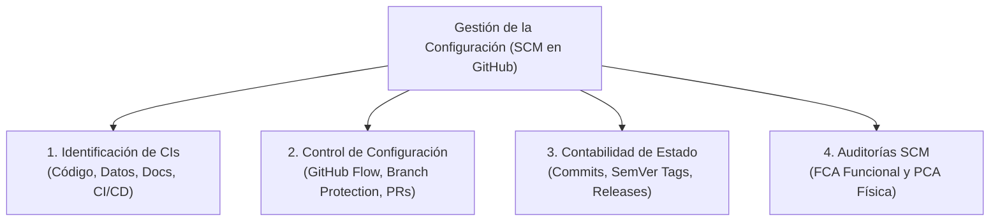

# 04-00 Índice y Plan de Gestión de la Configuración del Software (SCM)

> **Proyecto:** Inti - Asistente Jurídico Inteligente  
> **Área:** Gestión de la Configuración del Software (IEEE Std 828-2012 & ISO/IEC/IEEE 12207)  
> **Documento Wiki:** `04-00-indice-configuracion-scm`  
> **Herramienta Central:** Git & GitHub (`jorghee/inti-rag`)

---

## 1. Propósito y Alcance del Plan SCM

El **Plan de Gestión de la Configuración del Software** (*Software Configuration Management* - SCM) establece los mecanismos formales para identificar, controlar, registrar y auditar la evolución de todos los artefactos de trabajo (código, documentos, esquemas y configuraciones) del proyecto **Inti**. Su objetivo primordial es garantizar la integridad técnica, consistencia operativa y reproducibilidad matemática del sistema a lo largo de su ciclo de vida.

Para el proyecto Inti, la plataforma central seleccionada es **GitHub**, aprovechando de forma unificada su ecosistema de control de versiones distribuido (Git), automatización de integración continua (GitHub Actions), seguimiento de requerimientos (GitHub Issues y Projects) y publicación documental (GitHub Wiki).

---

## 2. Mapa Documental del Módulo SCM

El plan se detalla en tres documentos técnicos disponibles en la Wiki del repositorio:

| Documento en Wiki | Título Técnico | Propósito y Contenido Fundamental |
| :--- | :--- | :--- |
| [`04-01-catalogo-elementos-config`](04-01-catalogo-elementos-config.md) | Catálogo de Elementos de Configuración (CIs) | Identificación y clasificación de artefactos controlados: código fuente, esquemas de BD, documentación PMP/ADR y pipelines. |
| [`04-02-estrategia-versionado-ramas`](04-02-estrategia-versionado-ramas.md) | Estrategia de Versionado y Políticas de Ramas | SemVer 2.0.0, GitHub Flow adaptado, reglas de protección de la rama `main` y compuertas de integración continua (CI). |
| [`04-03-auditoria-trazabilidad`](04-03-auditoria-trazabilidad.md) | Auditoría y Trazabilidad de la Configuración | Contabilidad del estado (CSA), trazabilidad bidireccional mediante `Closes #ID` y auditorías física (PCA) y funcional (FCA). |
