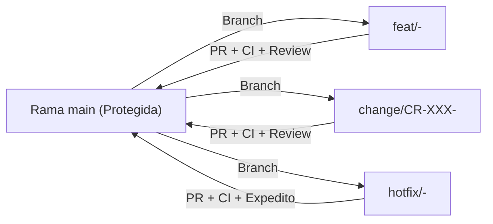

# 04-02 Estrategia de Versionado y Políticas de Ramas en Git

> **Proyecto:** Inti - Asistente Jurídico Inteligente  
> **Área:** Gestión de la Configuración del Software (IEEE Std 828-2012)  
> **Documento Wiki:** `04-02-estrategia-versionado-ramas`  
> **Mecanismo:** GitHub Flow & Semantic Versioning (SemVer 2.0.0)

---

## 1. Estrategia de Versionado Semántico (SemVer 2.0.0)

El proyecto adopta la convención formal **SemVer 2.0.0** (`MAJOR.MINOR.PATCH`) para identificar las versiones oficiales del software y la documentación:

- **MAJOR (v1.0.0):** Versión del Producto Mínimo Viable (MVP) completamente funcional, entregada al finalizar la Semana 8.
- **MINOR (v0.X.0):** Incrementos funcionales entregados al término de cada Milestone o Sprint quincenal:
  - `v0.1.0`: Milestone 1 — Ingestión del Código Civil y Autenticación `@unsa.edu.pe` (Semana 2).
  - `v0.2.0`: Milestone 2 — Almacenamiento vectorial en `pgvector` e historial de sesiones (Semana 4).
  - `v0.3.0`: Milestone 3 — Motor RAG con Groq API e interfaz web responsiva (Semana 6).
  - `v0.4.0`: Milestone 4 — Citas hipervinculadas verificables a SPIJ y MVP final (Semana 8).
- **PATCH (v0.X.Y):** Correcciones urgentes de seguridad o parches menores (*Hotfixes*).
- **Etiquetado en Git:** Toda versión se fija mediante etiquetas anotadas de Git firmadas criptográficamente (`git tag -a v0.1.0 -m "Release Milestone 1"`).

---

## 2. Políticas de Ramas en Git (GitHub Flow Disciplinado)

El flujo de trabajo se fundamenta en un modelo de ramas efímeras de ciclo de vida corto originadas desde la rama principal:

### Tipología de Ramas Efímeras:
- **`main`:** Rama principal inmutable que contiene el código validado para pruebas y producción. Protegida contra escrituras directas.
- **`feat/<issue-id>-<descripcion>`:** Ramas de trabajo para el desarrollo de historias de usuario planificadas.
- **`fix/<issue-id>-<descripcion>`:** Ramas para corrección de defectos o refactorizaciones técnicas de Nivel 2.
- **`change/CR-XXX-<descripcion>`:** Ramas exclusivas para implementar Solicitudes de Cambio de Nivel 3 aprobadas formalmente por el CCB.
- **`hotfix/<issue-id>-<descripcion>`:** Ramas de emergencia de Nivel 1 para contener incidentes críticos en producción.

---

## 3. Reglas de Protección de Ramas (*Branch Protection Rules*)

Para salvaguardar la integridad de la rama `main`, se configuran las siguientes políticas de seguridad en GitHub:

1. **Prohibición de Push Directo:** Ningún desarrollador ni administrador puede enviar commits directamente a `main` (`git push origin main` bloqueado por defecto).
2. **Revisión por Pares Obligatoria (*Peer Review*):** Todo cambio debe ingresar mediante Pull Request y contar con al menos una aprobación formal de un revisor técnico calificado.
3. **Cheques de Estado Automatizados (*Status Checks*):** GitHub Actions debe ejecutar y certificar en verde:
   - Cobertura de pruebas unitarias: `pytest --cov >= 80%`.
   - Linters y formateo de código: `ruff check` con cero advertencias.
   - Verificación de tipos estáticos: `mypy backend/`.
4. **Historial Lineal Limpio:** Toda fusión se ejecuta mediante **Squash and Merge**, consolidando los commits de la rama en un único commit atómico trazable.
